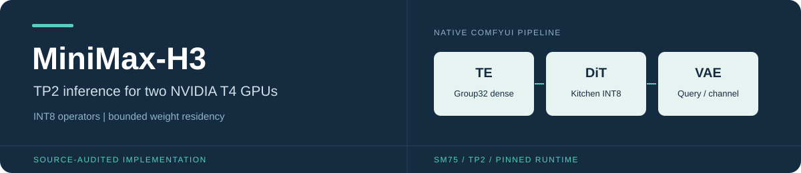

<p align="center">
  
</p>

<p align="center">
  <a href="docs/guides/MiniMax_H3_TP2_Optimization_Technical_Guide.pdf"><b>Technical guide (PDF)</b></a> &nbsp; / &nbsp;
  <a href="docs/README.md">Documentation</a> &nbsp; / &nbsp;
  <a href="docs/guides/H3_LEGACY_RUNTIME.md">Setup</a> &nbsp; / &nbsp;
  <a href="docs/reports/H3_PIPELINE_REVIEW.md">Validation status</a>
</p>

MiniMax-H3 Ref2VA inference with persistent tensor-parallel workers, INT8 operators,
bounded weight residency, and parallel VAE decoding. Native ComfyUI retains
conditioning, sampling, and public VAE planning.

> **Deployment status:** the validated local source and dependency versions are
> frozen. The matching Linux/T4 stack still requires explicit platform/ABI
> qualification. Historical T4 operator results are documented separately;
> they are not a full-pipeline speedup claim.

## Start here

| Resource | What you will find |
|---|---|
| [30-page technical guide](docs/guides/MiniMax_H3_TP2_Optimization_Technical_Guide.pdf) | Architecture diagrams, numerical contracts, memory charts, and implementation details |
| [Runtime setup](docs/guides/H3_LEGACY_RUNTIME.md) | Pinned ComfyUI, conda environment, launch commands, and platform limits |
| [Operator configuration](docs/guides/H3_OPERATOR_INTEGRATION.md) | Backend choices, workflow integration, and qualification scope |
| [Loading and LoRA](docs/guides/H3_LOADING_STAGES.md) | Layer-parallel baking, staged VAEs, and idle preloading |
| [All documentation](docs/README.md) | Current guides, experiment reports, design notes, and historical records |

## Local preview

Run from the repository root with the existing `comfyui` conda environment:

```powershell
.\launch_h3_legacy.cmd --preview --check
.\launch_h3_legacy.cmd --preview
```

The preview supports a single-GPU host. Physical TP2 execution requires two
matching CUDA GPUs and NCCL. Keep the pinned attention API and package versions;
see the [frozen runtime record](runtime/README.md).

## Current defaults

| Component | Selection |
|---|---|
| TE / DiT / Token Refiner | TileLang Group32 dense / Kitchen INT8 / Native SDPA |
| Row projections | TileLang packed, global row scales, native INT32 SUM |
| DiT FC2 | Owned FP32 rotation with fused SwiGLU preparation |
| Video / Audio VAE | Aligned query parallelism with Kitchen INT8 / FP32 channel parallelism |
| LoRA | Online, with Selective B for qualified FC1 shapes; offline baking optional |

Sparse dropping/scalar pooling, scaled FP16 transport, adaptive lookahead, and
idle residency are explicit options. Numerical differences and Native fallbacks
are explained in the [technical guide](docs/guides/MiniMax_H3_TP2_Optimization_Technical_Guide.pdf).

## Repository map

| Directory | Purpose |
|---|---|
| [`patches/`](patches/) | Runtime, operators, loaders, and residency control |
| [`custom_nodes/`](custom_nodes/) · [`workflows/`](workflows/) | ComfyUI integration and workflow graphs |
| [`benchmarks/`](benchmarks/README.md) | Explicit tests, profiling, and operator experiments |
| [`runtime/`](runtime/README.md) | Frozen source/dependency identity |
| [`docs/`](docs/README.md) | PDF guide, current documentation, reports, and plans |

Models, private upload capabilities, and large traces stay outside the published
source. See [artifact retention](docs/guides/ARTIFACT_RETENTION.md).
