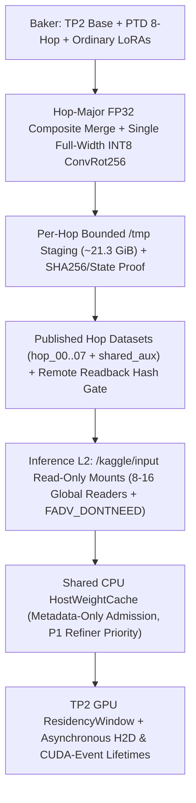

# H3 PTD RefAsymOPD: Offline Joint-Baked Bank and Direct Kaggle Streaming Plan

**Status:** Revised implementation plan (reviewed and corrected on 2026-11-02 against physical T4 / CPU storage measurements and current runtime contracts; not yet an E2E deployment receipt)
**Original Date:** 2026-10-30 | **Revision Date:** 2026-11-02
**Target:** [`chinokikiss/minimax-h3-2xt4`](https://github.com/chinokikiss/minimax-h3-2xt4/tree/codex/h3-ptd-refasymopd), branch `codex/h3-ptd-refasymopd` / `main`
**Platform:** Kaggle T4 × 2, TP2, frozen H3/ComfyUI/Kitchen/TileLang environment

## 1. Executive decision and 2026-11-02 design corrections

Decoupling offline PTD + LoRA baking from runtime inference across **two separate Kaggle workflows** is **necessary and feasible**: a complete eight-hop TP2 INT8 bank is approximately **170.18 GiB (182.73 GB)**, whereas Kaggle's container root overlay (`/tmp`, `/var/tmp`, `/root`) hits a hard writeback `ENOSPC` at **94.000 GiB** (`H3_WRITABLE_DISK_CAPACITY_20261029.md`) and previously failed with `EIO` around **~92 GiB** during an single-job eight-hop bake (`H3_PTD_LONG_E2E_20261029.md`).

However, eight assumptions in the initial 2026-10-30 draft conflicted with the live codebase and physical measurements and are **corrected in this revision**:

1. **Eliminate the mandatory `/tmp` (`L1`) Rolling Window (`32 GiB`) and local TE/VAE copy (`30 GiB`) when Datasets are mounted under `/kaggle/input` (`L2`):**
   - **Pre-split rank-shard reality:** Unlike an unsplit 20 GB monolithic checkpoint (which requires per-row `pread` column slices), baked TP2 shards (`dit.block{i:02d}.rank{r}.safetensors`, ~187.25 MiB each) are **already pre-split by rank**. Reading a baked shard from `/kaggle/input` into `HostWeightCache` is already a sequential whole-tensor read.
   - **Zero intra-request reuse for rolling hops:** PTD evaluates `hop 0 -> hop 1 -> ... -> hop 7` strictly once per generation request (`patches/ptd/runtime.py`, `patches/ptd/queue.py`). Staging single-use hops from `/kaggle/input` into `/tmp` before reading them into RAM has **0% intra-request cache reuse**, turns one sequential NFS read (**740.78–831.90 MiB/s** at 8–16 readers) into `NFS read + /tmp overlay write + /tmp read` (**~126 MiB/s** observed when syncing to `/tmp`), and doubles kernel file-cache pressure inside the 30 GiB cgroup limit.
   - **Corrected streaming path:** Stream baked rank shards **directly from read-only `/kaggle/input` (`L2`) into `HostWeightCache` pageable CPU storage** with bounded concurrent readers (8–16 global threads) and immediate post-read `posix_fadvise(POSIX_FADV_DONTNEED)` retirement. Reserve `/tmp` (`L1`) strictly for (a) bounded Hop-by-Hop Baker scratch ($\le 25\text{ GiB}$ live), (b) unmounted HuggingFace downloads when not attached via `/kaggle/input`, and (c) an *optional*, benchmark-gated cross-request Protected Prefix if multi-request warm reuse is explicitly enabled.
2. **Bake and publish in bounded parts with 3-Stage Full-Duplex pipelining (`Download Rx` $\parallel$ `Dual-T4 GPU Bake` $\parallel$ `Upload/Publish Tx`):**
   - The current `patches/ptd/bank.py::_bake_partition` accumulates all 50 layers × 8 hops (`170.18 GiB`) on `/tmp` before publishing, and `run_ptd_e2e_batch.py` waits >600 s downloading all base shards (`48.38 GB`) before GPU baking starts.
   - Instead, the Baker supports (a) **Hop-Major bounded publication** (`1 Hop = 1 Dataset Part ≈ 21.27 GiB`) when the base is already mounted in `/kaggle/input`, and (b) **3-Stage Full-Duplex Layer-Band pipelining** when streaming base shards from HuggingFace: prefetch 2–4 base layers (`~375 MiB/layer`, `~3.5 s/layer`), bake all 8 hops per layer on Dual T4s (`~28.5 s/layer`) while caching the dequantized FP32 base matrix across the 8 hops, immediately `unlink()` each consumed base shard, and overlap background part upload + remote readback verification (`Part b-1`) with GPU baking (`Part b`), capping peak `/tmp` usage at **~35–56.6 GiB** (well below the 94 GiB `ENOSPC` limit).
3. **Drop the "append-safe Dataset version" and mid-run `/kaggle/input` remount assumptions:**
   - Kaggle's `dataset_upload` / `dataset_create_version` replaces the Dataset's file tree with the uploaded local folder; deleting local Part 0 before uploading Part 1 as "Version 2 of the same Dataset" would erase Part 0 from Version 2. Furthermore, `/kaggle/input` mounts are static at container boot and cannot be dynamically attached inside a running Baker Notebook.
   - Each Hop Part must either use its own Dataset slug (`8` hop Datasets + `1` manifest/shared-aux Dataset, well within Kaggle's mount limit) or publish via commit-per-hop to a private HuggingFace repository (authorized in `AGENTS.md` 2026-10-22). Remote readback verification inside the Baker must stream-verify via the API/HTTP download handle into a small bounded RAM buffer.
4. **Align runtime verification strictly with the 2026-10-30 Production Metadata Policy (`AGENTS.md`, `H3_RUNTIME_FILE_CHECKS.md`):**
   - Production inference removes **all** SHA256 file and tensor hashing (`RuntimeConfig` normalizes `verify_dit_weights=False`; `RankRuntime` and `WorkerAdapter` enforce `verify_weights=False` / `verify_payloads=False`). In `H3_TE_DIRECT_IO_RESULTS_20261030.md`, file + tensor SHA256 consumed **86.3% of buffered layer-preparation CPU time** (`82.67 s` per rank for 11.36 GiB), which would translate to **> 600 s of CPU stall per rank** across an 85 GiB/rank PTD bank.
   - Full cryptographic SHA256 (`verify_payloads=True`, `state_proof`, `verify_weight`, and remote readback SHA256) is mandatory in the **Offline Baker and standalone integrity tools**, whereas **Production Inference** uses `FileChecks` metadata admission only (byte size, `mtime_ns`, device/inode signature, safetensors header/range coverage, and tensor schema checks).
5. **Embed the ~58 MiB Shared Static Base Auxiliary (`shared_base_aux.safetensors`) to truly eliminate the 19.78 GiB Base Bundle at inference:**
   - Currently, `PTDBank` and `WorkerAdapter` require mounting the full 19.78 GiB `BundleReader(bank.base)` solely so `HopReader` can fall back to `super().read_tensor(...)` for unmodified non-block tensors (`adaln_t_table`, `rope.inv_freq`, `condition_proj`, `token_refiner` norms, `video_patch_proj`, `audio_patch_proj`, `final_layer.norm`, `final_layer.adaln_proj`).
   - Those hop-invariant tensors total only **~58 MiB**. Exporting them (plus the base block schema plan) into `shared_base_aux.safetensors` inside the bank removes the 19.78 GiB base bundle requirement from inference completely.
6. **Implement Joint Merge via `CompositeLoRAStore(HopStore, H3LoRAStore)` to preserve distinct adapter conventions:**
   - PTD factors (`HopStore` in `patches/ptd/checkpoint.py`) use Diffusers naming, `[up, gate]` SwiGLU permutation on `mlp.fc1`, and separate Q/K/V `A` matrices zero-padded into thirds of `qkv_proj`. Ordinary H3 LoRAs (`H3LoRAStore` in `patches/h3_lora.py`) use ComfyUI/Native naming and `selective_b` rules, and may also target dense modules not adapted by PTD (e.g., `adaln_proj.linear` or `condition_proj`).
   - Rather than rewriting `offline_lora.merged_weight`, compose `HopStore(checkpoint, hop)` and `H3LoRAStore(lora_stack, base)` via a `CompositeLoRAStore` whose `.terms(target)` concatenates both term lists in FP32 before the single full-width ConvRot256 INT8 quantization (`Layout.quantize`).
7. **Reconcile the Pruned-AdaLN Base Contract (`allow_pruned_adaln=True`) and Kaggle's 200 GB Private Quota:**
   - The repository's pinned TP2 base (`cnmds/minimax-h3-tp2-int8-561a6211`) uses pruned AdaLN curves (`adaln_t_table`). Keep `allow_pruned_adaln` explicit and recorded in the recipe manifest (defaulting to `False` unless explicitly enabled for the current pruned TP2 base, matching `patches/ptd/bank.py`).
   - Because one 182.73 GB bank consumes >91% of Kaggle's 200 GB private Dataset quota, the Baker preflight must check available account quota and support either designated reusable Dataset slugs (`h3-ptd-active-hop-00..07` updated as a synchronized cohort) or private HuggingFace repository storage.
8. **Coordinate Rank-0 Refiner Preparation and Kernel Page-Cache Retirement (`POSIX_FADV_DONTNEED`):**
   - `H3_PTD_AUXILIARY_SPLIT_T4_RESULTS_20261029.md` showed Rank 0 is the critical-path bottleneck (`65.21 s` mean host wait vs `8.95 s` on Rank 1) because only Rank 0 prepares the ~1.45 GiB FP32 `token_refiner` per hop. Keep buffered `pread` as default (`O_DIRECT` was 17.9%–45.4% slower in `H3_TE_DIRECT_IO_RESULTS_20261030.md`), retire consumed shard/overlay pages from the kernel page cache via `posix_fadvise(POSIX_FADV_DONTNEED)` immediately after tensor construction so cgroup file cache stays `< 3.5 GiB`, and prioritize Rank 0's P1 refiner read lane over Rank 1's far lookahead across the shared ~832 MiB/s NFSv3 pipe.

## 2. Hard constraints and non-goals

- Preserve the frozen ComfyUI legacy attention API (`d49e888586dd8ae012c0667b33466b815fee07f7`), pinned `comfy-kitchen==0.2.37` and `tilelang==0.1.13`, native TP2 semantics, sampler inputs, P0-2/P0-3 DiT lifetime defaults, and established video/audio precision behavior. No upstream upgrades.
- The released PTD checkpoint is **8 hops / 32 PDD intervals**. Respect the per-hop sigma grid, independent adapters, Token Refiner, time-conditioned video/audio output heads, and audio/video schedule (`video_shift=12.0`, `audio_shift=3.0`). Never treat PTD as one global static LoRA.
- Record whether the base uses full AdaLN projections or the current pruned AdaLN-curve base (`allow_pruned_adaln=True`). Never silently substitute one for the other without recording `pruned_adaln_approximation` in the recipe digest.
- Use the original base **only in the Baker**. Inference mounts the published bank (including its ~58 MiB `shared_base_aux.safetensors`) and **never** requires downloading or mounting the 19.78 GiB original DiT base bundle.
- Never mutate an attached `/kaggle/input` Dataset. `/kaggle/input` is read-only; `/tmp` is session-local, disposable, and strictly capped below its 94.000 GiB `ENOSPC` boundary.
- The user-facing inference workflow accepts only a **complete, self-contained bank manifest** (`status == "complete"`). It does not accept raw LoRAs with a hidden runtime-bake fallback.
- Never poll Kaggle job status/list endpoints or live logs (`AGENTS.md`).

## 3. Corrected data flow and storage tiers



### Tier responsibilities

| Tier | Material | Lifetime / ownership | Corrected behavior |
|---|---|---|---|
| Published Datasets / `L2` (`/kaggle/input`) | 8 Hop Dataset parts (`dit.block{00..49}.rank{0,1}.safetensors` + `aux_overlay.safetensors`), `shared_base_aux.safetensors` (~58 MiB), global `bank.json` manifest | Immutable across sessions; version-pinned | Primary read-only streaming source during inference; sequential whole-shard reads directly into `HostWeightCache` |
| `/tmp` (`L1`) **in Baker** | Single active hop directory (`hop_{h:02d}`, ~21.27 GiB) + base layer read buffer | Single hop during baking | Flushed, SHA256-proved, uploaded, remote-readback verified, then **unlinked** before `hop h+1` starts |
| `/tmp` (`L1`) **in Inference (Optional)** | Unmounted HF assets (if TE/VAE are not attached via `/kaggle/input`) + optional cross-request **Protected Prefix** (e.g., Hop 0 first $K$ blocks + refiner) | Current Kaggle instance | **No rolling `/tmp` copy for single-use Hops 1–7.** TE/VAE stay in `/kaggle/input` when mounted as Datasets |
| Kernel Page Cache (cgroup file memory) | Transient buffered read pages from `/kaggle/input` | Bounded to active read window (`< 3.5 GiB`) | Retired immediately after tensor construction via `os.posix_fadvise(fd, 0, 0, POSIX_FADV_DONTNEED)` |
| CPU `HostWeightCache` | Prepared `TPDiTBlockINT8`, `ptd_refiner` (Rank 0), `ptd_heads`, and pinned H2D staging buffers | Shared `HostBudget` (20 GiB across both ranks) | Existing `ExpertQueue` + `HostWeightCache` with P1 next-hop refiner priority lane and `verify_payloads=False` |
| GPU `ResidencyWindow` | Active/lookahead TP2 modules (`6 GiB` cap) and DiT activations (`9 GiB` reserve) | Per rank; CUDA-event-owned | Preserve `ExpertQueue` (`hop_handoff='queue'`) without inter-hop window teardown or global CUDA sync |

## 4. Offline Joint Baker design

### 4.1 Inputs and recipe identity

Require immutable identities for:

- Compatible H3 Ref2VA TP2 base descriptor (`BundleReader`), with explicit `allow_pruned_adaln` validation when `'adaln_t_table' in base.header`.
- Exact PTD RefAsymOPD checkpoint (`MiniMax-H3-Ref2VA-PTD-RefAsymOPD-8Step.safetensors`, 8 hops / 32 PDD intervals).
- Ordered ordinary LoRA stack: `[(path, float(strength)), ...]`, admitted via `H3LoRAStore` (`patches/h3_lora.py`) with exact file SHA256, target mapping, and `selective_b=True, selective_qkv_b=True`.
- Frozen code/environment identity (`bank.py`, `checkpoint.py`, `mapping.py`, `schedule.py`, `offline_lora.py`, `offline_lora_reference.py`, `h3_lora.py`, `comfy-kitchen==0.2.37`, `torch`), ConvRot group size (`256`), TP2 partition rules, `video_shift=12.0`, and `audio_shift=3.0`.

Reject unrecognized, non-finite, unmatched, duplicate, or unsupported target tensors. No silently dropped ordinary LoRA targets.

### 4.2 Numerics: `CompositeLoRAStore` and single ConvRot256 quantization

For every target matrix in `targets = ptd_hop_store.targets | ordinary_lora_store.targets` and hop `h`:

```text
W_fp32[h] = DequantizeOnce(W_base)
            + ApplyTerms(HopStore(ptd_ckpt, h).terms(target))
            + ApplyTerms(H3LoRAStore(ordinary_stack, base).terms(target))
```

1. **Preserve adapter-specific conventions via `CompositeLoRAStore`:**
   - `HopStore(checkpoint, hop).terms(target)` handles Diffusers-to-Native mapping: `[up, gate] -> [gate, up]` row permutation on `mlp.fc1` (including `token_refiner`) and independent Q, K, V `A` matrices zero-padded into the three slices of `attn.qkv_proj`.
   - `H3LoRAStore(lora_stack, base).terms(target)` handles ordinary ComfyUI/Native LoRA keys and scales.
   - `CompositeLoRAStore.terms(target)` returns `ptd_store.terms(target) + ordinary_store.terms(target)`. Passing `CompositeLoRAStore` into `patches/offline_lora.py::merged_weight` and `patches/offline_lora_reference.py::verify_weight` executes all deltas sequentially in FP32 after a single `Layout.dequantize` and performs **one** full-width `Layout.quantize(..., per_channel=True, convrot=True, convrot_groupsize=256, stochastic_rounding=0)` before `split_matrix` into Rank 0 and Rank 1 shards.
2. **Dense / non-PTD targets and `aux_overlay.safetensors`:**
   - If an ordinary LoRA adapts a dense block tensor not adapted by PTD (such as `blocks.{i}.adaln_proj.linear`), `merged_weight` keeps its original FP32 dtype (`scale is None`) and replicates it across both ranks.
   - If an ordinary LoRA adapts `condition_proj`, fold it once into `shared_base_aux.safetensors`.
   - For `token_refiner.blocks.*`, merge both `HopStore` and `H3LoRAStore` terms in FP32 and store the resulting floating-point weights in `hop_{h:02d}/aux_overlay.safetensors`.
   - Keep PTD's 32-interval PDD output heads (`proj_out`, `audio_proj_out` -> `final_layer.video_out`, `final_layer.audio_out`) fused by `hop_plans(8, 32, 12.0, 3.0)[h]` in FP32; reject any ordinary LoRA that attempts to target the PDD output head bank unless explicitly qualified.

### 4.3 Bounded bake, publication state machine, and 3-stage full-duplex pipeline

To stay well below the **94.000 GiB** `/tmp` write ceiling while eliminating the **540+ second GPU idle wait** during initial base-model downloading (`H3_PTD_LONG_E2E_20261029.md`), the Baker supports both **Hop-Major sequential publication** (when the base is already mounted in `/kaggle/input`) and a **3-Stage Full-Duplex Pipeline (`Download Rx` $\parallel$ `Dual-T4 GPU Bake` $\parallel$ `Upload/Publish Tx`)** when streaming base shards from HuggingFace:

#### A. Why Full-Duplex Download $\parallel$ Bake $\parallel$ Upload works on 2×T4

In `H3_PTD_LONG_E2E_20261029.md`, downloading all 200 TE/DiT base shards (`48.38 GB`) and the `11.11 GB` PTD checkpoint sequentially took **> 600 seconds** before the GPUs executed a single kernel, and pinned **~30 GiB** of `/tmp` for the entire run. Compare per-layer I/O vs GPU compute:

- **Stage 1 — Base Shard Download (Network Rx, CPU/I/O only):** One DiT layer is two immutable pre-split files (`dit.block{i:02d}.rank{0,1}.safetensors`, total **~375 MiB**), each with its own pinned SHA256 in `bundle_assets.json`. At `80–120 MiB/s`, downloading and SHA256-verifying one layer takes **~3.1–4.7 seconds**.
- **Stage 2 — Dual-T4 GPU Bake (CUDA Compute):** Baking one layer across all 8 hops (`merged_weight` + `verify_weight` + full-width ConvRot256 INT8 quantization) takes **~28.5 seconds of GPU compute** (`~3.57 s` per `(layer, hop)` pair). Note: caching the dequantized FP32 `W_base` (or reconstructed full-width INT8 `W_base`) inside `_LayerSource` across the 8 hop merges of Layer `i` avoids re-dequantizing the same base matrix 8 times.
- **Stage 3 — Bounded Part Upload & Remote Readback (Network Tx, CPU/I/O only):** Grouping layers into **8 Layer-Bands** (e.g., 6–7 layers × 8 hops $\approx$ **20–22 GiB per Band**, plus `aux_overlay` in Band 0) or **8 Hop-Parts** (~21.27 GiB per Hop when base is mounted in `/kaggle/input`) allows the background publisher to upload and remote-verify Completed Part $b-1$ while the GPUs bake Part $b$ and the downloader prefetches base shards for Part $b+1$.

Because **Stage 1 (`~3.5 s/layer`) is ~8× faster than Stage 2 (`~28.5 s/layer` across 8 hops)** and uses **0 CUDA VRAM / 0 GPU SMs**, the two T4 GPUs can start baking as soon as Layer 0 and Layer 1 (`~750 MiB`, `< 8 seconds`) are downloaded, completely hiding the remaining 48 layers of base downloads behind GPU compute and immediately `unlink()`ing each base shard after its layer finishes baking (**saving ~18.5 GiB of `/tmp` space**).

#### B. Full-Duplex execution & semaphore bounds

1. **Startup (PTD Header / Auxiliary + First 2 Base Layers):**
   - Admit the 11.11 GB PTD checkpoint (and ordinary LoRA stack), export `shared_base_aux.safetensors` (~58 MiB), and bake the 8 `aux_overlay.safetensors` files while prefetching Base Layers 0–3 (`~1.5 GiB`).
2. **Stage 1 Producer (`BaseShardPrefetcher`, max 2 download threads, bounded queue `max_prefetched_layers = 4`):**
   - Downloads `dit.block{index:02d}.rank{0,1}.safetensors` into `/tmp/ptd_bake/base_staging/`, verifies exact byte size and SHA256 against `bundle_assets.json`, and pushes `index` into the GPU ready queue.
   - Blocks on a semaphore if `4` downloaded base layers are already waiting (~1.5 GiB cap).
3. **Stage 2 Consumer/Producer (Dual-T4 GPU Baker, 1 process per T4, bounded output semaphore `max_uncleaned_parts = 2`):**
   - GPU 0 consumes even layers (`0, 2, ...`), GPU 1 consumes odd layers (`1, 3, ...`) within the current Band/Part.
   - Reads the layer's two base shards into `_LayerSource`, **immediately `unlink()`s both base shard files from `/tmp`** (freeing `/tmp` blocks and kernel page-cache pages), caches the reconstructed base matrices in RAM/VRAM for that layer, and bakes `hop 0..7` (with `CompositeLoRAStore`).
   - Background durable writer (`_persist_layer`) writes `dit.block{index:02d}.rank{0,1}.safetensors` + `.json`, runs `fsync` + `sha256`, and calls `os.posix_fadvise(fd, 0, 0, os.POSIX_FADV_DONTNEED)` so written shards do not bloat the 30 GiB cgroup file cache.
4. **Stage 3 Consumer (`PartPublisher`, 1 background process/thread):**
   - When all layers in Part $b$ (~20–22 GiB) are durable, Part $b$ is handed off to `PartPublisher` while the GPUs immediately begin Part $b+1$ (provided `uncleaned_parts < 2`).
   - `PartPublisher` uploads Part $b$ to its dedicated Dataset handle (`<owner>/<bank_slug>-part-0{b}` or private HF commit), waits for processing readiness, stream-verifies remote byte sizes and SHA256 in 8 MiB chunks (`POSIX_FADV_DONTNEED` on local read), marks `PUBLISHED_VERIFIED`, and **unlinks Part $b$ from `/tmp`**, releasing the `uncleaned_parts` semaphore slot.
5. **Publish global `bank.json` last:** Once all parts and `shared_base_aux.safetensors` are `PUBLISHED_VERIFIED`, publish the top-level `bank.json` manifest pinning every Dataset `owner/slug/version` (or HF commit SHA), relative path, byte size, and SHA256 digest.

#### C. Worst-case `/tmp` and cgroup RAM budget under Full-Duplex

| Resource | Active components under Full-Duplex (`max_prefetched_layers=4`, `max_uncleaned_parts=2`) | Peak bound | Hard limit / Margin |
|---|---|---:|---|
| `/tmp` disk | PTD + ordinary LoRAs (`~12.5 GiB`) + 4 prefetched base layers (`~1.5 GiB`) + Baking Part $b$ (`~21.3 GiB`) + Uploading Part $b-1$ (`~21.3 GiB`) | **~56.6 GiB** | **> 37 GiB safety margin** below 94.000 GiB `ENOSPC` |
| Host RAM + File Cache | 2 GPU worker processes (`~6 GiB` anon) + Downloader/Uploader 8 MiB stream buffers (`< 0.2 GiB`) + `DONTNEED`-bounded page cache (`< 4 GiB`) | **~10.2 GiB** | **~19.8 GiB safety margin** below 30 GiB cgroup limit |
| CPU threads (4 vCPUs) | 2 GPU bake workers (`OMP_NUM_THREADS=1`) + 1–2 I/O threads for Download/Upload | **4 threads** | Prevents GIL/CPU starvation of GPU kernel launches |

Crash/restart state machine per part:

```text
PLANNED -> BAKING_PART -> LOCAL_PROOF_VERIFIED -> UPLOAD_ACKNOWLEDGED
        -> REMOTE_PROCESSED -> REMOTE_READBACK_HASH_VERIFIED -> LOCAL_CLEANED
```

### 4.4 Storage backend & quota gate

- **Kaggle Datasets (200 GB private quota limit):** A single 8-hop bank (`170.18 GiB = 182.73 GB`) fits within the 200 GB private quota (split across 8 per-hop Datasets of ~22.8 GB each, well below the 200 GB per-Dataset and 50 top-level-file limits), but leaves `< 18 GB` for other private Datasets. Preflight must query existing private quota usage; when rebaking a new LoRA recipe under the 200 GB cap, reuse/update the 8 designated hop Dataset slugs in place only after user confirmation, or clean retired banks first.
- **HuggingFace private repository alternative (`AGENTS.md` 2026-10-22):** Publishing the 8 `hop_{00..07}` folders and `shared_base_aux.safetensors` to a private HF repo via `HF_TOKEN` Secrets avoids the 200 GB Kaggle private Dataset ceiling entirely while supporting commit-pinned immutable URLs.

## 5. Self-contained bank manifest and original-base-free `HopReader`

To eliminate the 19.78 GiB original DiT base dependency at inference while keeping `patches/ptd/bank.py` backward-compatible with local monolithic banks:

```json
{
  "format": "h3-ptd-tp2-bank-v2",
  "status": "complete",
  "recipe": {"...": "full base, PTD, and ordinary_lora_stack recipe"},
  "recipe_sha256": "<64-hex-digest>",
  "full_model": true,
  "online_lora": false,
  "sigmas": [0.999, "..."],
  "shared_base": {
    "dataset": "owner/h3-ptd-bank-aux/versions/1",
    "auxiliary_file": "shared_base_aux.safetensors",
    "auxiliary_bytes": 60817408,
    "auxiliary_sha256": "<64-hex-digest>",
    "bundle_plan": "bundle_plan.json",
    "bundle_plan_sha256": "<64-hex-digest>"
  },
  "hops": [
    {
      "hop": 0,
      "dataset": "owner/h3-ptd-bank-hop00/versions/1",
      "directory": "hop_00",
      "receipt_file": "hop_00/receipt.json",
      "receipt_bytes": 65536,
      "receipt_sha256": "<64-hex-digest>"
    }
  ]
}
```

### Runtime vs Offline verification boundary (`AGENTS.md` 2026-10-30)

- **Baker / Offline Integrity Tools (`verify_payloads=True`):** Verify `recipe_sha256`, `shared_base_aux.safetensors` SHA256, every `receipt.json` SHA256, every `dit.block{i:02d}.rank{r}.safetensors` SHA256, `state_proof`, and `aux_overlay.safetensors` SHA256.
- **Production Inference Runtime (`verify_payloads=False` mandatory):**
  - `PTDBank` and `HopReader` admit files strictly through `FileChecks` (`patches/file_metadata.py`): exact byte size against receipt, `(st_size, st_mtime_ns)` signature stability across admission and reads, safetensors header bounds, contiguous non-overlapping tensor byte ranges, and expected tensor shapes/dtypes.
  - **Zero SHA256 computation occurs during `PTDBank` admission, `HopReader._shard`, or `HopReader._verify_overlay` when `verify_payloads=False`.**
  - When `shared_base` is present in `bank.json`, `PTDBank` and `HopReader` construct a lightweight `SharedBaseAuxReader` backed by `shared_base_aux.safetensors` + `bundle_plan.json` instead of opening the 19.78 GiB `BundleReader(bank.base)`. `WorkerAdapter` accepts this self-contained bank without requiring `runtime.readers['dit']` to point to a full base bundle.

## 6. I/O architecture, page-cache retirement, and optional `/tmp` L1 prefix

### 6.1 Why direct `/kaggle/input` (`L2`) streaming beats a `/tmp` (`L1`) rolling disk cache

Empirical findings from the 2026-10-29 and 2026-10-30 studies:

1. `/kaggle/input` Datasets share a single NFSv3 mount (`192.168.14.2`, superblock `0:52`, `rsize=524288`). Increasing concurrent readers from 1 to **8–16 global threads** scales aggregate read throughput from **238.31 MiB/s to 740.78–831.90 MiB/s** (`H3_DATASET_CPU_RESULTS_20261030.md`).
2. `/tmp` is a container root overlayfs with a hard **94.000 GiB** `ENOSPC` limit (`H3_WRITABLE_DISK_CAPACITY_20261029.md`). Copying from `/kaggle/input` into `/tmp` with sync/verification ran at **~126 MiB/s** and consumes both NFS read bandwidth and overlayfs write bandwidth.
3. Because PTD executes each of the 8 hops **once per sample**, any rolling shard written to `/tmp` for Hops 1–7 is read once by `HostWeightCache` and immediately discarded.
4. `O_DIRECT` on `/tmp` reduced TE first-call performance by **17.9%** and repeat performance by **45.4%** due to user-space alignment copy overhead (`H3_TE_DIRECT_IO_RESULTS_20261030.md`). Buffered `pread` into final CPU tensor storage remains the fastest path (**12.60 s** loading CPU per rank for 50 layers vs **22.99 s** with `O_DIRECT`).

Therefore, **buffered sequential reads directly from `/kaggle/input` into `HostWeightCache` pageable tensors, paired with immediate `POSIX_FADV_DONTNEED` page-cache retirement**, is the primary inference architecture.

### 6.2 Kernel file-cache control (`POSIX_FADV_DONTNEED`)

Without page-cache retirement, buffered reads across a 170.18 GiB 8-hop bank fill the Linux page cache (measured at **15.43–18.34 GiB** file cache on TE alone in `H3_TE_DIRECT_IO_RESULTS_20261030.md`), colliding with the **20 GiB** `HostBudget` anonymous memory inside the **30 GiB** container cgroup limit.

In contrast, `H3_DATASET_CPU_RESULTS_20261030.md` demonstrated that issuing `os.posix_fadvise(fd, 0, 0, os.POSIX_FADV_DONTNEED)` after reading keeps peak cgroup file cache at **3.16 GiB** across 74 trials with **zero `pgscan`/`pgsteal` reclaim stalls**:

- After `CheckpointReader.read_tensor` / `load_rank_block` finishes reading a shard `dit.block{i:02d}.rank{r}.safetensors` (or after `refiner_group` / `head_group` finishes reading `aux_overlay.safetensors` for hop $h$), call `os.posix_fadvise(fd, 0, 0, os.POSIX_FADV_DONTNEED)` on Linux (except for files explicitly pinned in an optional warm-instance prefix).
- Never use `O_DIRECT` Python bounce buffers.

### 6.3 `/tmp` usage envelope during inference (GiB, *upper bounds*)

| `/tmp` category | Target when TE/VAE & Bank are mounted in `/kaggle/input` | Target when TE/VAE are fetched from HF | Rule |
|---|---:|---:|---|
| Rolling baked shard window | **0** | **0** | Stream directly from `/kaggle/input` (`L2`) into `HostWeightCache` |
| TE and VAE local source assets | **0** (read from `/kaggle/input`) | **~30** | Never copy already-mounted `/kaggle/input` TE/VAE files into `/tmp` |
| Optional Protected Prefix (Hop 0 initial blocks + refiner) | **0–12** (opt-in) | **0–12** (opt-in) | Enable only if benchmarked to beat direct `/kaggle/input` warm reads |
| Compiler / TileLang / Kitchen / Sol caches + AOT receipts | **~2** | **~2** | Persist across calls within instance |
| Free safety headroom below 94 GiB `/tmp` quota | **80–92** | **50–62** | Prevents any container overlay `ENOSPC` / `EIO` |

## 7. HostWeightCache, P1 Refiner Priority, and 8–16 Reader Coordination

Retain the existing `ExpertQueue` (`patches/ptd/queue.py`), `HostWeightCache` (`patches/host_weight_cache.py`), and `ResidencyWindow` (`patches/weight_residency.py`) architecture:

```text
/kaggle/input (L2 NFSv3)
  --[buffered pread + FADV_DONTNEED]--> HostWeightCache (pageable CPU module, 20 GiB shared HostBudget)
  --[copy_stream non_blocking H2D]----> ResidencyWindow (GPU module, 6 GiB cap, CUDA-event fenced)
```

### Critical scheduling refinements for PTD 8-hop streaming

1. **Eliminate the Rank-0 Refiner bottleneck (`H3_PTD_AUXILIARY_SPLIT_T4_RESULTS_20261029.md`):**
   - Rank 0 prepares both the ~1.45 GiB FP32 `ptd_refiner` (`refiner_group` in `patches/ptd/queue.py`) and 50 DiT blocks per hop, whereas Rank 1 prepares only 50 DiT blocks and tiny output heads.
   - With `verify_payloads=False` (2026-10-30 policy), the ~44 s whole-overlay SHA256 scan on Rank 0 and ~41 s scan on Rank 1 are already gone.
   - To further cut Rank 0's `refiner_group` preparation time:
     - Store `token_refiner.blocks.*` weights in `aux_overlay.safetensors` with pre-folded `1 / flow.divisor` output scales (or perform the FP16/BF16 $\to$ FP32 cast + scale multiply in a single preallocated destination tensor without intermediate copies in `refiner_group`).
     - Keep `prefetch_refiner=True` (`P1`) enabled so Rank 0 starts reading `hop + 1`'s `aux_overlay.safetensors` on its dedicated CPU priority lane while the GPUs are still executing `hop`'s DiT blocks.
2. **Increase intra-shard / cross-shard reader concurrency within `HostBudget`:**
   - Currently, `HostWeightCache` uses a small per-rank thread pool, while `H3_DATASET_CPU_RESULTS_20261030.md` showed that `/kaggle/input` NFSv3 reaches peak bandwidth (**740.78–831.90 MiB/s**) at **8–16 concurrent readers** across the two ranks (4–8 reader threads per rank process).
   - Allow `HostWeightCache` (or parallel tensor range loading inside `load_rank_block` / `refiner_group`) to issue up to **4–8 concurrent file reads per rank** (8–16 total across both ranks), strictly gated by `HostBudget.acquire(..., staging=True)` so raw bytes never exceed the shared 20 GiB `HostBudget`.
3. **Rank-synchronized layer readiness:**
   - `H3_TE_DIRECT_IO_RESULTS_20261030.md` showed that collective entry skew (up to 1.98 s) occurs when one rank prepares a layer faster than the other. Because Rank 0 also prepares `ptd_refiner`, Rank 1 must not hog NFS bandwidth prefetching far-future blocks while Rank 0 is reading `ptd_refiner` or the current block. Bounding `cpu_lookahead` and prioritizing the lowest `(hop, block_index)` across the shared `HostBudget` keeps both ranks aligned at each block's NCCL AllReduce.

## 8. Evidence and performance envelope (2026-10-30 to 2026-11-02)

### 8.1 Kaggle `/kaggle/input` NFSv3 read throughput (`H3_DATASET_CPU_RESULTS_20261030.md`)

74 CPU-only trials (4 vCPUs, 30 GiB cgroup limit, `POSIX_FADV_DONTNEED`):

| Total readers | 1 dataset | 2 datasets | 4 datasets | 6 datasets | Interpretation |
|---:|---:|---:|---:|---:|---|
| 1 | 238.31 MiB/s | 229.72 MiB/s | 235.38 MiB/s | 234.70 MiB/s | Single-thread NFS latency bound |
| 4 | 607.45 MiB/s | 560.28 MiB/s | 574.94 MiB/s | 593.60 MiB/s | 2.5× single reader |
| 8 | 740.78 MiB/s | 770.92 MiB/s | 702.42 MiB/s | 784.68 MiB/s | Near plateau (4 readers/rank) |
| **16** | **831.90 MiB/s** | **830.63 MiB/s** | **814.28 MiB/s** | **798.60 MiB/s** | **Sweet spot (8 readers/rank); 3.49× 1 reader** |
| 32–64 | 739–761 MiB/s | 706–796 MiB/s | 811–813 MiB/s | 767–812 MiB/s | No further gain; extra contention |

- **Why dataset count does not multiply bandwidth:** All `/kaggle/input` mounts share one NFSv3 server (`192.168.14.2`) and superblock (`0:52`). Splitting the 170.18 GiB bank into 8 Hop Datasets is for **bounded `/tmp` baking (< 22 GiB/part) and modular publication**, *not* to multiply NFS channels.
- **Overlap math against T4 DiT compute:**
  - At $S=59,134$ to $65,166$ tokens, one 50-block DiT hop takes **~125–150 seconds of T4 GPU compute** (`~2.5–3.0 s` per block; see `T4_P0_AUDIT_REPORT.md` and `H3_CONTEXT_HANDOFF_20261031.md`), or **~1,000–1,200 seconds** across 8 hops.
  - Reading one hop's weights (`~21.27 GiB` across both ranks) directly from `/kaggle/input` at **740–832 MiB/s** takes **~26–29 seconds per hop** (**~209–235 seconds** across all 8 hops).
  - Because **~26–29 seconds of L2 read time per hop is < 25% of the ~125–150 seconds of T4 GPU compute time per hop**, direct L2 $\to$ `HostWeightCache` prefetching with `ExpertQueue` + `verify_payloads=False` can **completely hide L2 read latency behind T4 GPU compute** after Hop 0's initial blocks!

### 8.2 Upload and verification evidence

- Python `kaggle` API (`dataset_create_new(..., public=False)`) and `kagglehub.dataset_upload` succeeded on Kaggle using native notebook authentication (`H3_DATASET_CPU_RESULTS_20261030.md`).
- Because `dataset_upload` returns at `"Files are being processed..."`, the Baker must wait for dataset readiness and verify remote file sizes/SHA256 before deleting local `/tmp/ptd_bake/hop_{h:02d}` files.

## 9. Implementation work packages

| Priority | Work package | Key modules / output | Completion gate |
|---|---|---|---|
| **P0** | Shared static base auxiliary extractor & original-base-free `HopReader` | `patches/ptd/bank.py`, `patches/ptd/runtime.py` | Export ~58 MiB `shared_base_aux.safetensors` + `bundle_plan.json`; run `PTDBank` / `HopReader` / `WorkerAdapter` without mounting the 19.78 GiB base bundle |
| **P1** | `CompositeLoRAStore` for joint PTD + ordinary LoRA FP32 merge | `patches/ptd/checkpoint.py`, `patches/ptd/bank.py`, `patches/offline_lora.py` | FP32 native merge parity for `PTD + ordinary LoRA` (including QKV thirds, SwiGLU swap, refiner, and dense targets); single ConvRot256 INT8 quantization |
| **P2** | Bounded Hop-Major & 3-Stage Full-Duplex (`Download` $\parallel$ `Bake` $\parallel$ `Upload`) publisher | `patches/ptd/bank.py`, new `patches/ptd/publish.py`; Baker Notebook | Semaphore-bounded base prefetch + immediate base `unlink()`, cached `W_base` across 8 hops, overlapped part upload & remote SHA256 readback, emit `bank.json` |
| **P3** | Direct `/kaggle/input` streaming with `POSIX_FADV_DONTNEED` & 8–16 readers | `patches/windowed_tp.py`, `patches/host_weight_cache.py`, `patches/ptd/queue.py` | Retire consumed shard page-cache pages via `DONTNEED`; keep cgroup file cache `< 4 GiB`; verify `verify_payloads=False` metadata-only fast path |
| **P4** | Rank-0 `refiner_group` fast preparation & P1 priority scheduling | `patches/ptd/queue.py`, `patches/ptd/bank.py` | Zero-hash metadata admission + single-allocation FP32 cast/scale in `refiner_group`; verify reduced Rank-0 `host_wait_ms` |
| **P5** | End-to-end 2×T4 qualification & recovery tests | `benchmarks/test_ptd_*.py`, CPU preflight, T4 E2E | All CPU contracts pass locally; 1-hop and 8-hop T4 streaming runs complete within memory/disk budgets |

## 10. Acceptance matrix

### Correctness

1. **Recipe and target coverage:** Exact base identity (with explicit `allow_pruned_adaln` check), PTD checkpoint, and ordered ordinary LoRA stack; reject unrecognized/non-finite/duplicate targets or accidental ordinary LoRA application to PDD interval heads.
2. **Joint bake math:** Compare `CompositeLoRAStore` merged weights against an independent sequential FP32 reference; verify single ConvRot256 INT8 quantization, TP2 rank splits, all 8 hop refiners, fused PDD heads, and `shared_base_aux.safetensors`.
3. **Original-base-free runtime parity:** Loading from the v2 self-contained bank (`shared_base_aux.safetensors` + 8 hop directories, with the 19.78 GiB base bundle removed) produces bit-for-bit identical tensors and denoiser outputs to the v1 bank.
4. **Verification boundary compliance (`AGENTS.md` 2026-10-30):** Offline Baker enforces 100% SHA256 + `state_proof` + remote readback hash checks (`verify_payloads=True`). Production Inference executes **zero** `hashlib.sha256` / `file_digest` calls on weights/manifests (`verify_payloads=False`), enforcing `FileChecks` metadata, size, signature, and schema guards.

### Resource safety and operational behavior

5. **Baker `/tmp` ceiling:** Peak `/tmp` usage during 8-hop baking never exceeds **35 GiB** in sequential Hop-Major mode or **56.6 GiB** in 3-Stage Full-Duplex mode (`max_prefetched_layers=4`, `max_uncleaned_parts=2`), staying > 37 GiB below the 94.000 GiB `ENOSPC` limit.
6. **Cgroup memory & page-cache bound:** During 8-hop inference streaming (170.18 GiB read), `HostBudget` stays within **20 GiB**, `POSIX_FADV_DONTNEED` keeps cgroup file cache bounded so total cgroup memory stays below the **30 GiB** limit with zero OOM kills.
7. **Overlap & Rank-0 wait telemetry:** Record per-hop L2 read throughput, Rank-0 vs Rank-1 `host_wait_ms`, `refiner_group` prepare time, H2D event durations, and GPU compute coverage across all 8 hops.

## 11. References

- Authoritative runtime map and 2026-10-30 metadata policy: `AGENTS.md`, `docs/guides/H3_RUNTIME_FILE_CHECKS.md`
- Existing PTD implementation: `patches/ptd/bank.py`, `patches/ptd/checkpoint.py`, `patches/ptd/queue.py`, `patches/ptd/runtime.py`, `patches/ptd/mapping.py`, `patches/ptd/schedule.py`
- Existing LoRA & streaming stack: `patches/offline_lora.py`, `patches/h3_lora.py`, `patches/tp2_bundle.py`, `patches/tp2_disk_bake.py`, `patches/host_weight_cache.py`, `patches/weight_residency.py`, `patches/windowed_tp.py`
- Physical T4 & Kaggle storage evidence:
  - `docs/reports/H3_DATASET_CPU_RESULTS_20261030.md` (74-trial NFSv3 read sweep & API/KaggleHub upload probe)
  - `docs/reports/H3_TE_DIRECT_IO_RESULTS_20261030.md` (Buffered vs `O_DIRECT` T4 results & SHA256 CPU cost breakdown)
  - `docs/reports/H3_WRITABLE_DISK_CAPACITY_20261029.md` (94.000 GiB `/tmp` `ENOSPC` & 19.000 GiB `/kaggle/working` boundaries)
  - `docs/reports/H3_PTD_LONG_E2E_20261029.md` (Single-job 8-hop `/tmp` bake `EIO` failure at ~92 GiB)
  - `docs/reports/H3_PTD_AUXILIARY_SPLIT_T4_RESULTS_20261029.md` (Rank-0 refiner preparation & overlay verification attribution)
