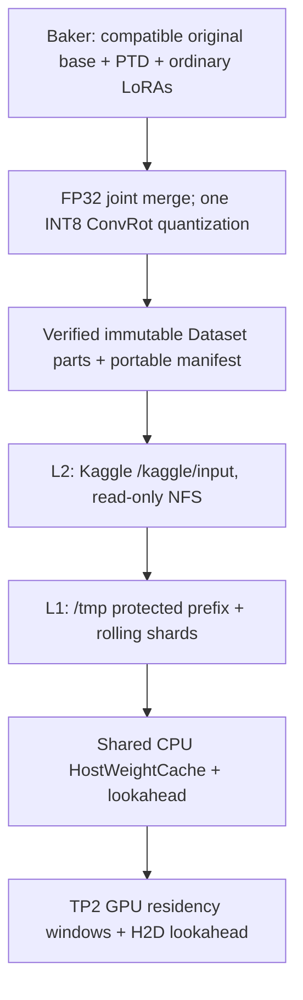

# H3 PTD RefAsymOPD: Offline Joint-Baked Bank and Tiered Kaggle Streaming Plan

**Status:** Proposed implementation plan (not an implementation or a completed E2E validation)  
**Date:** 2026-10-30  
**Target:** [`chinokikiss/minimax-h3-2xt4`](https://github.com/chinokikiss/minimax-h3-2xt4/tree/codex/h3-ptd-refasymopd), branch `codex/h3-ptd-refasymopd`  
**Platform:** Kaggle T4 × 2, TP2, frozen H3/ComfyUI/Kitchen/TileLang environment

## 1. Executive decision

Build **two separate Kaggle notebooks** with a strict handoff at an immutable, version-pinned Kaggle Dataset bank:

1. **Offline Joint Baker:** read original, PTD-compatible Ref2VA base shards; merge the selected **PTD hop LoRA and all ordinary user-selected LoRAs** into each required weight in native FP32; perform **one full-width ConvRot INT8 re-quantization**; produce complete per-hop TP2 shards and auxiliary/head data; publish and verify the bank as bounded, immutable Dataset parts.
2. **Streaming Inference:** mount the finished bank under Kaggle's read-only `/kaggle/input` (`L2`), use a bounded `/tmp` disk cache (`L1`) with a **Protected Prefix** and **Rolling Window**, and retain existing CPU HostWeightCache, two GPU residency windows, and CUDA/device lookahead. Stage TE/VAE assets into `/tmp` as well.

**There is no runtime LoRA baking, LoRA bypass, original DiT base download, or per-request weight conversion.** Changing the LoRA combination or strength creates a **new immutable bank** in the Baker. This deliberately trades frequent LoRA changes for consistent serving latency, deterministic recipes, and a simpler inference path.

The source ordinary LoRA may be about **1 GiB**, but its permanently merged *full model representation* is **not 1 GiB**. The previously cited approximately **19.78 GiB** is a complete ordinary Turbo DiT baked output, not the source adapter size. For PTD, budget the **eight-hop bank separately** (currently estimated at **~170.18 GiB**, subject to actual per-file accounting).

## 2. Hard constraints and non-goals

- Preserve the frozen ComfyUI legacy attention API, kernel versions, native TP2 semantics, sampler inputs, established video/audio precision behavior, and the existing weight-streaming implementation. No upstream upgrades as part of this migration.
- The released PTD checkpoint is **8 hops / 32 PDD intervals**. Respect the per-hop sigma grid, independent adapters, Token Refiner, time-conditioned video/audio output heads, and audio/video schedule. Never treat PTD as one global static LoRA.
- Use the original **non-pruned AdaLN-curve base** for the supported PTD bank. The current pruned-curve TP2 base is a separately labeled, explicit opt-in approximation only, never silently substituted.
- Use the original base **only in the Baker**. Inference needs the final bank and its shared immutable auxiliary assets, **not** a redundant complete original base model.
- Never mutate an attached Dataset or an already-published bank. `/kaggle/input` is read-only; `/tmp` is session-local, disposable, and quota-constrained.
- The user-facing inference notebook accepts only a **complete, verified, self-contained bank manifest**. It does not accept raw LoRAs with a hidden runtime-bake fallback.
- Do not depend on exceeding Kaggle's write quota or circumventing filesystem restrictions.

## 3. Data flow and storage tiers



### Tier responsibilities

| Tier | Material | Lifetime / ownership | Behavior |
|---|---|---|---|
| Published Datasets / `L2` | Fully baked hop/rank shards, hop-specific refiner/PDD overlays, shared immutable DiT auxiliary, small global manifest | Immutable across notebook sessions | Only durable model-bank source; read-only and version-pinned |
| `/tmp` / `L1` **Protected Prefix** | First useful DiT layers (initially prioritize the first hop), required immutable startup auxiliaries | Entire current Kaggle instance, across requests | Staged once, never evicted by the rolling scheduler |
| `/tmp` / `L1` **Rolling Window** | Remaining per-hop/per-layer/rank baked shard files | Until last scheduled consumer releases its lease | Prefetch, atomically promote, consume, evict, reuse bytes |
| `/tmp` / non-DiT assets | TE, reference encoders actually used, video/audio VAE assets as required | Stage once per instance; load/unload GPU state by phase | Keep weights locally available across requests; do not require them to occupy GPU simultaneously |
| CPU host cache | Parsed/pageable TP2 weights and pinned staging buffers | Shared RAM budget across both ranks | Existing HostWeightCache, bounded preparation and prefetch |
| GPU windows | Current/future TP2 modules and activations | Per rank; CUDA-event-owned | Preserve current residency and asynchronous H2D semantics |

**Critical boundary:** A `Protected Prefix` is a *local disk residency policy*, not a second Dataset or a second upload. Its shards occur **exactly once** in the published bank. On the first startup, copy them once from L2 into L1; subsequent requests in the **same** instance reuse them without re-downloading. A new Kaggle instance must re-stage them, because `/tmp` does not persist between instances.

## 4. Offline Baker design

### 4.1 Inputs and recipe

Require immutable identities for:

- Original H3 Ref2VA model/base descriptor, compatible with the PTD checkpoint (non-pruned AdaLN by default).
- Exact PTD RefAsymOPD checkpoint and its 8-hop/32-interval metadata.
- Ordered ordinary LoRA stack: `{source SHA256, adapter mapping, strength, alpha/rank rules}` for each style/aesthetic LoRA.
- Frozen code/environment identity, quantization format, ConvRot group size, TP2 partition rules, video shift, audio shift, and PDD schedule.

Reject unrecognized, non-finite, unmatched, duplicate, or unsupported target tensors. No silently dropped ordinary LoRA targets. The recipe hash must change whenever *any* source weight, adapter strength/order, quantization parameter, PTD schedule, or relevant code version changes.

### 4.2 Numerics and representation

For every supported target matrix and hop `h`, construct the result from the **same compatible base matrix**, not from an already quantized PTD output:

```text
W_fp32[h] = DequantizeOnce(W_base)
            + NativeMerge(PTD_LoRA[h])
            + NativeMerge(ordinary_LoRA_0, strength_0)
            + ...
            + NativeMerge(ordinary_LoRA_n, strength_n)

(Q[h], scale[h]) = ConvRotINT8_FullWidth(W_fp32[h])
TP2_shards[h, rank] = SplitAlongValidatedTP2Axes(Q[h], scale[h])
```

The formula expresses the merged weight conceptually. **Execute the adapters through the validated native merge semantics and order**, including any convention-specific transforms; do not assume a naive `B @ A` covers every supported module. Quantize **once**, after all modifications and before TP2 splitting. Never re-quantize an already PTD-baked INT8 shard just to insert the ordinary LoRA.

Implement the **hop-aware joint merge** by extending the current PTD/offline-bake stack, rather than running the existing independent Turbo baker over each PTD hop. Preserve the specialized PTD refiner and PDD output-head construction, folding the ordinary adapters only where their actual supported targets apply. Validate video/audio head biases and schedules separately. Do not accidentally bake an ordinary style LoRA into a PTD curvature/training-only head.

For matrices unaffected by hop-dependent PTD factors, deduplicate identical content only when supported by a full tensor/recipe proof; share static auxiliary weights explicitly. Record all dynamic-vs-shared decisions in the manifest. No unsupported lossless deduplication assumptions.

### 4.3 Bounded bake and publication

The projected complete eight-hop bank is larger than the measured `/tmp` write allowance. Use **bounded layer-group publication**:

1. Read and validate only the required original base layer(s) and relevant adapter slices. Avoid downloading or keeping the complete original base on local scratch.
2. Bake whole compatible matrices on both T4s using the existing per-layer partition pattern and background durable writer, with a byte-based staging budget.
3. Group completed immutable files into a small **8–16 GiB publication part** initially (tunable after quota and throughput measurements). Place individual rank/layer/hop shards under nested directories; never require a complete 170 GiB bank in writable storage.
4. Flush, close, and hash the completed part; write per-file SHA256/size and a part receipt. Publish the part to a *new immutable Dataset handle or verified append-safe version strategy*. **Do not assume that uploading a new Dataset version appends to all previous files.**
5. Wait for Dataset processing/readiness; attach/read back the published version, compare expected size and SHA256, then mark that part `PUBLISHED_VERIFIED`. Only then remove the local part and release its quota.
6. After **all** parts pass readback, publish the final small global manifest with exact Dataset owner/slug/**version**, relative paths, per-file checksums, hop count, step schedule, shared auxiliary identities, model/adapter recipe hash, and format compatibility version.

Crash/restart state machine:

```text
PLANNED -> BAKING -> LOCAL_VERIFIED -> UPLOAD_ACKNOWLEDGED
        -> DATASET_READY -> REMOTE_READBACK_VERIFIED -> PUBLISHED_VERIFIED
```

An upload acknowledgment ending with **"Files are being processed..."** is *not* a verified remote readback. Reconciliation should be idempotent: reuse published, hash-matching parts; retry or rebuild only the failed part. Never expose a partially published bank as an inference-ready manifest.

### 4.4 Dataset quota gate

Kaggle currently documents **200 GB per Dataset** and **200 GB total private Dataset storage**, with a maximum of 50 top-level files per Dataset. Approximately **170.18 GiB = 182.73 GB decimal** consumes most of that private quota **before** TE/VAE or other private datasets. Check *actual owner quota consumption*, metadata, auxiliary bytes, and final bank sizes **before** launching a large bake.

If the complete private bank cannot fit within the legitimate quota, **do not start an unpublishable bake**. Resolve storage capacity or reduce redundant bytes without changing model semantics; do not rely on multiple Dataset names to bypass a total private-storage quota. The public/private choice must comply with model/adapters' licenses and user privacy requirements.

## 5. Portable bank manifest and runtime loader

The current `patches/ptd/bank.py` bank uses a local base descriptor and local hop receipts. `PTDBank` / `HopReader` also derive shard paths from a local bank root and may instantiate `BundleReader` on the base. Those assumptions must change for multi-Dataset, original-base-free inference.

Proposed immutable manifest schema (illustrative):

```json
{
  "format": "h3-ptd-tp2-remote-bank-v2",
  "status": "complete",
  "model": "h3-ref2va",
  "hops": 8,
  "pdd_steps": 32,
  "recipe_sha256": "<full-recipe-digest>",
  "quantization": {"dtype": "int8", "convrot": true, "groupsize": 256},
  "assets": {
    "hop_00/block_00/rank_0": {
      "dataset": "owner/bank-part-00/versions/1",
      "path": "hop_00/dit.block00.rank0.safetensors",
      "bytes": 0,
      "sha256": "<payload-digest>"
    }
  },
  "shared_auxiliary": {"...": "explicitly enumerated"},
  "schedule": {"...": "PTD sigma grid and video/audio head metadata"}
}
```

The `bytes: 0` above is a **placeholder**, not a legitimate published size. The real manifest must enumerate **all** 50 blocks × 2 ranks × 8 hops (or a rigorously proved shared-subset encoding), every hop-specific auxiliary/head asset, and each required shared auxiliary tensor. It must not require an original DiT Base path to resolve ordinary inference weights.

Introduce an `ImmutableBankResolver` that maps a logical `(recipe, hop, layer, rank, asset_type)` key to:

1. A version-pinned read-only L2 Dataset source;
2. A verified or explicitly trusted L1 local file with a lifetime lease;
3. The existing `CheckpointReader` / `HopReader` tensor-range interface.

The existing runtime default `verify_dit_weights=False` remains available for immutable, already verified baked payloads; `True` must remain available for explicit full verification. Preserve strict manifest/schema/size/signature guards and **verify every payload at bake/publication**. A `stat`/signature fast path is not equivalent to cryptographic proof; document the trust boundary. Avoid re-hashing every file on every hot-path read.

## 6. `/tmp` L1 budget and scheduling

### 6.1 Capacity is a quota, not `df` free space

The Kaggle probe found that `/tmp` reported approximately **1,048.81 GiB free** on its host backing filesystem, but a real write/fsync/readback test hit `ENOSPC` at **94.000 GiB**. `/tmp` and `/var/tmp`/root-overlay aliases do **not** represent independent writable capacity. `/kaggle/working` has its own approximately **19.5 GiB** volume, but is not the 170 GiB bank store. `/dev/shm` is memory-backed and must not be counted as free disk.

Use an **instance-specific preflight** for effective writable quota, inode limits, available RAM, and disk throughput. Prefer the last validated quota and conservative headroom; never fill the quota to 94 GiB or trust `df` alone.

### 6.2 Initial planning allocation (GiB, *soft budgets*)

| `/tmp` category | Initial target | Eviction rule |
|---|---:|---|
| Protected Prefix for first useful DiT hop/layers | 12 | Pinned during instance |
| Rolling baked shard window | 32 | Evict after last-use + no outstanding lease |
| In-flight download/copy staging | 4 | Reclaim after atomic promotion / failure |
| TE and VAE local source assets | 30 | Preserve across requests when capacity allows; unload GPU memory by phase |
| Safety, metadata, auxiliary spikes, quota uncertainty | 16 | Never allocated speculatively |
| **Total planning envelope** | **94** | **Not** a target to fill |

**Important:** 12/32/4/30/16 are **initial proposed allocations**, not verified model sizes or an instruction to allocate all 94 GiB. In practice subtract a startup reserve (and any existing files) from the measured writable quota; admit TE/VAE from **measured file sizes** first, then compute `rolling = quota - reserved - TE/VAE - prefix - staging`. If any required minimum fails, stop at preflight or reduce the configurable prefix/window; never evict TE/VAE implicitly or overcommit scratch. Protected Prefix and Rolling Window must share one accounting ledger across all ranks and both notebooks' locally relevant artifacts.

### 6.3 Protected Prefix policy

- Stage the chosen first layers of **hop 0** and common startup auxiliaries once per Kaggle instance. Keep them on disk for later requests even while later hops execute.
- Choose the protected set from actual first-use/critical-path timings and bytes, not a fixed count of layers; allow reconfiguration if request patterns change.
- Protect **file identities** (recipe/hop/layer/rank/hash), not mutable paths alone. Shared auxiliary assets must not be duplicated into per-hop private copies.
- The prefix is not permanently resident in GPU or pageable HostWeightCache: those have independent RAM/VRAM budgets and phase lifetimes.

### 6.4 Rolling Window policy

- Use a single byte-bounded queue and **one global disk-prefetch scheduler**, shared across both TP ranks and all hop/refiner/head work.
- Know the complete PTD execution order: hop, refiner, block/layer, video/audio head. Issue L2→L1 prefetch before the first consumer; use a per-shard deadline and priority instead of blind `N`-layer lookahead.
- Fetch **whole safetensors files sequentially** from NFS into local staging where practical; do not expect existing tiny `pread`/per-row TP column slices on remote NFS to reach the sequential-read benchmark rate. After local promotion, use existing range reads from `/tmp` into CPU tensors.
- Each staging file uses `*.partial` + closed/size-checked atomic rename; bound total writers, readers, staging bytes, and inflight futures. Runtime L1 is disposable, so per-shard `fsync` is not automatically required for durability (validate correctness and failure recovery).
- Hold leases until the **last host/device consumer** and asynchronous transfer event releases them. Never delete a currently read, mmapped, or future-owned file. Preserve both rank shards of a layer until the full layer's dependent consumers finish.
- Evict only non-protected, unleased files after last use; admit the next file only when `rolling_used + staging_reserved <= budget`. On `ENOSPC` or cache-miss/read failure, block/backpressure or report an error; do not silently fall back to online baking.
- At a hop transition, prioritize the next hop's refiner and initial blocks, then the remaining layers. Coordinate P1 CPU refiner prefetch and disk prefetch so each stage has an explicit memory/disk budget.
- Optionally apply `posix_fadvise(DONTNEED)` to consumed **non-protected** files when measured cgroup file-cache pressure warrants it; it is advisory and must never substitute for L1 disk eviction or reference-lifetime tracking.

## 7. Three-stage lookahead and host/device coordination

Retain the existing implementation's layer-use graph, TP2 GPU weight residency, CUDA-event ownership, asynchronous H2D staging, and `HostBudget` resource accounting. Introduce **disk lookahead as the outermost producer**, not a competing independent loader.

```text
L2 NFS -> L1 local-file READY -> Host weight PREPARED -> GPU module READY -> CONSUMED
  (disk)        (disk lease)        (RAM lease)          (CUDA events)
```

Suggested scheduler resource guards:

- **Disk:** fixed L1 protected/rolling/staging byte reservations; initially test 8–16 global L2 readers (not 16 per Dataset), with bounded sequential buffers and an adaptive cap.
- **Host:** reuse a **single shared `HostBudget`** for both ranks, plus preparation slots and explicit cgroup file-cache pressure. The current code's default is **16 GiB managed allocations**; don't independently allocate `16 GiB × 2` or assume all 30 GiB of Kaggle RAM is free.
- **Device:** preserve current rank-specific GPU windows and activation reserves; do not broaden VRAM occupancy for disk caching. H2D overlap must be checked with CUDA-event timing, not guessed from CPU host-wait counters.
- **Ordering:** avoid `L2` workers holding HostBudget slots while waiting on disk capacity, and avoid holding L1 staging bytes while waiting for a GPU slot. Reserve and release resources at explicit stage boundaries.
- **Telemetry:** include disk copy queued/active/wait, NFS bytes, L1 hit/miss, protected hit, local read latency, HostWeightCache prepare/wait, pageable/pinned bytes, H2D timing, device window occupancy, GPU compute, disk queue depth, and cgroup file-cache/PSI.

## 8. Evidence and performance envelope (2026-10-30)

The attached [`H3_DATASET_CPU_RESULTS_20261030.md`](https://www.kaggle.com/code/pamcks/h3-dataset-read-sweep-cpu-20261030) reports **74 CPU-only trials**, with four CPUs and a four-CPU cgroup quota. It is **not** a T4 mixed-I/O-and-compute benchmark.

| Observation | Measured value | Interpretation / limitation |
|---|---:|---|
| 1 reader, 1 Dataset | **238.31 MiB/s** | CPU-instance advisory-DONTNEED median |
| 2 readers, 1 Dataset | 399.00 MiB/s | Concurrent read benefit |
| 8 readers, 1 Dataset | 740.78 MiB/s | Near reported plateau |
| **16 readers, 1 Dataset** | **831.90 MiB/s** | Best measured single-Dataset aggregate; **3.49×** 1 reader |
| 16 readers, 2 / 4 / 6 Datasets | 830.63 / 814.28 / 798.60 MiB/s | No extra aggregate throughput from dataset splitting |
| 32–64 readers | No consistent improvement | Avoid hardcoding more workers |
| Shared L2 mount | NFSv3, same `192.168.14.2` endpoint and `0:52` superblock | Dataset count is not an independent I/O channel count |
| Cached read controls | 5,080–6,496 MiB/s | **Not** cold NFS bandwidth |
| Kernel file-cache peak, DONTNEED | **3.16 GiB** | Must include file cache in the cgroup budget despite low reader RSS |

The single-Dataset source corpus was only **2.62 GiB**, trials stopped at 12 s / 4 GiB / exhaustion, and each condition had two samples. The measurements do **not** establish a universal 832 MiB/s hard limit or sustained transfer of a 170 GiB bank.

An optimistic arithmetic-only read time for **170.18 GiB** at a sustained **831.90 MiB/s** is about **209 seconds**; a warm-instance request that genuinely needs to re-read all non-protected **~158 GiB** would have a comparable **~194-second** *non-overlapped remote-work* floor **only if** that experimental throughput held. These figures exclude `/tmp` writes, weight parsing, CPU staging, hashing, H2D, and T4 compute, and are **not E2E latency estimates**. The correct success criterion is whether each shard arrives **before its existing lookahead deadline**.

The earlier remote-to-local 2 GiB copy with fsync/hash took **~16.3 s (~126 MiB/s)** in its particular setup; this is an important counterexample to equating bare NFS read throughput with a working L2→L1 pipeline. Test the new no-unnecessary-fsync, whole-shard staging path directly and in conjunction with DiT.

### Upload feasibility: observed, not assumed

- Kaggle CPU environment successfully used **Python `kaggle` API** to create a private dataset (16 MiB probe, **7.27 s** acknowledgment) and **KaggleHub `dataset_upload`** to upload a version (**4.01 s** acknowledgment).
- The Kaggle CLI attempt failed **before** an upload due to a missing `kaggle.__main__` entry point; this does **not** prove CLI upload unsupported.
- The Hub response finished at **"Files are being processed..."**. Full processing readiness, reattachment, SHA256 readback, large-shard throughput, and 170 GiB quota feasibility **remain unverified**.
- KaggleHub's documented inside-Notebook dataset resolver **attaches a Dataset as an input** from the shared resource cache; it does **not** require first copying the entire Dataset into `/tmp`.

**Gate:** Before deploying this architecture, complete at least one **realistic 256 MiB–2 GiB part** upload → Dataset processing-ready → version-pinned attachment → readback SHA256 cycle, and one **real H3 shard** L2→L1→CPU→GPU timing test on the intended T4 environment. Never use the 16 MiB acknowledgment timing to forecast the 170 GiB upload duration.

## 9. Implementation work packages

| Priority | Work package | Key modules / output | Completion gate |
|---|---|---|---|
| **P0** | Validate dataset quota, real upload/readback and actual bank byte accounting | New bounded Kaggle storage integration benchmark and manifest prototype | Real part round trip; no quota or dataset-version ambiguity |
| **P1** | Joint PTD + ordinary LoRA offline bake | `patches/offline_lora.py`, `patches/ptd/bank.py`, `patches/tp2_disk_bake.py` | FP32 native merge parity, exact target coverage, one ConvRot quantization, 8-hop TP2 fixtures |
| **P2** | Immutable chunk publication and resume | New publication/receipt module; standalone Baker Notebook | Recoverable local/remote state machine; every part remote-hash verified |
| **P3** | Portable manifest and original-base-free reader | `patches/ptd/bank.py`, `patches/ptd/checkpoint.py` as needed, `patches/windowed_tp.py`, `patches/tp2_bundle.py` | All logical shards/assets resolve from attached Datasets; no original base dependency |
| **P4** | Quota-enforced L1 Protected Prefix + Rolling Window | New `tiered_shard_cache.py` and global disk scheduler; preserve `patches/ptd/queue.py` ordering | No over-budget writes, no lease/UAF bugs, no repeated prefix copies within instance |
| **P5** | Disk/host/device lookahead integration | `patches/host_weight_cache.py`, `patches/weight_residency.py`, PTD queue integration | Bounded global reader concurrency; no deadlocks; device/H2D events retained |
| **P6** | TE/VAE local staging and independent notebook UX | Baker Notebook, Inference Notebook, preflight/README | TE/VAE staged locally; runtime takes immutable bank handle and reports exact recipe |
| **P7** | T4 correctness, latency, memory and recovery matrix | GPU/CPU targeted test harnesses, receipts, E2E results | Pass all acceptance tests below; publish evidence rather than projections |

Do **P0 before** spending GPU hours producing an unpublishable bank. Subsequent packages should be incremental and separately reviewable; **do not** refactor frozen Native operators, VAE numerical implementation, or attention kernels as part of the storage migration.

## 10. Acceptance matrix

### Correctness

1. **Source and recipe:** exact original non-curve base / PTD / every ordinary adapter and strength; reject incompatible shape, missing target, non-finite weight, schedule mismatch, and pruned-base mismatch.
2. **Bake math:** compare each merged pre-quantization target with an independent native FP32 reference; compare ConvRot INT8 codes/scales, TP2 splits, shared auxiliary, all eight per-hop refiners, video/audio PDD heads and sigma grid. Record error metrics as well as any bitwise passes.
3. **Runtime semantic parity:** for the *same final quantized bank*, streaming versus fully resident execution must preserve validated tensors/output hashes (bit-for-bit where the existing deterministic contract guarantees it). **Do not** assert the offline-quantized bank is byte-identical to a different online LoRA bypass path.
4. **Manifest integrity:** complete shard inventory, pinned Dataset versions, hash readback, safe paths, immutable signatures, explicit verified/trusted runtime modes; no duplicate LoRA application.
5. **TE/VAE:** unchanged preprocessing/decoding behavior; preserve existing bit-for-bit VAE contract, stage files independently of runtime weight-window eviction.

### Resource safety and operational behavior

6. Test L1 at near-quota pressure, with injected incomplete copy, `ENOSPC`, checksum mismatch, missing Dataset part, dataset processing delay, cancellation, file eviction races, in-flight H2D, and mid-request abort.
7. Prove **both GPU ranks share one host and disk budget**. Track process RSS **plus** cgroup file cache; no uncontrolled resident byte growth, deadlocks, invalid tensor/file lifetimes, or eviction of an active lease.
8. Test cold-instance first request, warm subsequent request, warm Protected Prefix, repeated requests, and an entirely new instance. The prefix must be copied once **per instance** and survive rolling eviction only within that instance.
9. Record separately: cold/warm TE, DiT hops, host preparation, H2D, VAE, disk-stage wall time, NFS bytes, L1 hit rate, CPU/memory/VRAM peaks, latency/critical-path stalls, upload/readback time. Compare fixed inputs against the current TP2 implementation.
10. Compare 1/2/4/8/16 **global** disk readers with real H3 shard staging, both idle and while 2×T4 compute is active; check that new disk lookahead does not contend excessively with CPU preparation, page cache, or PCIe transfers.

### Release gates

- The Baker emits **only** a complete final manifest after every bank part is remotely processed and SHA256-verified.
- The Inference Notebook **rejects** incomplete/unknown banks and does **not** fall back to runtime online baking.
- Reproducibility artifacts include recipe, source/version pins, hashes, byte and quota accounting, runtime configuration, numerical results, and measured T4 timings.
- A regression against the frozen source or degraded VAE/TP2 semantics blocks the release even if disk throughput improves.

## 11. Suggested user workflow

**Baker Notebook (run when the LoRA stack changes):** select original-compatible base, PTD checkpoint, ordinary LoRA stack/strengths, and a private Dataset destination; run resource/quota preflight; bake and publish bounded chunks; wait for verified remote readback; emit a single **versioned bank-manifest handle**.

**Inference Notebook (run repeatedly with the same bank):** supply the manifest handle; attach all pinned parts under `/kaggle/input`; validate the manifest; stage TE/VAE and the Protected Prefix to `/tmp`; start bounded global L2→L1 lookahead; serve requests using the current HostWeightCache and TP2 GPU windows. Subsequent requests reuse local TE/VAE and Protected Prefix without copying them again.

**Intentional trade-off:** every new style/aesthetic adapter combination or strength requires rebaking and publishing a new bank. This is a deliberate product restriction, not an optimization left unfinished.

## 12. References

- Project branch: <https://github.com/chinokikiss/minimax-h3-2xt4/tree/codex/h3-ptd-refasymopd>
- Existing PTD bank and queue: [`patches/ptd/bank.py`](https://github.com/chinokikiss/minimax-h3-2xt4/blob/codex/h3-ptd-refasymopd/patches/ptd/bank.py), [`patches/ptd/queue.py`](https://github.com/chinokikiss/minimax-h3-2xt4/blob/codex/h3-ptd-refasymopd/patches/ptd/queue.py)
- Existing LoRA/streaming: [`patches/offline_lora.py`](https://github.com/chinokikiss/minimax-h3-2xt4/blob/codex/h3-ptd-refasymopd/patches/offline_lora.py), [`patches/tp2_disk_bake.py`](https://github.com/chinokikiss/minimax-h3-2xt4/blob/codex/h3-ptd-refasymopd/patches/tp2_disk_bake.py), [`patches/host_weight_cache.py`](https://github.com/chinokikiss/minimax-h3-2xt4/blob/codex/h3-ptd-refasymopd/patches/host_weight_cache.py), [`patches/windowed_tp.py`](https://github.com/chinokikiss/minimax-h3-2xt4/blob/codex/h3-ptd-refasymopd/patches/windowed_tp.py)
- Kaggle CPU study (2026-10-30): [dataset read notebook](https://www.kaggle.com/code/pamcks/h3-dataset-read-sweep-cpu-20261030), [Dataset upload study](https://www.kaggle.com/code/pamcks/h3-dataset-upload-study-cpu-20261030) and the accompanying `H3_DATASET_CPU_RESULTS_20261030.md`.
- Official constraints and API: [Kaggle Datasets documentation](https://www.kaggle.com/docs/datasets), [Kaggle Notebooks documentation](https://www.kaggle.com/docs/notebooks), [KaggleHub repository](https://github.com/Kaggle/kagglehub), [KaggleHub Notebook cache resolver](https://github.com/Kaggle/kagglehub/blob/main/src/kagglehub/kaggle_cache_resolver.py).
