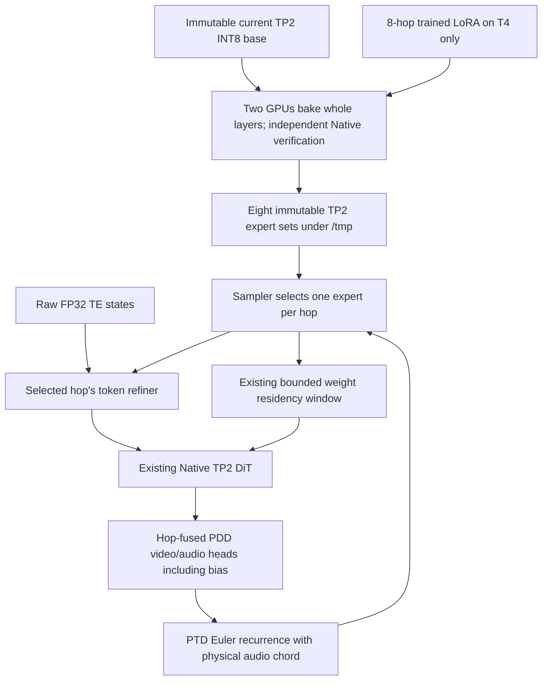
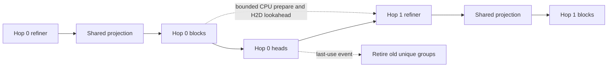

# Optional PTD RefAsymOPD adaptation for TP2

This branch adds an adapter for `MiniMax-H3-Ref2VA-PTD-RefAsymOPD-8Step.safetensors`.
The existing Native H3, Native sampler choices, attention operators, FP16-fix
flow and dependency versions are retained. PTD is disabled by default. The
reference source in the user's Downloads directory is read-only.

## Compatibility boundary

The supplied reference rejects the current pruned AdaLN-curve base. At the
user's request, this adaptation keeps that TP2 bundle, but requires
**`allow_pruned_adaln=True`** at both bake and model-adapter admission. This is
an explicit approximation; matching tensor shapes does not establish matching
generation semantics. Strict mode rejects the current bundle. This branch
does not replace Native block math with the reference's non-curve math.

The provided `schedule.py` is retained verbatim, including its warning that
the `.999` endpoint is derived and not yet verified against the Diffusers
scheduler. T4 operator success must not be described as full PTD quality
qualification. A future matched-reference generation comparison is needed.

## Data path

For each DiT layer, a GPU worker reads both base shards once, reconstructs a
full projection, merges one hop's factors using the existing Native LoRA
formula, independently verifies it, performs the original full-width INT8
ConvRot quantization, and then splits it into the two owners. Layer ownership
is divided between the two GPUs. One bounded writer per GPU overlaps durable
shard output with the next merge. Shards and manifests are hash-bound and
published atomically after all eight expert sets are complete. Interrupted
partial shards can be admitted and resumed when their bake recipe matches.

Unchanged auxiliary weights remain shared with the immutable base. Each hop
stores only its adapted token-refiner projections and its effective video and
audio heads as an overlay. No LoRA factors or CPU remerges are needed during
sampling. Eight experts live on disk; the ordinary residency window holds
only the bounded working set on GPU. `hop_handoff=queue` retains one Native
shell and window, appending the next expert's refiner, shared projection,
DiT blocks and full output heads to the ordered plan. Old unique groups retire
after their last recorded CUDA use; preparation/H2D of future groups can overlap
the current tail. Readers carry distinct hop identities and reuse the admitted
base's immutable metadata. Overlay hashing is deferred to the CPU preparation
that first consumes it, with unchanged-file checks before and after hashing.

There is no unconditional window close, device synchronization, GC or allocator
flush at a queued hop boundary. The ordinary byte/free-memory guards still
apply, including event waits or a guarded foreground reclaim under pressure.
Sampling exit drains once before releasing auxiliary CPU ownership and restores
the ordinary base reader. `hop_handoff=rebuild` retains the original explicit
teardown/reconstruction path for comparison.

Per-hop refiner preparation loads the baked matrices into the existing Native
FP32 projection format and applies the same output-weight division as Native
FP16-fix construction. Shared norms keep their already-folded epsilon once.
Large pageable refiner groups transfer their host-cache reservation to the
window until H2D completes, avoiding a second multi-GB pinned copy. This does
not promise asynchronous DMA from pageable storage or zero idle time.

## Details that must survive adaptation

* Q, K and V retain independent A factors. B is zero-padded into the appropriate
  third of Native fused QKV; a shared A approximation is not used.
* The first SwiGLU projection permutes Diffusers `[up, gate]` into Native
  `[gate, up]` before merging, including in the token refiner.
* The 32 PDD heads are full heads, with biases. Four trained intervals are
  fused for each of eight hops using separately normalized video/audio dt.
  They are serialized as one ordinary Native head, avoiding Native's distinct
  "head zero plus offsets" PDD interpretation.
* Text refinement runs for every hop. Raw TE FP32 states travel in Native's
  existing payload dictionary, avoiding an early FP16 cast of TE outliers.
* The sampler carries FP32 physical video/audio states. Audio uses the analytic
  3/12 relative clock and a per-hop chord ratio, applied at the FP32 audio-head
  output before Native latent-storage casting. A private model-sampling clone
  uses physical audio export scaling; ordinary model objects remain untouched.
* Exactly eight ordered calls, CFG=1, the complete trained sigma grid, pure
  noise initialization and no denoise mask are required. Unsupported grids,
  another Turbo/online LoRA, changed files and incomplete banks fail explicitly.

## ComfyUI graph

1. Use the existing TP2 loader with the current pre-sliced base and **no other
   LoRA stack**. Keep its MODEL, CLIP and `MINIMAX_TP2_SESSION` outputs.
2. `MiniMaxH3TP2PTDBake`: enable explicitly; provide the base descriptor and
   `/tmp/h3_ptd_refasymopd`; choose `download_on_t4` or an existing T4-local
   checkpoint. Enable the pruned-base approximation. Connect the session to
   release its previous TE/DiT window before baking. Reuse the published bank
   for subsequent requests.
3. `MiniMaxH3TP2PTDAdapter`: connect the original MODEL, session and bank;
   enable PTD and its approximation consent.
4. `MiniMaxH3TP2PTDSampler`: connect the adapter's controller; feed its SAMPLER
   and SIGMAS to Native advanced sampling, with CFG=1 and empty generated
   latents. Keep Native reference image/audio conditioning. The release card
   recommends a reference-image short edge of 768; set this explicitly in the
   existing reference-preparation nodes. This adapter does not silently resize
   images or alter Native reference policy.

| Switch | Default | Meaning |
|---|---|---|
| Bake `enabled` | false | No download or bake when disabled |
| Adapter `enabled` | false | Returns the exact input MODEL and no controller |
| `allow_pruned_adaln` | false | Required explicit consent for this base approximation |
| `use_hop_refiner` | true | False is a deliberate base-refiner ablation |
| `use_pdd_heads` | true | False is a deliberate base-output-head ablation |
| `audio_chord_correction` | true | False is a deliberate audio-clock ablation |
| `hop_handoff` | queue | Persistent bounded queue; rebuild is the explicit teardown comparison |
| `stream_weights` | true | False requests a resident **active** expert, with VRAM admission |
| `future_cache` | true | Complete-sequence CPU reclamation with consumer event protection; prerequisite for P1 |
| `prefetch_refiner` | true | Bounded next-hop CPU lane; can be disabled; requires future cache |
| Sampler `enabled` | true | When false, returns connected Native sampler/sigmas by identity |

Refiner/head/audio algorithmic ablations do not implement the trained PTD recipe.
They exist for controlled experiments, not as quality-equivalent settings.
The model remains private to the adapter; disabling it does not mutate the
original MODEL or change global Native functions. Disabling the PTD sampler
requires reconnecting the original Native MODEL too; a PTD MODEL deliberately
rejects calls outside its PTD sampler.
The resident-expert ablation (`stream_weights=False`) requires the explicit
`rebuild` handoff. Queue mode keeps ordinary group-by-group streaming.

## Storage and delivery

The full release is 11,112,893,024 bytes. It is pinned to HF revision
`d1f88c89c352e7751b56b5f32c7b657fb3e0f2c5`, SHA256
`6796802b9150110a3cd7f66891c9e6190502a432c30b0fa1aa299724cfc15cc3`.
No LoRA payload is downloaded locally. Full-file delivery checks both size
and digest on T4. Source identities are recorded in
`patches/ptd/reference_sources.json`.

Eight INT8 expert sets require roughly eight times the DiT block storage plus
eight refiner/head overlays, in addition to the shared base and LoRA download.
The current public bundle's metadata gives a conservative **170.18 GiB bank
estimate**, or **184.53 GiB free space** including the release download and
reserve (shared base storage is additional if not already present). These are
storage estimates, not measured written sizes; floating refiner overlays may
use less than the conservative four-byte-per-element allowance.
`disk_plan()` estimates this from the actual base header, with a 4 GiB safety
reserve, and admission rejects insufficient free space **before downloading**
the full release. `/tmp` is disk-backed storage and is ephemeral; it is not
assumed to have unlimited capacity. Resume admission currently conservatively
requires the complete bank's free-space estimate again; it may reject a nearly
full disk even if some partial shards are reusable.

## Qualification, not yet a quality claim

`benchmarks/run_ptd_tp2_t4.py` has a CPU import/signature preflight and a bounded
physical two-T4 qualification mode. The latter tests mapping, masks/grid
rejection, disabled-object identity and audio clocks, then downloads only real
trained DiT blocks 0–1, both refiners and the full head banks. Immutable HTTP
range receipts explicitly state that a subset hash does **not** verify the
complete release's SHA256. This fixture bank is prohibited from production
admission. It performs all eight Native TP2 denoiser calls on small seeded
operator inputs, validates finite outputs and ordered expert selection, and
separates AOT preparation from hop execution. The handoff experiment reuses one
bake in rebuild/queue/queue/rebuild order, hashes both stream outputs at every
hop and the final FP32 carry, and checks stable shell/window identities in
queue mode. It records selection RPC time, denoiser RPC time, benchmark-only
worker wall/thread CPU spans, peak CUDA allocation/reservation and host RSS snapshots. Default-stream CUDA
intervals include waits and idle gaps; they are not a kernel-time breakdown or
a substitute for a Nsight trace. It does not execute TE, VAE or a
complete H3 generation and does not measure output quality.

The adaptation audit also found the AOT RMS-RoPE plan used 128 rotary features
while Native H3 uses 96 of its 128 head features. The plan and its rehearsal
consumer now use 96; the underlying qualified operator and Native math are
unchanged. Previous 128-feature preparation traces cannot establish a 96-feature
cache hit. T4 version 2 confirms SM75 preparation of the corrected 96/128 layout;
this receipt does not prove zero runtime first-use work.

The bounded physical comparison completed all four eight-hop cases with
byte-identical video/audio outputs and final FP32 state. The queue reduced
mean selection-plus-denoiser RPC time by 24.2%, while retaining more CPU cache
and leaving substantial preparation waits. These small-fixture results do
not qualify full-model speed or quality. See the
[physical comparison report](../reports/H3_PTD_QUEUE_T4_20261029.md).

Kaggle uses the frozen source archive, native Torch/CUDA family, Kitchen
0.2.37 and TileLang 0.1.13. No upstream update, token, private activation,
dataset mount, status polling or live-log polling is required for this test.

References: [release card](https://huggingface.co/taobao-content-ai/MiniMax-H3-PTD-RefAsymOPD-LoRAs),
[pinned PTD inference source](https://github.com/vita-epfl/PTD-inference/tree/65e593ff0cb0e68f885caa412cdd1c4c6cb08e6b).

P0 future-use reclamation and P1 refiner prefetch are **on by default** in the
adapter, graph node and newly generated E2E configurations. Set
`prefetch_refiner=False` to disable P1. Disable both for the rebuild control.
Its physical fixture improved mean RPC latency but worsened maximum hop time;
see the [measured results](../reports/H3_PTD_CPU_SCHEDULING_T4_RESULTS_20261029.md).

Only the original monolithic auxiliary layout is implemented. It is hash-checked
once per hop reader at first tensor consumption, with signature checks on later
reads. The FP32 sidecar and P2 Split implementation, switches and experiment
launch paths were removed at the user's request; the historical measurements,
submitted capsules and receipts remain as experiment records. Old Split banks
require their archived runtime or a new monolithic bake. See the
[cleanup and validation record](../reports/H3_PTD_RUNTIME_CLEANUP_20261029.md).

The subsequent user-requested P1 promotion and remaining DiT memory priorities
are recorded in the [VRAM fusion/lifetime analysis](../reports/H3_DIT_VRAM_FUSION_ROI_20261029.md).
