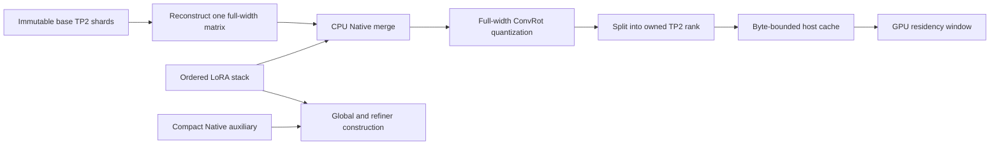

# TP2 bundle offline LoRA and worker profiling — 2026-10-23

The pipeline can now prepare offline LoRA directly from the existing base TP2
bundle. It does not create a complete merged checkpoint or publish LoRA-specific
weights. The experiment is designed to compare Kitchen with Scalar Sparse
attention using the same bundle preparation and real 51,220-token conditioning.
GPU version 1 did not complete that comparison.

**Validation status:** 61 CPU tests pass from the corrected isolated source
capsule and on Kaggle CPU. The first CPU capsule omitted a required benchmark
assertion change and is superseded. The corrected CPU version 2 completed in
121.81 seconds. Kaggle accepted GPU version 1 of
[`pamcks/h3-dit-scalar-single-profile`](https://www.kaggle.com/code/pamcks/h3-dit-scalar-single-profile)
at 2026-10-23 23:39 Beijing time. Its 67 final artifacts were collected once on
2026-10-24. The minimal worker capture gate passed on real dual T4s, but the
Kitchen NFE exceeded the 600-second worker deadline after host block scopes
0–27. Scalar Sparse did not start. There is no valid attention performance
comparison or resolved Norm/Residual CPU root cause.

The [aggregate record](../data/bundle_scalar_worker_profile_20261023.json)
contains source identities and experiment status. Raw local evidence is under
`D:/attention_eval/bundle_scalar_profile_20261023/`.

## GPU version 1 result — collected 2026-10-24

The source binding and all 67 downloaded artifact hashes were verified locally.
Actual hardware was two distinct Tesla T4s, SM75. GPU Torch was 2.11.0+cu128,
CUDA/compiler 12.8, Kitchen 0.2.37 and TileLang 0.1.13. Setup completed in
107.60 seconds. The execution supervisor exited with an error after 1,693.52
seconds; this is failed-job wall time, not DiT latency.

| Stage | Result |
|---|---|
| Minimal worker capture | Passed; four lifecycle cases took 25.94 s in total |
| Immutable base bundle / auxiliary delivery | Completed |
| Real TE/reference input preparation | Completed in 262.02 s |
| Exact-shape trained-block warmup | Completed; returned rank-0 receipt reports 53.82 s |
| Kitchen one-NFE control | Failed on the 600-s TP-worker command deadline |
| Scalar Sparse one-NFE | Not started because the control failed |
| Resident observer-overhead replay | Not reached |

Conditioning and both initial-noise hashes match the preceding L1/Kitchen
workload exactly. The reported failure is a timeout; there is no OOM exception
in the returned failure path. The host trace shows both workers entering
`block_compute` for blocks 0 through 27, followed by weight acquisition for block
28. This establishes progress through 28 host compute scopes, not completion of
28 GPU blocks or a completed denoiser output. CPU on-demand preparation and
other host work remain within this command deadline; their separate costs have
not been established by a valid complete profile.

The minimal test now gives direct lifecycle evidence:

| Exit / flush case | Worker CUDA correlation |
|---|---|
| Forced termination, no explicit flush | Failed; required CUDA tables missing |
| Forced termination, explicit flush | Passed; four kernels per worker on separate GPUs |
| Graceful exit, no explicit flush | Passed; four kernels per worker on separate GPUs |
| Graceful exit, explicit flush | Passed; four kernels per worker on separate GPUs |

The main NFE timeout took the existing service's exception path:
`PhysicalTPService.call()` called `abort()`, which terminated both workers before
the benchmark's orderly close/flush could run. Both exit codes are -15; no
worker flush receipts were saved. A local SQLite export of the raw report
contains 21 parent CUDA kernels and **zero worker CUDA kernels**. Consequently,
the main trace remains incomplete. No Systems kernel-latency attribution or
Kitchen/Scalar speedup is reported. Export used the already installed local
Nsight Systems 2026.1.3; collection used 2025.1.1.0. This conversion did not run
workloads on the local GPU or change the Kaggle environment.

The selected-call CPU profiles also fail validity checks. Eleven of twelve
`.pstats` files contain negative times or individual self times exceeding the
profile total. For example, rank 1 residual call 50 reports a negative total
of -451.78 s. Disk/cache functions appear among the captured calls. These data
must not be interpreted as operator CPU cost. The remaining one profile passing
basic arithmetic checks does not validate the profiler as a whole. The exact
profiling-clock/thread mechanism needs a concurrent CPU-only reproduction;
the original roughly 0.5-s/call host anomaly remains unresolved.

The forced exit also prevented final CPU stack/call-summary JSON files from
being written. The observer-overhead replay was after the NFE and did not run.
The next attempt needs CPU profiler qualification on native Python 3.13,
incremental durable progress/CPU evidence, trace flushing before failure
cleanup, and a benchmark deadline that accounts for measured bundle preparation.
Increasing the timeout alone would not fix the missing evidence.

Reproducible local analysis and the exported coverage diagnostics are in
`analysis_v1/analyze.py`, `partial_diagnostics.json` and `verified_results.json`
under the evidence directory. No retry or additional GPU job was submitted
during this collection.

## Loading without a baked-model upload

The base weights remain at the immutable HF revision
`cnmds/minimax-h3-tp2-int8-561a6211@d3e6a4b131056d2c626a01acf6ba48123a885783`.
The 200 shards contain both ranks of 50 TE and 50 DiT blocks. Their total size is
44,032,850,400 bytes, or 41.01 GiB. They contain base weights, not baked DMAD.

`patches/tp2_bundle.py` opens an explicit JSON checkpoint descriptor. It verifies
the complete bundle plan, source identity, auxiliary checkpoint, shard file
hashes and Native tensor proofs. A compact auxiliary checkpoint supplies the
startup, vision, global and refiner tensors that block shards do not contain.
Those bytes are fetched from immutable source ranges and verified against the
locally constructed plan.

| Component | Delivered bytes | Contents |
|---|---:|---|
| TE block shards | 24,398,037,600 | Rank-owned transformer weights |
| DiT block shards | 19,634,812,800 | Rank-owned base transformer weights |
| TE auxiliary | 2,746,396,392 | Native tensors outside transformer blocks |
| DiT auxiliary | 1,602,311,528 | Native global/refiner/final tensors |

LoRA remains a separate input. Changing the adapter or strength changes the
preparation identity without replacing the public base bundle. The current
comparison uses the previous fixed adapter to retain workload continuity; it
does not upload that adapter or any baked output. Reference encoding needs the
Video VAE separately. There is no audio encoder or decoder in this experiment.

QKV and FC1 reconstruction preserves component packing. Attention output and
FC2 concatenate their input columns. Row-parallel scales are shared across the
full input width. LoRA is merged before quantization and rank splitting. This
avoids the different operation of quantizing independent shard-local updates.

Only one full-width matrix is merged at a time. Preparation workspace is charged
to the existing shared host budget; prepared blocks use the bounded host cache.
The implementation records `persistent_baked_bytes=0`. Cache eviction can cause
another CPU preparation, and each rank can reconstruct the same full matrix;
this first implementation trades preparation work for avoiding a persistent
merged model. Preparation speed and cache misses must therefore be reported
separately from attention execution.

The explicit descriptor path selects this behavior. Existing safetensors paths
and the legacy GPU offline baker retain their existing behavior. `offline_store`
is kept distinct from the online `lora_store`, preventing a second adapter
application during inference. Runtime FP16 folds follow block preparation.

## Numerical boundary: CPU baking differs from GPU baking

Five trained targets were checked locally: block 0 QKV, attention output, FC1 and
FC2, plus block 49 FC2. All five reconstruct the base weights exactly and match
an independently evaluated CPU Native merge/quantization formula exactly.

CPU and GPU baking nevertheless differ: four of the five INT8 payloads differ,
and all five scale tensors differ. Block 0 FC2 is the only checked INT8 payload
that is equal across devices. These are actual measured differences, not a
claim that one device is a more accurate reference.

Consequently, the old GPU-baked Kitchen profile is historical context. The new
experiment must run a fresh Kitchen control with the same CPU-prepared bundle
and adapter as Scalar Sparse. Neither local formula equality nor a finite
single denoiser output establishes generation quality. No full trajectory or
semantic/temporal quality acceptance is claimed here.

The trained checks used local Torch 2.12.1+cu132 and an RTX 5060 Ti. They establish
the loading contract only; they are not T4 performance measurements.

## Worker capture must pass before model downloads

The [previous single-call profile](DIT_SINGLE_CALL_PROFILE_20261023.md) completed
on two T4s, but Systems contained parent CUDA kernels and worker NVTX without
worker CUDA kernels. That trace cannot support DiT kernel attribution. Immediate
worker termination before CUPTI flush is a hypothesis, not an established cause.

The new gate runs the same four tiny additions in each GPU worker under four
lifecycle combinations:

| Worker exit | Explicit CUDA synchronize / profiler stop | Purpose |
|---|---|---|
| Terminate | No | Reproduce the suspected old lifecycle |
| Terminate | Yes | Isolate explicit flushing |
| Graceful | No | Isolate orderly process exit |
| Graceful | Yes | Required successful protocol |

The gate verifies numerical output, two distinct worker PIDs, two distinct GPUs,
and correlated CUDA kernels inside each worker's named NVTX scope. It runs before
weight downloads. Missing Nsight Systems or failed graceful/flushed capture
blocks the expensive stage and leaves an explicit diagnostic artifact.

The real DiT worker flushes before acknowledging close, and the parent allows
workers to join before cleanup. The actual trace must also show kernels in all
50 block-compute scopes per rank. Raw reports, SQLite exports, coverage records,
worker flush receipts and exit codes are retained.

This layer-coverage check is necessary but does not alone prove every kernel is
attributable. Final review must inspect dropped-record warnings, CUDA driver API
launches as well as runtime launches, and uncorrelated kernels. The current
automated coverage check uses runtime correlations. No kernel bottleneck claim
should be made from incomplete driver correlation or lost worker records.
Nsight Compute's earlier counter-permission failure remains a limitation; no
new counter evidence is implied by this Systems experiment.

## Norm/Residual host time and observer controls

The earlier roughly 0.5-second host cost per Norm/Residual call is unresolved.
The benchmark now collects evidence inside each worker instead of inferring CPU
work from a parent timeline:

- Python call-stack samples every 10 ms, including the main thread and cache
  threads; sampling gaps expose GIL starvation.
- Per-call wall and thread-CPU time around the complete observed span.
- Thread-CPU `cProfile` records on calls 1, 2, 50 and 99 for each operation, with
  `.pstats` files and function summaries.
- Actual modulation segmentation, allowing the resident operator replay to use
  the same segmentation and `[51220, 5376]` FP16 residual shape.

After the NFE, the model is released before a resident Norm/Residual replay.
Three counterbalanced repeats compare observer-off, NVTX-only, CUDA-events-only,
full-observer, sampled-full and profiled-full modes. Outputs must be byte-exact
between modes. Host enqueue, thread CPU and CUDA stream intervals are recorded
separately. Sampler/profiler setup and teardown are outside the timed operator
pair; their per-call instrumentation is inside it.

The observer also has an owner-thread guard. Background CPU weight preparation
must not create CUDA events or GPU NVTX spans. A regression test enforces this.
Whether it explains the earlier anomaly is a question for the new measurement.

Python sampling requires the GIL and cannot resolve an arbitrary native stack.
Selected-call profiling also perturbs the instrumented NFE. The replay quantifies
instrumentation cost; this experiment does not establish steady-state pipeline
latency or p95 request latency.

## Matched two-T4 workload and reproducibility

| Property | Setting |
|---|---|
| Sampling scope | One NFE with Kitchen, one NFE with Scalar Sparse; separate processes |
| Sequence | 51,220 tokens: text 1,182; references 896; audio 1,206; video 47,936 |
| TP2 query shape | `[1, 28, 51220, 128]` per rank |
| Original workload | 896×512, 362 frames, fixed two-image reference and prompt |
| Sampler input | Same seed 20261020 and first Native LCM/simple interval |
| Other operators | FP16-fix, `fused_stored`, scaled FP16 SUM transport |
| Residency | 6 GiB GPU window/rank; 3 GiB host cache/rank; 16 GiB shared host budget |
| GPU reserve | 9 GiB/rank for the DiT workload |
| Full pipeline / media | Not run |

Conditioning/reference preparation happens once, outside the measured DiT
processes. Both backends receive the same serialized inputs. Backend counters
must prove all 50 attention calls use the requested path; a silent Kitchen
fallback in the Scalar run fails validation. Sparse routing/preparation/execute
phases are named separately.

Source and core dependencies remain frozen. Kaggle retains its native Torch
family; Kitchen 0.2.37, TileLang 0.1.13 and ComfyUI commit
`d49e888586dd8ae012c0667b33466b815fee07f7` remain pinned. The CPU host reports
Python 3.13.15 and Torch 2.11.0+cpu; these are not the eventual GPU environment
receipt. The GPU gate requires two actual T4s, SM75, native Torch 2.11.0+cu128 and
the preinstalled CUDA 12.8 compiler, and records actual versions.

All 119 runtime/benchmark file hashes in the corrected CPU receipt match the
local source. The corrected source capsule SHA256 is
`66e7b8a92aac750c7f8849f09f3914edc09e4158b66b07700152f9ab59643d82`,
published at immutable commit `cd49dbe63347d31fbddd78f9ef504f3d6f6b3560`.
The frozen ComfyUI archive and exact core wheel lock are unchanged.

There are zero Kaggle Dataset/kernel-output mounts. No status/list/live-log
polling is used. Final outputs are collected once after completion; no timed
collector is started. GPU submission acceptance, successful capture, completed
DiT execution and a valid performance conclusion are distinct milestones.

## Packaging regression caught before GPU submission

CPU version 1 passed its tests, but the final source audit found that
`build_dit_profile_delivery.py` refreshed the batch launcher without refreshing
`run_h3_l1_current_e2e.py`, whose `CurrentRank` base class still rejected a
bundle-offline adapter stack. No GPU job used that capsule.

The builder now includes that file. A new test constructs the worker with an
offline bundle stack and verifies acceptance, while an ordinary online stack is
still rejected. All 61 tests pass from the corrected isolated archive and the
Kaggle CPU environment. The old
publication and CPU outputs are retained as superseded evidence.
