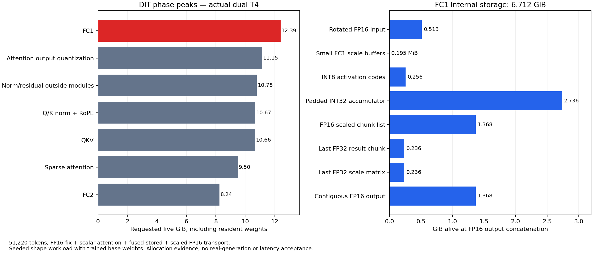
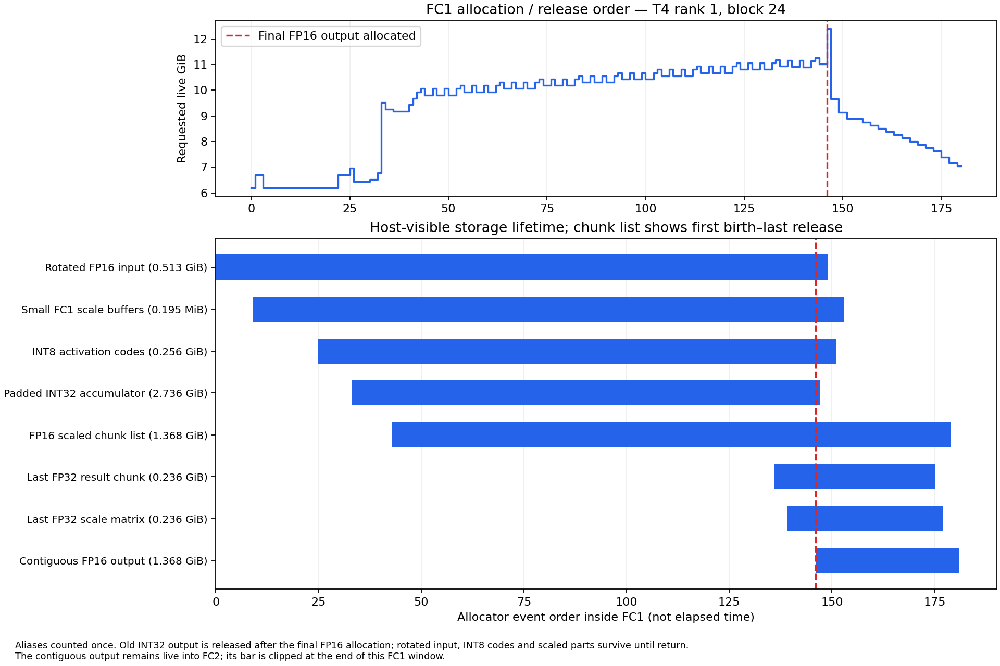

# DiT memory profile at 51,220 tokens — actual dual T4

The read-only profile completed all **50 DiT blocks on both physical Tesla T4s**.
The largest measured PyTorch allocated peak was **12.427 GiB**. FC1 is the
largest activation/temporary peak: **6.712 GiB inside one rank's FC1** at its
final FP16 concatenation, excluding its caller's inputs and resident weights.
The main avoidable overlap is the full INT32 accumulator, the accumulated
FP16 chunks and the newly allocated contiguous FP16 output.

This is a memory diagnosis and proposed plan. No optimization, runtime default,
dependency or frozen production source was changed. Candidate work remains paused.

The subsequent [lifetime-only implementation and validation](DIT_TEMPORARY_LIFETIMES_20261023.md)
is recorded separately; the measurements on this page remain the original baseline.

**Scope limitation:** the old failed E2E run did not save its 51,220-token DiT
inputs. This probe used deterministic synthetic inputs with the exact recorded
shapes and native packing, and original trained base weights without offline
LoRA. It completed successfully; it does **not** reproduce or invalidate the
previous real offline-LoRA E2E OOM. Neither this probe's success nor its measured
headroom establishes E2E safety.

## Execution and evidence

| Item | Recorded configuration/result |
|---|---|
| Job | [h3-dit-memory-51220](https://www.kaggle.com/code/pamcks/h3-dit-memory-51220), version 1 |
| Hardware | Two distinct Tesla T4 devices, SM75; UUIDs in the evidence record |
| Software | Native Torch 2.11.0+cu128 / CUDA 12.8; Kitchen 0.2.37; TileLang 0.1.13 |
| Source | Frozen ComfyUI and current TP2 source capsule; no upstream update |
| Operators | FP16-fix, scalar sparse attention, fused-stored FC2, scaled-FP16 transport |
| Work | Refiner, packing/projections and one DiT NFE at sigma 1; all 50 blocks |
| Excluded | TE, VAE, sampler loop, generation and optimization candidates |
| Delivery | Immutable, hash-verified source/model; zero dataset or kernel-output mounts |
| Qualification | Separate CPU v2: 23 frozen-runtime tests plus three profiler checks |
| Collection | One final collection; 40 artifacts verified by size and SHA256; no status/log polling |

CPU v1 exposed an omitted existing analyzer module in the profiler bundle after
its frozen-runtime tests passed. The corrected bundle passed CPU v2 before
GPU submission. No core-package or production-source change was used to fix it.
The GPU run had a 240-second setup and 600-second execution watchdog, with a
900-second outer CLI limit. Its one DiT evaluation took 296.4 seconds **with
tracing, snapshots, JIT and evidence-export overhead**. This is not steady-state
performance evidence.

The [machine-readable record](../data/dit_memory_51220_20261023.json) binds
source, submission, qualification, result, analysis and chart hashes. Full local
evidence is under `D:/attention_eval/dit_memory_51220_20261023/`:

| Path within evidence root | Purpose |
|---|---|
| `gpu_output_v1/dit_memory/result.json` | Device/version records, completion and allocator counters |
| `gpu_output_v1/dit_memory/gpu_memory/rank{0,1}/002_denoise_nfe1.json.gz` | Raw continuous allocation/free histories, stacks and shape observations |
| `gpu_output_v1/dit_memory/gpu_memory/rank{0,1}/checkpoint_*` | Crash-safe FC1 boundary snapshots at blocks 0, 24 and 49 |
| `lifetimes_v2/` | Corrected storage lifetimes, CSV/JSON, live sets and plots |
| `report_v1/profile_summary.json` | Compact measured totals and completeness limits |

`lifetimes_v1` is preserved as an earlier analysis, but final conclusions use
v2's timestamp-correct residency classification and explicit marker-cap handling.

## Shapes and accounting boundary

Inputs were text `[1,1182,5120]`, video `[1,24,107,32,56]`, audio
`[1,32,2,603]` and two reference images `[1,24,1,32,56]` each. Native packing
produced the following segments:

| Segment | Tokens | Half-open offsets |
|---|---:|---|
| Text | 1,182 | 0–1,182 |
| Image 1 | 448 | 1,182–1,630 |
| Image 2 | 448 | 1,630–2,078 |
| Audio | 1,206 | 2,078–3,284 |
| Video | 47,936 | 3,284–51,220 |

One rank's FC1 input is `[51220,5376]`, weight `[14336,5376]` and FP16
output `[51220,14336]`. Sparse attention does not reduce these FFN rows.
The INT8 matmul pads its accumulator to **51,232 rows**; accounting for only
51,220 rows slightly underestimates its actual backing storage.

| Memory metric | Rank 0 | Rank 1 |
|---|---:|---:|
| PyTorch maximum allocated | 12.425 GiB | 12.427 GiB |
| PyTorch maximum reserved | 14.217 GiB | 14.314 GiB |
| Requested live bytes replayed from events | 12.392 GiB | 12.392 GiB |

Requested bytes exclude allocator block rounding/reuse slack, explaining the
roughly 35–36 MiB difference from allocated counters. Reserved memory includes
cached allocator segments and is not all live tensors. These are per-process,
per-rank metrics, not a sum across GPUs or a measurement of every driver/NCCL
allocation. NVML samples are retained separately.

## FC1 allocation and release sequence

At representative rank 1, block 24, these **distinct backing allocations** are
simultaneously live when `torch.cat(scaled_parts, dim=0)` allocates the result:

| Internal buffer | Live GiB | Allocation / last consumer / actual release |
|---|---:|---|
| Padded INT32 accumulator | 2.736 | Allocated by INT8 GEMM; last read in the scale loop; released only after the new concatenation output is allocated |
| FP16 scaled chunk list | 1.368 | Built over 11 chunks; consumed by concatenation; list retains chunks until eager linear returns |
| Contiguous FP16 output | 1.368 | Allocated by concatenation; returned to caller and consumed by FC2 |
| Rotated FP16 input | 0.513 | Produced before input quantization; its local variable/view retains storage through eager return |
| INT8 activation codes | 0.256 | Produced by row quantization; last consumed by GEMM; retained through eager return |
| Last FP32 result chunk | 0.236 | Converted from accumulator slice; remains referenced after its scaled FP16 result is stored |
| Last FP32 scale matrix | 0.236 | Broadcast row/channel scale product; remains referenced after chunk multiplication |
| Small scale buffers | 0.000191 | 204,880 bytes; retained through the call |
| **Internal total** | **6.712** | Excludes caller residual/input, model state and resident weights |

The current eager expression `result = torch.cat(...)` evaluates the entire
right-hand side before rebinding `result`. Consequently the old INT32 `result`
cannot be released before the FP16 destination is allocated. Chunking the
FP32 scaling avoids one full FP32 output, but accumulating FP16 pieces and then
concatenating still duplicates the entire FP16 output at this boundary.

The trace also establishes the surrounding lifetimes:

- QKV's `[51220,10752]` FP16 allocation is **1.026 GiB**. Its Q/K/V views share
  that storage. At all six checked rank/block combinations (0, 24, 49), its
  host release and allocator `free_completed` precede the FC1 boundary. The
  release stack points to the existing attention-stage `del` in
  `patches/tp_dit.py`. The large QKV output does not leak into these FC1 peaks.
- The caller's modulated-norm input `h2` stays live during FC1 and is released
  by `del normed_x2, h2` immediately after FC1 returns. Its lifetime is separate
  from the rotated copy inside eager linear.
- `mlp_act = fc1_out` is an alias, not another 1.368 GiB allocation. The stored
  FC1 output survives into FC2's SwiGLU/quantization stage.
- Allocator free request, `free_completed`, and release of cached reservations
  are recorded separately. A Python `del` alone does not imply a driver free.

## Weight loading, retirement and the next bottleneck

The runtime window changes how much weight storage overlaps identical FC1
temporaries. Measured FC1 concatenation live sets are:

| Rank / block | Total requested live GiB | Resident weight GiB | Relevant residency |
|---|---:|---:|---|
| 0 / 0 | 10.984 | 3.164 | Refiner/condition group still resident |
| 0 / 24 | 10.929 | 3.109 | Refiner group evicted; 17 DiT shards |
| 0 / 49 | 10.929 | 3.109 | 17 later DiT shards |
| 1 / 0 | 8.003 | 0.183 | One DiT shard; no refiner group |
| 1 / 24 | 12.392 | 4.572 | 25 DiT shards |
| 1 / 49 | 12.392 | 4.572 | 25 later DiT shards |

The rank-0 early refiner/condition group is 3,193,044,992 bytes, about
2.974 GiB. It is already evicted by blocks 24 and 49. Explicit retirement after
refinement can improve early headroom, but **does not independently remove
2.974 GiB from the eventual peak**: the residency cache later fills with DiT
weights. Each prepared DiT shard is 196,346,880 bytes, about 187.25 MiB.

Measured phase maxima below include resident weights and surrounding live
buffers, rather than being isolated operator workspace sizes. Phase coverage
is complete until the verbose marker cap described below.

| Phase | Requested live peak GiB |
|---|---:|
| FC1 | **12.392** |
| Attention-output global quantization | **11.150** |
| Norm/residual outside projection scopes | 10.782 |
| Q/K normalization and RoPE | 10.674 |
| QKV projection | 10.656 |
| Sparse attention | 9.501 |
| FC2, fused-stored / scaled transport | 8.244 |

The attention-output quantizer appears under the shared observer scope
`AttentionO/FC2_global_quantizer/row_global_quantizer`; it belongs to attention
O preparation here. It is not the MLP FC2 row above. Once FC1 is reduced below
that phase, the approximately **11.15 GiB** peak becomes the next target under
the same residency. FC1 workspace savings therefore cannot simply be
subtracted from the overall peak. A larger cache may also absorb freed space.

## Why FC1 is using the eager path

The pinned Kitchen CUDA extension is available and reports cuBLASLt support.
The frozen `ComfyUI/comfy/quant_ops.py` explicitly disables Kitchen's CUDA
registry backend when `torch.version.cuda < 13`. This job's native CUDA build
is 12.8, so generic Kitchen INT8 linear dispatch uses the eager implementation.
The allocation stacks confirm `comfy_kitchen/backends/eager/quantization.py`.
This is a dispatch-policy effect, not evidence of a mismatched Kitchen version
or missing extension. The plan preserves the current pins and global guard.

## Proposed FC1 reduction plan — not implemented

1. **Shorten temporary lifetimes in a scoped column-linear adapter.** Release
   the rotated input and its view after quantization, codes after GEMM, and
   chunk/scale temporaries at their last consumers. Release the full INT32
   accumulator after the last scaling chunk and **before** final concatenation.
   Preserve the caller input and online-LoRA consumers. Keep the same ConvRot,
   INT8 GEMM, per-row scaling, FP32 operation order and FP16 rounding boundaries.
   This removes the measured accumulator/output overlap without changing
   arithmetic. Earlier loop peaks still exist, so 2.736 GiB eliminated at
   concatenation is not a promise of 2.736 GiB lower overall peak.

2. **Write the dequantized result into one preallocated FP16 output.** Replace
   the FP16 chunk list and concatenation with a TileLang dequantization
   epilogue, retaining the original INT8 GEMM and INT32 accumulator. Broadcast
   scales in the kernel instead of storing full FP32 scale matrices. Preserve
   the eager sequence: FP32 row-scale × weight-scale, then FP32 accumulator ×
   that product, then FP16 storage rounding. At these shapes, accumulator plus
   output require about **4.10 GiB**, before small scales/workspace. This is a
   storage budget, not an optimized T4 measurement. The shared column path can
   also serve QKV after separate equivalence checks. Leave the installed pinned
   Kitchen library untouched.

3. **Use row-chunked FC1 only if the remaining peak is still unacceptable.**
   Try 2,048/4,096-row GEMM tiles and one output allocation to bound INT32
   workspace. This adds launches and may reduce GEMM efficiency, so benchmark
   it after steps 1–2. More aggressive FC1→SwiGLU/quant streaming could remove
   the full stored FC1 output, but it must preserve its FP16 rounding boundary
   before FP32 SwiGLU and maintain collective order. It is a later candidate,
   not required to fix the proven lifetime overlap.

4. **Calibrate residency against the measured temporary envelope.** Retire
   GPU refiner state after its last use while retaining canonical CPU state.
   Reserve shape-dependent activation/workspace headroom before admitting more
   weight shards, including allocator/external memory margin. Do not rely on
   `empty_cache()` per layer or global synchronization to manufacture savings.
   Re-profile attention O after FC1 improvements because the peak will move.

Validation should remain at operator/DiT level: compare the scoped path
byte-for-byte with the current eager path on fixed weights and inputs, including
33/513-row tails and full 51,220-row FC1/QKV shapes; verify INT32 outputs and
FP16 rounding separately; then collect warmed repeated timings separately
from allocation tracing. Re-run one DiT evaluation to observe cache growth and
the next peak. No new full H3 generation is needed for this memory plan.

## Completeness and limitations

Both ranks have complete allocator histories: **39,356 / 38,884 events**, zero
unknown frees, zero missing timestamps and no 50,000-event truncation. Shape
observation at blocks 0/24/49 records 1,569 observations per rank with no drops.
Verbose line markers reached their 12,000-record cap during block 37;
allocation/free histories continue through all 50 blocks. Late detailed phase
labels are unavailable and are not carried forward from block 37.

All 50 FC1 and 50 QKV final outputs per rank are identified from their exact
storage sizes, eager concatenation stacks and execution order. Blocks 0, 24
and 49 are independently checked using before/after FC1 snapshots. Saved
prefix events are validated structurally against the final history; PyTorch
recalibrates timestamps on each snapshot, shifting earlier timestamps by
roughly 4–16 microseconds, so final-history timestamps are used consistently.
Five offline analyzer tests cover alias accounting, host/CUDA release
separation, address reuse, failed allocations and time-correct weight residency.

These records establish a concrete FC1 lifetime failure mechanism and memory
budget. They do not establish the exact external allocation/fragmentation
history of the earlier failed offline-LoRA E2E run, generation fidelity or a
latency improvement.
