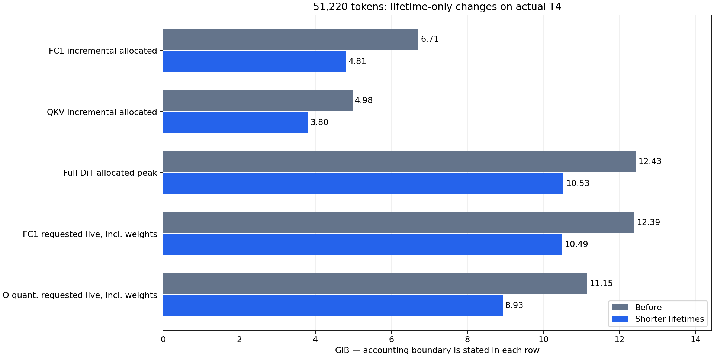

# DiT temporary lifetime reduction at 51,220 tokens

This change shortens temporary ownership across the DiT without changing
ConvRot, INT8 GEMM geometry, row scales, reduction codecs, activation arithmetic
or storage-rounding boundaries. It follows the
[actual T4 lifetime diagnosis](DIT_MEMORY_51220_20261023.md).

**Completed on actual 2×T4:** notebook version 2 finished all 50 DiT blocks on
both ranks. Maximum allocated memory fell from **12.427 to 10.526 GiB**, a
**1.901 GiB / 15.3%** reduction. Full-shape trained FC1/QKV outputs are
byte-exact against the pinned eager implementation. Their isolated incremental
peaks fell by 28.3% / 23.6%, respectively, with no demonstrated speed gain.

The immutable source first passed a separate Kaggle CPU gate: **31 tests plus
three profiler checks**. Local validation includes 50 regression tests and
the separate small CUDA block/stream checks below. Frozen ComfyUI, dependency
versions and operator policy defaults remain unchanged.

## Changes and ownership boundaries

| Location | Old lifetime | New lifetime |
|---|---|---|
| DiT QKV input | Normalized/modulated input retained through attention O and its residual update | Released after QKV projection returns |
| DiT Q/K/V and backing QKV | Retained during attention-output promotion, padding, rotation, quantization and projection | Released immediately after attention returns, before attention O |
| QKV/FC1 eager rotated input | Retained until eager linear returns | Released after row quantization, including its flattened view |
| QKV/FC1 eager INT8 codes | Retained through scaling and concatenation | Released after the unchanged full GEMM |
| QKV/FC1 FP32 scale chunks | Last chunk and scale matrix remained referenced through concatenation | Released at the end of each scale-loop iteration |
| QKV/FC1 INT32 accumulator | Survived allocation of the contiguous FP16 result | Released after the last scaling chunk, before concatenation |
| DiT FC1 output | Two aliases retained storage during the MLP residual update | One owner, released immediately after FC2 returns |
| Attention O packing input | A separate contiguous temporary survived full-width rotation | Released after padding is populated |
| Scaled-transport row path | Caller retained quantized codes despite a helper's `del q` | Caller performs GEMM and releases codes before encoding/reduction |
| Fused FC2 / native fallback | Additional input/code/gather references survived their consumers | Metadata saved separately; unused local references dropped after preparation/GEMM |
| Native token refiner attention | Q/K/V retained through output projection | Released after native SDPA, before output projection |

The new `patches/dit_column_linear.py` adapter asks the pinned Kitchen registry
which backend the original call would use. It schedules lifetimes only for
the **existing eager implementation**. Accelerated backends, autograd, compiled
calls and Tensor subclasses keep Kitchen's public operator. No registry flag
is changed, and the installed library and frozen ComfyUI remain untouched.

The eager path deliberately retains the original scale-loop chunk size and
final `torch.cat`. This experiment isolates lifetime scheduling from the later
single-output/fused-epilogue proposal. Weight/activation scaling multiplication
order and FP16/BF16/FP32 output casts are unchanged. LoRA remains outside the
base projection, with the original caller input available to its adapter.

## Local operator preview — SM120 only

The preview uses trained block-0 rank-0 FC1/QKV shards, fixed seeded FP16
inputs `[51220,5376]`, two warm-up calls and three measured repetitions.
Each comparison retains identical inputs, weights and GEMM dimensions. Output
bits are compared in CPU chunks after memory measurement, so a retained GPU
reference output does not inflate the candidate's measured peak.

| Operator | Before incremental allocated GiB | After GiB | Median latency before / after |
|---|---:|---:|---:|
| FC1, output width 14,336 | 6.713 | 4.811 | 140.16 / 139.80 ms |
| QKV, output width 10,752 | 4.978 | 3.803 | 110.32 / 110.30 ms |

Both operators have **zero unequal storage values and zero nonfinite values**.
The latency differences are small and do not establish a speed improvement.
The intended benefit here is lower temporary memory with the same arithmetic.

The first local attempt to map the full 20 GB safetensors file terminated in a
Windows storage access violation before an operator ran. That attempt is
preserved. The successful preview uses the existing `CheckpointReader` to read
only the owned ranges; it does not alter the loader, model or environment.

## Actual T4 measurements

The [T4 notebook](https://www.kaggle.com/code/pamcks/h3-dit-memory-51220),
version 2, used two distinct Tesla T4 SM75 devices, native Torch 2.11.0+cu128 /
CUDA 12.8, Kitchen 0.2.37 and TileLang 0.1.13. The candidate capsule SHA256 is
`c2bf6f40d68ca864ae2fd89945e11326be0bc4fadbe23c0872c6d94d0c33345d`.
Frozen-source/bootstrap/core pins match the CPU-qualified archive. Source was
delivered by an immutable GitHub commit, with no dataset/kernel-output mounts
or credentials. One CPU submission/collection and one GPU submission/collection
were used, with no status/list/live-log polling.

The paired column check uses the same trained rank-0 block-0 shards and fixed
seeded FP16 inputs at the full 51,220 rows. First-call time is recorded
separately; two warm-ups precede three measured repetitions per implementation.
No tracing is active in these operator timings.

| Operator | Before incremental allocated GiB | After GiB | Median before / after | Unequal FP16 bit patterns |
|---|---:|---:|---:|---:|
| FC1 `[51220,5376] × [14336,5376]` | 6.713 | **4.811** | 631.69 / 632.80 ms | **0** |
| QKV `[51220,5376] × [10752,5376]` | 4.978 | **3.803** | 483.78 / 488.26 ms | **0** |

Both outputs are finite. FC1 latency differs by +0.18%, QKV by +0.93% in this
three-repeat sample; this establishes a memory reduction, not acceleration.

The DiT-only profile preserves the previous shape/packing, scalar attention,
FP16-fix, fused-stored FC2, scaled-FP16 transport and residency settings. It
includes refiner, packing/projections and all 50 transformer blocks. Per-rank
PyTorch counters are:

| Metric | Rank | Before GiB | After GiB |
|---|---:|---:|---:|
| Peak allocated | 0 | 12.425 | **10.525** |
| Peak allocated | 1 | 12.427 | **10.526** |
| Peak reserved | 0 | 14.217 | 14.203 |
| Peak reserved | 1 | 14.314 | 14.303 |

Reserved memory is still about 14.3 GiB because the caching allocator retains
freed storage. The gain is **lower simultaneous live allocation and more
reusable space inside that pool**, not a demonstrated 1.9 GiB reduction in
driver/NVML peak usage. No per-layer synchronization or cache flush was added.

The event-replayed maxima below count requested live bytes, including resident
weights. They differ slightly from allocated counters because allocator block
rounding/reuse has slack.

| Phase | Before requested GiB | After requested GiB |
|---|---:|---:|
| FC1 | 12.392 | **10.490** |
| Attention-output quantization | 11.150 | **8.928** |
| Q/K normalization and RoPE | 10.674 | 10.161 |
| QKV projection | 10.656 | 9.482 |
| Sparse attention | 9.501 | 8.988 |
| Norm/residual outside projections | 10.782 | 8.559 |
| FC2 | 8.244 | 8.244 |

Both before and after global peaks contain **4.572 GiB of resident weights**.
The reduction therefore does not come from evicting more model weights at
the peak. Peak activation/temporary requested bytes fall from about 7.817 to
5.916 GiB on rank 1. Residency was measured, not assumed to remain constant.

## Returned lifetime evidence

At FC1 concatenation in blocks 0/24/49 on both ranks, internal live storage
falls from **6.712 to 2.736 GiB**. The INT32 accumulator, rotated input and
INT8 codes are all absent at that boundary. The remaining storage is the
FP16 chunk list plus its new contiguous FP16 output. The operator peak moves
earlier into the scale loop, explaining why its overall reduction is 1.902 GiB
rather than the larger saving at concatenation alone.

At all six checked attention-output quantization peaks, QKV storage has already
completed its allocator release. Release stacks point to the earlier DiT
deletion. First-block allocator timestamps place that release about 2 ms after
the O/begin marker, still well before its quantization peak; blocks 24/49 place
it before O/begin. The report uses the observed peak boundary rather than
claiming every first-call event is immediately reusable at the Python marker.
The quantization-phase reduction is about **2.223 GiB**, consistent with
removing the previous normalized input and QKV/Q/K owners from that overlap.

Complete allocation/free histories contain **39,244 / 38,803 events**, zero
unknown frees and no history truncation. Detailed markers now total 4,201 /
4,188, so neither rank reaches the prior 12,000-marker cap. There are 1,569
representative shape observations per rank with no drops. All 50 FC1 and 50
QKV final outputs per rank are identified, and continuous-prefix snapshots
independently validate representative FC1 boundaries.

FC1 remains the largest phase, but Q/K normalization/RoPE is now close behind:
**10.490 versus 10.161 GiB**. A future FC1-only fusion would therefore soon
move the overall bottleneck to that FP32 island. No such fusion is included
in this lifetime-only change.

## Validation and target experiment

The local regression set covers numerical equality over FP16/BF16/FP32,
ConvRot/no-ConvRot and scalar/per-channel scales; weak-reference checks at
last-consumer boundaries; public-dispatch fallbacks; operator policy and LoRA
rounding order; transport selection; tensor-flow contracts; allocator analysis;
and runtime/diagnostic isolation.

Eight additional small CUDA block cases compare against the preserved original
block source: 33/513 rows, legacy FP32/FP16-fix flow, with/without online column
LoRA. All are finite and exactly equal. A nondefault-stream column test also
passes after allocation churn. These small SM120 gates exercise ownership and
call-order compatibility; they are separate from deployment-shape T4 evidence.

The completed target experiment is one bounded **DiT-only** evaluation on actual 2×T4,
using the previous 51,220-token input shapes, base weights, packing, scalar
attention and residency settings. A separate subprocess first checks paired
full-shape FC1/QKV outputs and warmed operator measurements, then exits to
release its CUDA context before the DiT memory profile starts.

Allocation/free histories cover both ranks. Detailed helper-line tracing is
restricted to representative blocks 0/24/49, while DiT boundaries and module
scopes remain recorded across all 50 blocks; this avoids exhausting the prior
verbose marker budget. Before/after FC1 snapshots remain crash-safe. Historical
baseline sources/results are preserved.

The comparison must report temporary storage separately from resident weights:
the window may retain more weights after workspace shrinks. The same principle
applies to the next-largest phase and allocator reservation. Neither a cache
increase nor a lower isolated FC1 peak by itself establishes an E2E OOM fix.

This experiment does not run TE, VAE, sampler trajectories or a full H3
generation. Inputs are seeded shape proxies and weights have no offline LoRA;
the prior real offline-LoRA failure remains a separate acceptance boundary.

Local evidence root: `D:/attention_eval/dit_lifetimes_20261023/`.

The [aggregate evidence record](../data/dit_temporary_lifetimes_20261023.json)
contains source/submission bindings and the measured comparison. Full raw
captures are in `gpu_output_v1/`, reconstructed lifetimes in `lifetimes_v1/`,
and the compact comparison/charts in `report_v1/`. The 274.3-second instrumented
DiT stage is diagnostic; tracing coverage differs from the baseline and its
duration is not a latency speedup measurement.
