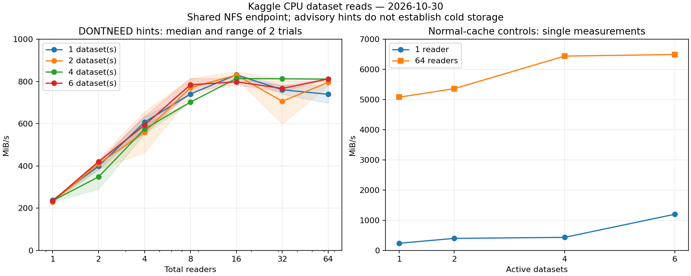

# Kaggle CPU dataset read and upload results — 2026-10-30

The read study completed **74 trials**. Concurrency increased the single-dataset
median from **238.31 to 831.90 MiB/s** (3.49×), but increasing the active dataset
count from one to six did **not** raise the observed approximately 0.8 GiB/s
plateau. All six mounts shared one NFS endpoint and superblock.

The upload retry completed: the native **Python API acknowledged private dataset
creation**, and **KaggleHub acknowledged a version upload** to that dataset.
Neither supplied credentials nor client installation was needed. The CLI arm
failed before upload because the probe invoked a missing module entry point.
Its local correction is regression-tested but has not been uploaded as another
Kaggle job.

These are **CPU-instance results**, not T4 storage measurements. The GPU seed
repeat was not queried or resubmitted during this collection.

## Read throughput

[Read notebook](https://www.kaggle.com/code/pamcks/h3-dataset-read-sweep-cpu-20261030),
version 1, source commit `4f1f599eea823bafc5aa10e738974d5e9b036580`.
The worker exited successfully in **489.40 s**; the sweep itself took **487.94 s**.
The instance reported four CPUs and a four-CPU cgroup quota. No trial reported
an error, RSS guard trigger or scheduling-deadline stop.

| Total readers | 1 dataset | 2 datasets | 4 datasets | 6 datasets |
|---:|---:|---:|---:|---:|
| 1 | 238.31 | 229.72 | 235.38 | 234.70 |
| 2 | 399.00 | 409.30 | 348.68 | 420.42 |
| 4 | 607.45 | 560.28 | 574.94 | 593.60 |
| 8 | 740.78 | 770.92 | 702.42 | 784.68 |
| 16 | **831.90** | **830.63** | **814.28** | 798.60 |
| 32 | 761.01 | 706.23 | 813.23 | 767.18 |
| 64 | 739.41 | 796.14 | 811.33 | **812.44** |

Values are **MiB/s**, medians of two measurements with advisory DONTNEED hints.
The shaded chart ranges are the two observed values, not confidence intervals.



The 74 trials comprise 56 main trials (four cohorts × seven reader counts × two
repetitions), ten additional individual-dataset controls, and eight normal-cache
controls. Cohort order was 512, 768, 1024, 384, 256 and 128; all six contained
32 binary files each, about **19.28 GiB** in total. Per-dataset byte counters
confirm that every active dataset contributed bytes; a larger cohort was not
merely a nominal mount count.

Each trial stopped at 12 seconds, 4 GiB read, or corpus exhaustion. The
single-dataset corpus was only **2.62 GiB** and exhausted before the 4 GiB cap;
the strongest multi-dataset cases read 4 GiB. The trials are therefore bounded
throughput samples rather than equal-duration sustained transfers. The
0.2-second observer interval also contributes visible overhead to subsecond
cache-control trials. Two repetitions and uncontrolled shared-host/backend
cache state do not establish a universal hard upper limit.

### Why more datasets did not improve the plateau

The saved mount table shows all six paths using **NFSv3**, the same server
`192.168.14.2`, the same device/superblock `0:52`, and 524,288-byte NFS read/write
sizes. They have distinct dataset exports underneath a common service path.
Six dataset names therefore did not provide six independent storage paths.

This observation is consistent with the near-identical aggregate plateau,
but does not isolate a service throttle, server storage bandwidth, client CPU
limit or network-link limit. The experiment did not collect CPU utilization,
NFS RPC or link-level attribution sufficient to distinguish those causes.

The useful measured change is **reader concurrency**, especially 1 → 8 → 16.
For this instance, **8–16 total readers** is a reasonable starting point for
subsequent model-shard tests. Increasing to 32–64 readers had no consistent
benefit. There is no evidence here to justify splitting a model into more Kaggle
datasets solely to multiply read throughput. Model-loading, decompression,
weight verification and GPU transfer were not measured.

### Cache and host memory

Normal-cache controls reached **5,080.89–6,495.59 MiB/s with 64 readers**;
the maximum was 6.34 GiB/s. These were single measurements after the main sweep,
not independent cold-read results, and are plotted separately. DONTNEED is
advisory: successful hints neither prove cold reads nor clear remote caches.

| Memory measurement | DONTNEED trials | All trials, including normal-cache controls |
|---|---:|---:|
| Peak reader process RSS | 94.59 MiB | **101.82 MiB** |
| Largest RSS increase over a trial baseline | 60.89 MiB | 60.89 MiB |
| Peak cgroup anonymous memory | 103.74 MiB | 110.97 MiB |
| Peak cgroup file cache | **3.16 GiB** | **7.53 GiB** |
| Peak total cgroup memory | 3.26 GiB | 7.65 GiB |

The maxima are independent sampled maxima, not a single simultaneous accounting
snapshot. Each reader reused one 1 MiB buffer: at most **64 MiB of payload
buffers**, with no payload-bearing futures or full-file accumulation. That
successfully bounded the process heap, but **did not bound kernel file cache**.
The sampled cgroup reported a 30 GiB limit, zero memory-pressure totals, and
zero `pgscan`/`pgsteal` counters throughout. This instance did not exhibit reclaim
pressure; that does not guarantee the same behavior beside H3's CPU weight cache.

For deployment, preserve bounded queues and reusable buffers, and budget file
cache separately from anonymous weight memory. If strict total host-memory
control is required, the next experiment should verify cgroup cache behavior
while consuming real shards under the actual weight-cache budget. The present
study does not establish that DONTNEED alone meets that stronger requirement.

## Upload methods inside Kaggle

[Upload notebook](https://www.kaggle.com/code/pamcks/h3-dataset-upload-study-cpu-20261030),
version 2, source commit `642d3736c49313e615a9657bf53032f1ae06fbfd`.
The worker exited successfully in **17.64 s**. The earlier version's
missing-parent scratch-directory failure remains archived separately.

Native packages: **kaggle 2.0.2, kagglehub 1.0.2, kagglesdk 0.1.37,
requests 2.34.2, httpx 0.28.1**. No libraries were installed or upgraded;
H3, Torch operators and GPU execution were not involved.

| Method | Actual operation and outcome | Wall time | Peak child RSS |
|---|---|---:|---:|
| Kaggle CLI | Invocation failed before an upload request: native package has no `kaggle.__main__` | 1.00 s | 51.82 MiB |
| Python API | `dataset_create_new(..., public=False, convert_to_csv=False)` returned successfully | **7.27 s** | 54.91 MiB |
| KaggleHub | `dataset_upload(handle, folder, version_notes=...)` returned after uploading a version to the acknowledged private API-created dataset | **4.01 s** | 73.61 MiB |

`KAGGLE_API_TOKEN`, `KAGGLE_USERNAME` and `KAGGLE_KEY` were absent both before
and after attached-Secret lookup. Successful API/Hub requests therefore worked
with the notebook's implicit native authentication in this run. No local
credential was transferred and no token was embedded. Exact internal credential
resolution was not instrumented.

The payload was a **16 MiB synthetic random file**, generated on disk using
1 MiB blocks; no H3 weights or captures were uploaded. API creation explicitly
requested private visibility. Hub reused that private handle and also uploaded
the small dataset metadata file. The retained probe is
[`pamcks/h3-upload-api-probe-20261030`](https://www.kaggle.com/datasets/pamcks/h3-upload-api-probe-20261030).
No automatic deletion or publication was attempted.

The API log confirms request return. The Hub log confirms file uploads and
version creation, ending with **“Files are being processed...”**. Dataset
processing completion, visibility readback and downloaded-content integrity
were **not** checked. The local payload SHA256 is recorded in the raw result.
This is a successful request/authentication probe, not a verified large-bank
round trip. Creating a dataset and uploading a version are different operations;
these single timings cannot establish that Hub is faster than the API.

### CLI correction and practical choice

The CLI error was `/usr/bin/python3: No module named kaggle.__main__`.
The corrected local probe loads the installed distribution's **`kaggle` console
entry point** instead of `python -m kaggle`. It also avoids accidentally invoking
another Python environment's executable. A mocked regression test verifies the
entry-point invocation and arguments. **No version 3 was submitted**, so CLI
upload authentication remains unvalidated by this experiment.

For a future disk-backed bake export, the proven starting path is explicit
private creation through the Python API, followed by API or Hub version uploads
after validating the intended method. Keep persisted shards on disk and bound
concurrency; do not stage the entire baked bank in RAM. A representative large
synthetic shard and final readback/hash validation are still needed before
claiming scalable upload throughput or model-bank integrity. No production
upload path or default was changed here.

## Evidence and reproduction

All **18 downloaded files** across read v1 and upload v2 passed byte-size and
SHA256 checks against their download manifests. Executed module hashes and
source bindings match their submission receipts and the named Git commits.
Original submitted sources are retained independently of the local CLI fix.

Read collection first failed with TLS EOF before receiving any files. One
authorized, bounded **artifact-transfer retry** obtained the seven final files;
the original transport error and empty first-attempt manifest are retained.
Upload v2 needed one final collection, obtaining eleven files. No status/list or
live-log polling, automatic resubmission or extra GPU operation was performed.

Raw results:

- [Read v1 result](../data/h3_seed_dataset_batch_20261030/cpu_read/final_v1/dataset_read/result.json)
- [Upload v2 result](../data/h3_seed_dataset_batch_20261030/cpu_upload/retry2/final_v2/dataset_upload/result.json)
- [Recomputed summary and provenance](../data/h3_seed_dataset_batch_20261030/analysis/summary.json)
- [Read curves CSV](../data/h3_seed_dataset_batch_20261030/analysis/read_curves.csv)
- [Batch contract, source identities and earlier failure](H3_SEED_DATASET_BATCH_20261030.md)

Recompute the tables/chart locally without a Kaggle or network request:

```powershell
& C:\ProgramData\miniconda3\envs\comfyui\python.exe `
  benchmarks/analyze_dataset_cpu_studies.py `
  --evidence-root docs/data/h3_seed_dataset_batch_20261030 `
  --output docs/data/h3_seed_dataset_batch_20261030/analysis
```
