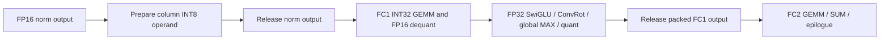

# DiT VRAM: remaining fusion and lifetime ROI

**Conclusion: there is still high-ROI work. Start with explicit ownership
boundaries and small FP32 norm/residual kernels, then bound FC1 accumulator
storage. A larger attention rewrite is not the first step.** This is a source
and retained-profiler analysis, not a new GPU measurement or an implementation
of the proposed kernels.

P1 next-hop refiner prefetch is now **on by default and can be disabled**.
`future_cache` also defaults on because P1 requires it. PTD itself remains
disabled until explicitly selected. The graph node, `PTDOptions`, generated E2E
plan and omitted-plan-field fallback agree. `prefetch_refiner=False` disables
P1 while retaining P0 reclamation; disable both for the rebuild/baseline control.
The benchmark controls now set those fields explicitly, so promotion cannot
silently change the baseline experiment. Sidecar and Split remain deleted.

## Evidence that applies, and its limits

- [51,220-token lifetime experiment](DIT_TEMPORARY_LIFETIMES_20261023.md):
  stage-wise release reduced measured maximum allocation from 12.427 to
  10.526 GiB, with unchanged resident weights at the peak. Those repairs are
  already integrated; they are not new savings to claim again.
- [59,134-token paired DiT calls](H3_DIT_PAIR_VAE_CUDA13_RESULTS_20261028.md):
  per-rank peaks were 10.855–11.078 GiB. First rank-0 peak retained the 1.579 GiB
  FC1 result through FC2 end; warm peaks involved QKV/RoPE and 4.393–4.572 GiB
  resident weights. Warm kernel/copy coverage exceeded 98%; this is not evidence
  that more lookahead is needed.
- [Later operator qualification](H3_OPERATORS_AOT_BAKE_BATCH_20261028.md):
  dedicated FP32 RMS-RoPE already reduced the **isolated** 59,134-row fixture
  peak from 5.259 to 2.044 GiB and median time from 78.942 to 12.811 ms on T4.
  Its final FP16 boundary is retained. That work is integrated, so the earlier
  full-DiT RoPE peak does not describe the current implementation exactly.
- [Completed anime E2E](H3_ANIME_REF2VA_E2E_20261027.md) reached 12.57/11.05 GiB
  PyTorch denoiser allocation, but about 15 GiB sampled full-device use.
  Process allocation, reservation and total-device usage must remain separate.

There is no complete current-PTD lifetime trace after every later integration.
The exact new global peak remains unmeasured. The estimates below describe
buffers and overlap opportunities, not promised end-to-end VRAM reductions.
PTD's queue also retires each expert's unique GPU groups at last use, retaining
the shared input projection. Its residency need not reproduce the older
same-expert paired-call totals. Re-measure the activation/residency split rather
than carrying the historical 4.572 GiB weight figure into PTD as a constant.

## Current per-rank geometry

Target: TP2, 59,134 packed tokens, hidden width 5,376, 28 local heads × 128,
local FFN width 7,168. The largest generated-video segment is 54,432 tokens.
All GiB values use 2^30 bytes and exclude padding/allocator rounding.

| Buffer | Shape / type | GiB |
|---|---|---:|
| Residual or normalized input | `[59134,5376]` FP16 | 0.592 |
| Same full tensor promoted to FP32 | `[59134,5376]` | 1.184 |
| FC1 INT32 accumulator | `[59134,14336]` | **3.158** |
| FC1 packed gate/up output | `[59134,14336]` FP16 | **1.579** |
| FC2 stored rotated activation | `[59134,7168]` FP32 | **1.579** |
| FC2 INT8 operand | `[59134,7168]` | 0.395 |
| Packed QKV | `[59134,10752]` FP16 | 1.184 |
| Separate normalized/rotated Q and K | two `[59134,3584]` FP16 | 0.790 |
| Attention output | `[59134,3584]` FP16 | 0.395 |
| Row projection FP32 epilogue output | `[59134,5376]` | 1.184 |

Sparse routing does not reduce FC1's token count. Rewriting another `del` in an
inner helper does not release storage still owned by the calling block or a view.

## Priorities

### 1. Release operands at their actual last consumer — highest engineering ROI

The block currently deletes `h2` after `fc1(h2)` and `fc1_out` after
`fc2(fc1_out)`. The column and row module frames also retain their arguments.
Consequently a helper's `del x` cannot remove those outer owners.

Introduce private prepare/consume boundaries for the offline-baked path:

Potentially releases **0.592 GiB** of normalized input before FC1 accumulation,
and **1.579 GiB** of FC1 storage before FC2 GEMM/transport/epilogue. It does not
remove the FC1 producer's own peak or the FC2 preparation peak. Prepared objects
must own only INT8 codes/scales and shape metadata, without hidden floating
tensor aliases. Preserve stream/event ownership; no per-block synchronization.
Online LoRA needs the original activation unless its own A projection has
already consumed it, so retain its existing path rather than applying this
ownership contract indiscriminately. PTD's offline banks are a good first scope.

For Kitchen attention, the pinned local 0.2.37 exposes
`prequantize_int8_attention` and `int8_attention_from_prequantized`. Its prepared
object explicitly does not retain floating inputs. Split the call in the block,
release **all** packed-QKV/Q/K/V aliases, then consume the prepared object.
Verify the target wheel's API during the CPU gate; do not upgrade dependencies.

This removes **1.974 GiB during attention consumption**, but quantization itself
still needs those inputs. The output is only 0.395 GiB: eliminating its overlap
with floating inputs alone cannot be advertised as a 1.974 GiB reduction of the
attention stage's overall maximum. The unchanged quantization phase may become
its maximum. Keep Native/sparse paths behind their existing dispatch contracts.

### 2. Fuse FP32 stability islands into FP16 stores — high ROI

`modulated_norm` currently materializes FP32 residual input and FP32 RMSNorm
output, applies AdaLN, then casts to FP16. A row kernel can keep FP32 statistics,
epsilon, gain and modulation while writing only the final FP16 destination.
Comparing two full FP32 arrays with one FP16 destination gives a **1.776 GiB
phase-local opportunity**. PyTorch/internal workspaces and the actual allocation
timeline still need measurement. Preserve the folded epsilon and cast boundary;
matching the algebra does not guarantee the same reduction rounding.

`gated_add` currently promotes residual and branch slices and creates a separate
FP32 `addcmul` result before FP16 copy-back. On the largest video segment, the
three FP32 arrays total **3.270 GiB** at the add's output allocation. The later
FP16 cast is a different lifetime boundary and must not be added blindly.
A small in-place FP32-compute/FP16-store gate kernel avoids these full arrays.
It has simpler arithmetic than a normalization reduction and is a good first
fusion candidate. Verify the current GPU FMA behavior and segment mapping.

Then fuse row dequantization with the gated residual update for O and FC2.
Current transport emits a full FP32 result, the row module casts it to FP16,
and the residual update promotes it again. An offline-only fused epilogue can
remove the **1.184 GiB FP32 destination** and intermediate branch storage.
It must still perform the existing FP16 branch rounding in registers before
FP32 gate/residual arithmetic. Skipping that cast changes the operator. Retain
INT32 reconstruction, row-scale/weight-scale order and existing FP16 SUM.
Keep the current path for online LoRA's FP32 post-projection addition.

These proposals overlap; their byte counts are not additive savings.

### 3. Bound the FC1 INT32 accumulator — largest structural opportunity

The current full GEMM still allocates **3.158 GiB INT32**, then a **1.579 GiB
FP16 result**. Earlier concat/lifetime fixes do not eliminate that overlap.

First quantize the full input with the existing geometry and rounding. Process
its **already quantized** rows in bounded GEMM chunks and dequantize directly
into a preallocated FP16 output. At 4,096 rows, accumulator storage is **0.219
GiB**, a **2.939 GiB accumulator-buffer reduction**. If a chunk epilogue cannot
write the destination slice directly, include its extra 0.109 GiB FP16 output
and copy cost. Neither number is a guaranteed global-peak improvement.

Reusing existing INT8 GEMM avoids writing a new Tensor Core kernel. At K=5,376
the signed INT8 product bound fits INT32; retain the same quantized operands,
scales and dequantization order. Chunking the FP16 ConvRot producer too would
change its GEMM geometry and needs separate qualification. Benchmark 4K/8K/16K
chunks: smaller accumulators can cost GEMM throughput and more launches.

Later, combine chunked FC1 dequantization, the **FP16 gate/up rounding**, FP32
SwiGLU/ConvRot and maxima into the existing stored rotated operand. That can
remove the full packed FC1 result as well. Keep one global MAX vector and one
FC2 SUM per block, not one collective per row chunk. This is a second phase,
not the quickest low-risk patch.

### 4. QKV ownership and residency — useful follow-ups

The current fused RMS-RoPE still allocates separate Q/K while V remains a view
of the entire packed QKV allocation. An ownership-qualified in-place Q/K variant
could remove **0.790 GiB**. CTA-local RMS/RoPE reads must finish before writes,
and the original Q/K must have no future consumer. Simply deleting `qkv` cannot
free it while V retains its backing storage. A V clone trades a copy/allocation
for earlier release and needs an actual timeline comparison.

P1 prepares CPU refiners; it is not an activation-memory optimization. Earlier
CPU readiness can affect later GPU prefetch overlap. The two-layer fixture
measured about 0.181 GiB extra peak CUDA allocation with P1; this is not a
long-sequence guarantee. Keep bounded GPU admission and event lifetimes.

Do not increase GPU lookahead to mask memory pressure. Existing adaptive depth
already chooses one or two groups from current headroom. A phase/shape-aware
temporary forecast could delay optional H2D work around FC1/norm peaks while
leaving CPU prefetch active. This is a medium-ROI scheduling follow-up, not a
reason to evict active weights or globally synchronize each block.

## Existing escape hatch and low-ROI approaches

`fused_recompute` already avoids the 1.579 GiB stored rotated FC2 tensor at this
shape, at the cost of recomputing SwiGLU/ConvRot. A smaller T4 fixture measured
about 28% higher row latency; that percentage is not a 59K-token prediction.
FC1 can remain the global peak, so keep `fused_stored` as the speed default and
test recompute only as a measured memory-pressure alternative.

Low priority: another generic `del` sweep, treating `empty_cache()` as a live
tensor reduction, wholesale attention/GEMM rewrites before ownership fixes,
or reducing precision in the established FP32 stability islands. Do not recreate
the deleted sidecar/Split approaches as part of this work.

## Operator-only validation plan

1. On actual T4, replay a current full 59,134-token block with fixed resident
   weights and operator policy. Observe producer/consumer boundaries for FC1,
   FC2, norm, residual, RMS-RoPE and Kitchen attention. Profile actual aliases.
2. Validate prepared operand bytes, scales, projection outputs, segment updates,
   finiteness and storage casts. Run same-stream and copy-stream lifetime tests.
3. Time warmed paired/reversed cases without intrusive observers; measure
   allocation peaks separately. Keep compilation and loading outside timing.
4. Report phase maxima, live activations versus resident/prefetched weights,
   allocated/reserved/device memory, and launch/collective counts. Hold weight
   residency fixed first; then test the normal window so it cannot silently
   refill every saved byte with weights and hide the memory benefit.

No new GPU experiment or full pipeline run was performed for this analysis.
The P1-default change passed **179 existing CPU contracts and 48 targeted PTD
contracts**, including explicit disabling through the graph and E2E plan and
preservation of the rebuild control. These tests do not qualify any proposed
fusion kernel or establish new performance results.
The [size model](../../benchmarks/analyze_dit_memory_roi.py) and
[source-bound calculation record](../data/h3_dit_memory_roi_20261029/memory_model.json)
make the buffer arithmetic reproducible. Actual current global savings and
end-to-end quality remain unmeasured.
