# H3 default promotion: FP16-fix + stored fusion + scaled FP16 SUM

Subsequent 2026-10-22 update: online RowParallel LoRA now defaults to FP32 A
partial SUM, and VAE components load on demand. See the
[combined follow-up](H3_ROW_PARTIAL_REFERENCE_LOADING_20261022.md). The checks
and source identities below describe the preceding fusion/transport promotion.

On 2026-10-22 the user requested promotion of the measured candidate into the
H3 pipeline default. This changes the policy selected by new loader sessions,
Python `RuntimeConfig` callers and the two bundled TP2 workflows. It does not
claim that operator-level validation establishes full generation quality.

| Setting | Current default | Previous selection remains available |
|---|---|---|
| Tensor flow | `fp16`, TE/DiT residual divisor 64 | `legacy` Native FP32 tensor flow |
| FC2 / TE down preparation | `fused_stored` | `owned_fp32`, `native`; `fused_recompute` is a memory alternative |
| Row transport | `tilelang_scaled_fp16` | `tilelang_packed` selects INT32 SUM; `native` retains Native row execution |
| Attention | TE Group32; DiT/Video Kitchen; refiner Native SDPA | Existing dense/drop/scalar choices retained |
| Audio VAE | Native single-GPU FP32 | Audio parallelism remains retired |

## Production computation

```mermaid
flowchart LR
    A[FP16 gate/up producers] --> B[Pack before activation]
    B --> C[FP32 SwiGLU + regular H4 ConvRot256]
    C --> D[Stored rotated FP32 values and group maxima]
    D --> E[Local row MAX and TP2 global MAX]
    E --> F[Shared-scale INT8 quantization]
    F --> G[Original INT8 GEMM / INT32 partial]
    G --> H[Power-of-two FP16 encode and AllReduce SUM]
    H --> I[Fused FP32 reconstruction/dequantization]
    I --> J[FP32 LoRA addition]
    J --> K[One FP16 output store]
```



The TileLang kernel is copied unchanged from the measured experiment into
`patches/tilelang_swiglu_quant.py`; an AST-equivalence regression checks that
identity. Production does not import benchmark modules or install bound-method
experiment wrappers. Policy dispatch is the existing production dispatch.

TE concatenates its gate/up producers before computing their product. DiT uses
its existing packed producer. `fused_stored` retains FP32 rotated activations
until the global scale is known. `fused_recompute` instead recomputes after that
scale exchange. Both preserve regular H4 ConvRot256, including the non-Sylvester
matrix used by pinned Kitchen. Butterfly FP32 summation order differs from the
old SGEMM rotation and is an explicit approximation.

Projection output remains FP32 through online LoRA addition. DiT then casts
once to the residual storage dtype; TE down/O also restore that storage dtype
at their module boundary. Casting before a cancelling LoRA contribution could
overflow even when the final result fits FP16, so a regression tests that case.
Attention-output row projections have no SwiGLU; the scaled backend promotes
their preparation input to FP32, uses its existing quantizer, and applies the
same codec/epilogue. Their kernels are not renamed as fused SwiGLU kernels.

## Defaults, fallback and compatibility

`H3OperatorPolicy()` now selects `row_linear_backend='tilelang_scaled_fp16'`
and `fc2_quantizer='fused_stored'`; `RuntimeConfig` inherits that policy and
already selected `TensorFlowPolicy('fp16', 6)`. Loader schema defaults and
Python signature defaults agree. Existing widget field positions and existing
enum strings are preserved. The workflow builder and both bundled TP2 graphs
explicitly record the new choices. Existing saved graphs with explicit old
values continue to use those values; reselect the new options to migrate them.
Restart ComfyUI to reload the node/module changes.

The measured fused path requires actual SM75, TP2, complete ConvRot256 groups,
FP16/FP32 producer storage, aligned INT8 weights and vector FP32 scales. Guards
run before collectives. Unsupported devices use the supplied Native row path;
when fused preparation is selected, the cast to FP32 happens before SwiGLU.
This protects that product without claiming a TileLang kernel ran on SM120.
Unsupported scaled codec contracts retain the existing INT32 fallback. Errors
after a collective begins still propagate; no rank silently changes algorithms.

The base `swiglu_reduction='native_int32'` setting remains unchanged: it governs
the Native/fallback implementation installed by `optimized_tp.enable`. The
operator policy overrides eligible row transport with scaled FP16. Changing
that base setting to an approximate codec would make fallback behavior unclear.

For the previous policy, select:

```python
operators = H3OperatorPolicy(
    row_linear_backend='tilelang_packed',
    fc2_quantizer='owned_fp32',
)
config = RuntimeConfig(te_path, dit_path, operators=operators,
                       lora_row_partial_reduce=False)
```

This restores the previous operator selection while retaining FP16-fix.
`TensorFlowPolicy('legacy')` additionally restores the old tensor flow. INT32
SUM alone does not make fused butterfly preparation Native byte-exact.

## Evidence and limits

The [physical T4 experiment](FP16_FC2_FUSION_VIDEO_SPLIT_20261022.md) completed
18 configurations on each of two distinct T4s. Stored+scaled row medians were
1.906 ms for TE S353 and 27.727 ms for DiT S6814, versus corrected INT32 controls
of 5.707 and 41.500 ms. Corresponding trained block medians improved 9.1% and
4.7%. These shape-specific results do not establish a full-pipeline speedup.
The small LoRA stress case favored recompute slightly; stored is selected as
requested, not presented as a universal winner.

The exact measured kernel passes the source-equivalence regression. Integration
checks cover dispatcher selection, FP32-before-product fallback, final FP16
storage, LoRA-before-store order, old policy dispatch, UI/service identity,
workflow defaults, and dependency rejection. A separate local SM120 preview
executes the production dispatch for TE down/O and DiT FC2/O on two logical
owners, with exact agreement against each case's independent scaled-codec
reference. That preview is wiring/arithmetic evidence, not physical NCCL or
T4 performance evidence. It uses three synthetic rows per projection, including
a SwiGLU product above FP16 range. See `D:/attention_eval/fp16_fc2_video_20261022/production_default_local_preview.json`.

Final local verification passed **42 focused tests**, plus the existing CPU
policy/UI/cache/residency integration gate. The GPU preview passed all **eight
projection/owner checks**. Historical Native-FP32 comparison runners now select
their previous packed/owned-FP32 policy explicitly, so a future re-run cannot
silently inherit the new lossy default as its reference. Immutable submitted
sources and historical measured results are preserved. The active pinned
ComfyUI checkout's TP2 workflow also records the promoted loader settings;
unrelated user graphs and the Native fallback graph are untouched.

The [promotion evidence record](../data/h3_fp16_fused_default_20261022.json)
separates these local integration checks from the prior physical T4 measurements.

The runtime dependency gate now requires the preserved **Kitchen 0.2.37** and
**TileLang 0.1.13**, matching the successful T4 batch; its stale 0.1.15 demand
was removed. No package, ComfyUI source, local lock, compiler selection or
historical artifact was changed. The GPU compiler gate still requires nvcc 12.8.
Historical `requirements-tp2-operators.txt` remains historical, not an install
recipe for the current default. Native Kaggle Torch is the authorized Linux
profile; its measurements do not qualify the Windows Torch/CUDA ABI on Linux.

No new Kaggle job or full H3 generation was run for this promotion. End-to-end
trajectory/semantic quality and integrated two-T4 latency remain unmeasured.
The Video 261 mismatch remains isolated to its final projection and is not
repaired by changing row preparation/transport. The Audio VAE remains FP32
Native single-GPU decode. Sparse quality policy is unchanged.
