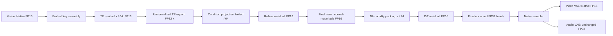

# H3 FP16 tensor flow and weight folding: historical BF16 pairwise checks

**Reference correction:** BF16 is a candidate, not ground truth. The numbers in this historical report are pairwise distances to BF16 and must not be interpreted as error against the Native FP32 tensor flow. The corrected evaluation preserves the current INT8 operators and native dtype islands: [Native FP32-flow comparison](H3_NATIVE_FP32_FLOW_20261021.md). The separate forced-dense-FP32 experiment is outside the requested scope and excluded.

**Subsequent default change (2026-10-21):** FP16-fix is now the loader/runtime
default at the user's request. References below to opt-in FP16 and the legacy
default describe the configuration at measurement time.

**2026-10-21 — implemented as an opt-in runtime route; full-trajectory accuracy remains unqualified.**

Select `tensor_flow=fp16` in `MiniMaxH3TP2Loader`. The experimental TE/DiT residual divisor is **64** (`residual_exponent=6`). Vision and Video VAE decoder gauges default to **1**, preserving their Native FP16 arithmetic. Audio VAE remains FP32. `tensor_flow=legacy` remains the loader default, so existing workflows retain their validated numerical path.

This implements the requested model activation flow across vision, TE, conditioning refinement, DiT and Video VAE. It retains explicit FP32 numerical islands. It does **not** establish production generation quality, whole-trajectory overflow safety, speedup, or T4 qualification.

Implementation: [tensor-flow module](../../patches/h3_tensor_flow.py), [runtime configuration](../../patches/comfy_tp_runtime.py), [loader](../../custom_nodes/minimax_h3_tp2/__init__.py). Aggregate evidence: [32 component cases](../data/h3_tensor_flow_bf16_20261021.json). Raw records and source snapshots: `D:\attention_eval\h3_tensor_flow_20261021`.

## Activation contract

| Stage | FP16 flow | FP32 boundaries retained |
|---|---|---|
| Qwen vision | Native FP16 projections, attention, MLP and residuals; optional residual gauge | Native positional/RoPE construction as defined by the pinned source |
| Qwen text decoder | Scaled FP16 hidden state, Q/K/V, attention and MLP activations | RMS statistics/gains; residual accumulation before storage; embedding assembly and unnormalized conditioning export |
| Condition projection / token refiner | Scaled projection output enters FP16 refiner; Native SDPA; final norm restores normal magnitude | Unnormalized TE input and condition projection until the scaled output is ready; normalization statistics |
| DiT packing | All modalities enter one common scaled FP16 stream | Native latent-row projections, position/time construction and FP32 curve state |
| DiT blocks | FP16 hidden/QKV/attention/FFN storage with folded row outputs | RMS/AdaLN, QK normalization/RoPE, gated accumulation, INT32 GEMM SUM and FP32 dequantization scales |
| DiT output | Native output interface and FP32 head computation | Final statistics/modulation and output heads; Native sampler state/updates |
| Video VAE encoder | Existing Native FP16 computation | Existing Native normalization and public latent/pixel handling |
| Video VAE decoder | Existing Native FP16 default; optional scaled residual stream | Existing public pixel finalization; optional final norm statistics |
| Online LoRA | Adds back to the selected activation dtype | A/B products and post-B scale/add use FP32 in the new route to prevent overflow before a small adapter strength is applied |
| Audio VAE | **Unchanged FP32** | Entire existing audio VAE path |

FP16 tensor flow means the model's activation storage and branch computation use FP16 with these explicit stability boundaries. It does not mean every temporary, integer accumulator, sampler tensor, or exported conditioning tensor is FP16. INT8 checkpoint weights remain INT8.



The refiner and DiT have separate gauges. Refiner final normalization ends its gauge. Packing then divides refined text once; the video/audio input projections have their output weights and biases divided once. Scaling the whole packed result again would double-scale the latent modalities.

## What can be folded

For `y=x/c`, positive power-of-two `c`:

```
RMSNorm_eps(x) = RMSNorm_(eps/c²)(y)
y_next = y + gate * branch(normalized_y) / c
```

LayerNorm has the same input-scale identity, including its original affine bias. Epsilon must remain FP32: for example, `1e-5 / 64²` is below the FP16 subnormal range.

| Location | Implemented compensation | Limit |
|---|---|---|
| TE O/down and DiT out/FC2 | Divide FP32 INT8 dequantization scales by `c` | INT8 bytes are unchanged; scaling occurs before the projection output storage cast |
| Row-projection online LoRA | Divide each adapter's post-B strength by `c` | A/B products need FP32 before that strength can protect their range |
| Condition projection | Divide output weight and bias by `c` | The TE input stays unscaled FP32 until this projection |
| Refiner attention/MLP residual outputs | Fold scales/biases and corresponding adapter strengths | Its final norm uses compensated epsilon and exports normal-magnitude conditioning |
| Video/audio DiT input projections | Divide output weight and bias by `c` | Packed text is scaled separately, exactly once |
| TE embeddings and DeepStack injection | Explicit division at decoder entry | A shared unnormalized export/assembly contract makes blind embedding-weight edits inappropriate |
| TE conditioning export | Explicit FP32 multiplication by `c` | Casting the restored physical magnitude to FP16 can recreate overflow |
| Optional vision gauge | Patch projection, position embeddings and residual outputs; compensated block/merger norm epsilons | Off by default; no overflow benefit established by the bounded image probe |
| Optional Video decoder gauge | Input projection, register tokens, attention/FFN outputs and biases; compensated block/final norm epsilons | Off by default; it changes the existing FP16 output numerically |
| Encoder GroupNorm → SiLU → Conv | Retain existing Native FP16 path | A scale cannot be blindly moved through SiLU; no new encoder residual gauge is enabled |
| Per-channel norm gain in ConvRot | Retained as a separate norm | A nonuniform gain does not commute with Hadamard rotation; folding generally needs inverse rotation and requantization |

Thus, **the important residual output scalars can be folded, but not every FP16-fix boundary can become a weight edit**. Epsilon, public unnormalized TE export, cross-stage packing and nonlinear boundaries still need explicit treatment. Dynamic AdaLN scale/shift/gates are not replaced with constant weight folds.

Scaling expands overflow headroom. It does not improve FP16 mantissa resolution or prevent small residual updates from rounding away. Larger divisors also increase underflow risk.

## Integration and ownership

`TensorFlowPolicy` is immutable and participates in runtime/session and residency identities. Folds happen after checkpoint/rank-local/offline load and LoRA attachment, on private prepared modules. Checkpoint files, offline rank manifests and cached startup source tensors are not edited.

The same policy reaches normal TE/DiT streaming, idle TE preloads, canonical preprocessing leases, parent Video VAE component loads, idle encoder preloads and worker decoder replicas. Token tags, references, masks and Native packed-layout construction remain intact.

The public Comfy model adapter must preserve large TE states before `condition_proj`. Simply switching `get_dtype_inference()` to FP16 would cast those states too early. The adapter refines FP32 conditioning first and then lets Native construct its conditions/layout from the already-refined FP16 tensor. Tests verify that this performs one refinement and retains Native layout and metadata.

Debug capture and statistics live in `benchmarks/`. The runtime exposes ordinary cast/normalization operations; it does not import profiling tools or write tensors.

Existing FP32-only TileLang packed-row, transport and fused SwiGLU specializations can fall back to Native implementations for FP16 inputs. Attention policy choices remain available. No new SM75 FP16 specialization or speedup is claimed here. Sparse dropping/scalar-pooling behavior has not been retuned or accepted through L1/L2 thresholds.

## BF16 reference and experiment protocol

- Local RTX 5060 Ti, SM120, BF16 hardware support; frozen conda `comfyui`, Torch `2.12.1+cu132`, Kitchen `0.2.37`, TileLang `0.1.13`.
- Pinned local ComfyUI `d49e888586dd8ae012c0667b33466b815fee07f7`; source hashes and all 94 locked package versions validate. No dependency or upstream update.
- BF16 means actual BF16 operator inputs/outputs, verified by hooks; it is not an FP32 result cast afterward. Existing INT8 model weight/activation-quantization semantics are retained.
- DiT references retain explicit FP32 AdaLN curve parameters. The pinned mixed-precision Linear factory ignores per-layer constructor dtype when loading dense weights: blindly using its BF16 factory would also round the intended FP32 AdaLN weights. Final curated probes construct the reference so that this island stays FP32 while branch inputs/outputs are BF16. Earlier diagnostic records remain preserved separately.
- Video references load checkpoint values directly into BF16 execution without an intermediate FP16 conversion. The decoder reference verifies all 36 legacy Kitchen attention dispatches. Candidate weights are freshly reloaded after the reference.
- Primary block comparisons use Native BF16 attention. DiT also records a Native Kitchen BF16 reference, a matched-runtime BF16 control, an SDPA-attention ablation, and a BF16 norm/modulation/residual-rounding ablation. These prevent all measured differences from being attributed solely to storage dtype or weight folding.
- Each TP block configuration runs one warm-up and two measured-output executions, with identical inputs and rank equality/repeat checks. Instrumentation adds synchronization, so these are **accuracy experiments, not latency measurements**. Other components are bounded accuracy/ownership probes.
- Two logical ranks run on one GPU with simulated collectives. This checks ownership and arithmetic, not physical NCCL/PCIe transport.

The real DiT fixture reconstructs the first block input from retained H3 conditioning, reference latents and initial noise: **7,895 × 5,376**, with 417 text, 266 reference-image, 300 audio and 6,912 generated-video tokens. Its retained workload was 512 × 512, 90 frames, seed 20261013. It is **not** a new capture of the original 640 × 352 request or of later denoising steps.

TE uses 257 seeded synthetic tokens. DiT layer-24/49 probes reuse a 513-token subset of the first-block input; TE layer 49 reuses the synthetic input. These are trained-weight stress probes, not the native distributions of those late layers.

## Results and decisions

Relative L2 below is a numerical diagnostic, not a perceptual or generation acceptance gate.

| Probe | Selected FP16 result against BF16 | Observed decision |
|---|---:|---|
| Real DiT block 0, S7895, divisor 64 | **0.6884%**, finite | Unscaled FP16 has one nonfinite output; retain residual fix |
| DiT layer 24, reused S513 input | 4.6659%, finite | Distribution is not native; substantial numerical difference remains unqualified |
| DiT layer 49, reused S513 input | 2.8156%, finite | Divisor 16 still produces one FC2 nonfinite; divisor 64 removes it in this probe |
| DiT block 0 + online DMAD LoRA, S513 | 1.0221%, finite | Tests folded post-B strengths and FP32 adapter arithmetic |
| TE layer 0, synthetic S257 | 0.3286%, finite | Gauge 64 is finite; BF16 TP control is exact against Native BF16 |
| TE layer 49, synthetic S257 | 3.9366%, finite | BF16 TP control is exact; FP16 difference remains, with little change between divisor 1 and 64 |
| Real conditioning projection + two refiner blocks | 0.7244%, finite | FP16 output and Native SDPA retained |
| Real all-modality packing | 0.2834% after gauge restoration, finite | FP16 shape is [7895, 5376]; both logical ranks receive identical data |
| Vision, Tokyo image, bounded 65,536-pixel preprocessing, all 27 blocks | 3.3019% merged output | No nonfinite observed; keep gauge off. DeepStack differences are 1.1681%, 1.8594%, 2.6261% |
| Video encoder, synthetic 1-frame 32×32 input | 0.2774%, finite moments | Preserve existing FP16 encoder |
| Video decoder, all 36 blocks, synthetic [1,24,1,4,4] latent | 1.8671%, finite raw pixels | Default remains byte-exact to existing Native FP16 on this probe |

The optional divisor-16 Video decoder fold differs **1.5039% from the existing FP16 decoder**, while remaining finite. Its 261-token query-parallel result is byte-exact to its own folded Native decoder. This does not justify changing the default. The optional vision fold changes its FP16 merged output by 0.3504%, also without an established overflow benefit.

Underflow is measurable. Dividing the real first-block input by 64 before FP16 storage turns **42 nonzero values into zero** and stores **104,709 FP16 subnormals** among 42,443,520 elements. The largest observed single cast inside that block loses 39 nonzero values. Event counts include instrumented warm/repeated calls and both logical ranks; they must not be summed and presented as one forward's unique loss count. Fused Native internals are not exhaustively instrumented.

The late-layer differences cannot be explained solely by the gauge: unscaled finite low-precision controls already show similar differences in the layer-24 and TE-layer-49 stress probes. BF16 controls, attention matching and rounding ablations also differ in DiT. Their raw records expose that residual uncertainty; there is no claim that one approximation explains all of it.

**Recommendation:** use the new route for further component qualification with TE/DiT divisor 64, Native FP16 vision/Video VAE and unchanged FP32 audio VAE. Keep the legacy workflow default until actual TE/DiT trajectories and output quality have been evaluated. A finite sampled probe is not a universal range guarantee.

## Reproduction and validation boundary

From the repository root, use the existing environment:

```powershell
& C:\ProgramData\miniconda3\envs\comfyui\python.exe benchmarks/run_h3_tensor_flow.py dit --tokens 0 --output D:/attention_eval/new_flow/dit.json
& C:\ProgramData\miniconda3\envs\comfyui\python.exe benchmarks/run_h3_tensor_flow.py te --tokens 257 --output D:/attention_eval/new_flow/te.json
& C:\ProgramData\miniconda3\envs\comfyui\python.exe benchmarks/run_h3_tensor_flow.py frontend --output D:/attention_eval/new_flow/frontend.json
& C:\ProgramData\miniconda3\envs\comfyui\python.exe benchmarks/run_h3_tensor_flow.py runtime --output D:/attention_eval/new_flow/runtime.json
& C:\ProgramData\miniconda3\envs\comfyui\python.exe benchmarks/run_h3_tensor_flow.py vision --output D:/attention_eval/new_flow/vision.json
& C:\ProgramData\miniconda3\envs\comfyui\python.exe benchmarks/run_h3_tensor_flow.py video --output D:/attention_eval/new_flow/video.json
```

`--layer 24/49` selects a stress layer, `--lora PATH` attaches a matched Native/candidate online adapter, and `--exponent 6` controls frontend/runtime probes. Block screens always include BF16, unscaled FP16, divisor 16 and divisor 64. Inputs default to retained local files identified in the raw records.

`summarize_h3_tensor_flow.py` validates completed records, source hashes/snapshots, selected finite block probes, preprocessing equality and Video gates before exporting the 32-case aggregate. Corrected and failed preliminary records remain under the same artifact root; they are excluded by an explicit file list rather than silently overwritten or treated as accepted results.

Validation completed: **79 focused unit/regression tests**, the existing four-case GPU operator wiring gate, and the existing 36-layer legacy Video query-parallel equality gate. The latter records 36 Native and 72 logical-parallel attention calls. The new tests cover Native Llama DeepStack/export boundaries, affine LayerNorm epsilon handling, private weight folds, post-B LoRA overflow, cache identity and public conditioning/layout handling.

No full H3 pipeline, sampler trajectory, generated video/audio comparison, Kaggle submission or T4 GPU experiment was run. SM75 TileLang FP16 behavior and frozen-stack Linux ABI remain unqualified; local fallback results must not be substituted for that evidence. No end-to-end latency, peak-memory or generation-quality improvement is claimed.
