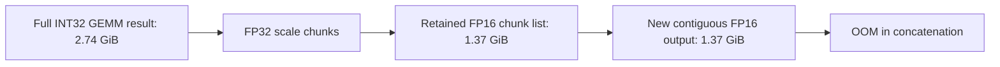

# Current-infrastructure long-sequence REF2VA retry

Status: the zero-mount **version 2** replacement ran on two actual SM75 T4s and
**failed at FC1 in the first denoiser call**, before any completed sampling step.
The private
[H3 L1 Current Offline E2E](https://www.kaggle.com/code/pamcks/h3-l1-current-offline-e2e)
job replaced version 1 after the user stopped it. It uses the separately CPU-qualified
[GitHub/direct-pip bootstrap](KAGGLE_LIGHT_DELIVERY_20261022.md), with frozen
source and preserved core pins. Final artifacts were retrieved once after the
bounded window and all 23 downloaded file sizes/hashes were verified. The
[submission/source receipt](../data/h3_l1_current_offline_e2e_20261022_submission.json)
preserves the original inputs, code hashes and version-1 upload history. The
[delivery record](../data/kaggle_light_delivery_20261022.json) binds the version-2
replacement. The workload and production operators are unchanged by delivery.

The user's 2026-10-22 request explicitly authorizes this full H3 run, superseding
the earlier operator-only restriction for this experiment. Other queued operator
experiments and historical sources/results are preserved. No Kaggle status,
list or live-log polling is used.

## Returned version-2 result

| Stage | Result |
|---|---|
| Hardware / core libraries | Two distinct Tesla T4 UUIDs, SM75; native Torch 2.11.0+cu128 / CUDA 12.8, Kitchen 0.2.37, TileLang 0.1.13 |
| Offline LoRA baking | Completed in 352.04 s; 208 independently verified Native targets; both baking devices recorded |
| TE and reference encoding | Completed in 147.80 s; actual conditioning `[1,1182,5120]`, finite |
| Reference-demand VAE | Video encoder read 360,747,328 bytes; Audio encoder read zero bytes |
| Packed DiT sequence | 51,220 tokens: 1,182 text + 896 image-reference + 1,206 audio + 47,936 video |
| First sampler call | Failed after 52.89 s, including refinement and compilation; no completed denoiser output or sampler step |
| Failure | FC1 Kitchen eager GPU implementation, `torch.cat(scaled_parts, dim=0)`; requested another 1,468,579,840 bytes (1.37 GiB) with 896.75 MiB free |
| Output media | None; sampling did not reach the latent-save or decode boundary |

The complete execution worker, including model downloads, baking and failed
generation, took 1,375.79 s. These cold stage measurements are not steady-state
inference latency. Input preparation is no longer silent: the returned source,
hardware, model checksums, bake receipt, stage logs and memory samples identify
the executed path. They do not establish why the earlier cancelled jobs stalled.

The [result record](../data/h3_l1_current_offline_e2e_20261022_v2.json) binds the
download manifest and individual evidence hashes. Rank 0 recorded a 12.57 GiB
allocator peak and 13.88 GiB reserved peak during the failed denoiser command.
NVML sampling reached 15,643,967,488 bytes on GPU0. These have different scopes:
NVML includes other allocations/processes; allocator peaks describe one rank.

## Allocation mechanism and targeted candidates

The failing per-rank FC1 has input `[51220,5376]` and INT8 weight
`[14336,5376]`. The selected eager orchestration still executes on GPU. It
materializes a **2.74 GiB INT32** result, retains **1.37 GiB FP16** scaled chunks,
then requests another **1.37 GiB FP16** output for concatenation. Chunking only
the FP32 scaling loop does not bound that accumulated output lifetime. This
allocation fails even with offline LoRA: no online adapter was attached.

The log proves the eager implementation was selected; it does not record its
registry eligibility decision. Kitchen CUDA extension/attention availability
alone cannot prove the fused INT8-linear path is eligible. The next operator
probe records the selected backend and `HAS_CUBLASLT` availability explicitly.
No dependency upgrade is used to change dispatch.

Two **benchmark-only** candidates now exist in
`benchmarks/bounded_column_int8.py`:

1. Preallocate the final output and write scaled chunks into it, releasing each
   temporary immediately. This retains the original full ConvRot and GEMM
   geometry and FP32 multiplication order.
2. Call the unchanged pinned Kitchen operator in 4,096-row chunks and copy each
   result into one preallocated output. This also bounds INT32 GEMM workspace,
   but changes GEMM geometry and requires device-specific equality validation.

Three CPU tests pass. At this FC1 shape, a local **SM120** screen using trained
block-0 weights and an RMS-normalized/repeated retained input template found
zero differing values and no nonfinite values for both candidates. Temporary
allocator increments were **6.71 GiB** baseline, **4.85 GiB** preallocated
epilogue and **2.41 GiB** bounded rows. These are local operator results, using
unbaked component weights and a shape proxy; they do not qualify T4, reproduce
the failed trajectory, or establish a generation speedup. Raw timings and
limitations are in the [local record](../data/h3_bounded_column_local_20261022.json).

Production source/defaults and submitted operator version 3 remain unchanged.
The next gate is CPU qualification of the new experiment source, followed by
a bounded T4 column-operator check before another expensive E2E retry. Removing
this allocation does not guarantee every later FC2/decoder stage will fit.

The experiment source is published at immutable GitHub commit
`78507fb524eff738b06c999c70ce15be07f7e590`; its archive SHA256 is
`a403e7ffeac991d6c5a04dd065836dd7abfc0c073007621db842bf57b5903c2a`.
All existing production runtime bytes, frozen ComfyUI bytes and core locks
match the version-2 source. Only three benchmark files and their CPU test
registration were added/changed. CPU-only qualification was accepted as
`pamcks/h3-light-cpu` version 2, with zero mounts and no GPU. Its execution
is pending; the original passed CPU version 1 still qualifies operator v3.

## Fixed workload and current runtime

| Item | Selection |
|---|---|
| Output | **896×512**, 362 frames, 24 fps (~15.08 seconds) |
| Previous L1 output | 864×480; the retry has 10.62% more pixels/frame |
| Prompt/references | Previous superhero/mechanical-dragon prompt and the same two named reference-image URLs; frozen image sizes and SHA256 hashes are embedded and enforced on download |
| Sampling | Seed 20261020; 4 LCM steps, simple scheduler, CFG 1; video/audio shifts 12/2 |
| LoRA | DMAD strength 1, revision `439136a1dd4f435b8137a084f73d558d2cecda2a`; offline Native merge only |
| Tensor flow | Current FP16-fix, residual divisor 64; Audio VAE remains FP32 |
| TE / DiT attention | Group32 / scalar sparse; the prior L1 scalar policy is preserved as an explicit override to the current Kitchen DiT default |
| Row preparation / transport | `fused_stored` / `tilelang_scaled_fp16`; original INT8 GEMM |
| Residency | 6 GiB rank weight cap, 9 GiB activation reserve, normal 2-layer lookahead; idle preload disabled as in L1 |
| Video / Audio VAE | Demand-loaded components and current Video query/native fallback; Audio Native single-GPU decoding |
| Source/dependencies | Frozen legacy ComfyUI `d49e888586dd8ae012c0667b33466b815fee07f7`; Kitchen 0.2.37, TileLang 0.1.13; reviewed native Kaggle Torch profile |

Native temporal packing yields 107 generated video latent frames. With a 32×56
latent spatial grid and the Native 2×2 patch, the generated-video segment has
**47,936 tokens**. Actual expanded TE/reference/audio contributions and total
sequence length are recorded at the attention consumer; no synthetic padding
is added to realize a target count. Increasing resolution changes reference
resizing/conditioning and noise shapes, so this is not an identical-input
performance comparison with the old L1.

## Offline baking and memory boundaries

The converter assigns complete layers across both T4s. It merges each matrix
in Native FP32, verifies the result against the independent ordinary A/B
formula, and requantizes the full input width before TP sharding. All **208**
active targets must pass; the receipt must identify both baking devices.
Offline merging/requantization is a different numerical model from the online
LoRA bypass and is not claimed byte-identical to it.

The original DiT and LoRA are downloaded into this invocation's private
temporary cache. After the baked checkpoint is verified and hashed, that
temporary download cache is released before TE/VAE downloads. Canonical local
checkpoints, historical artifacts and shared caches are untouched. Peak scratch
admission checks account for both the bake phase and the final model set.

Inference receives only the baked DiT path and an empty online LoRA stack.
Worker reader state and executed adapter counters must confirm no online LoRA.
This removes the former QKV online-B allocation mechanism; it does not guarantee
that every other allocation at the larger resolution will fit. Runtime memory
admission remains enabled; OOM/nonfinite/deadline failures remain failures.

Only the Video encoder is loaded for the image references. Both VAE constructors
must initially read zero component payload; the Audio encoder remains unloaded.
Encoders are released at sampling entry. Decoders load on demand afterward.

## Execution, progress and evidence

The version-2 setup worker has a separate **900-second** outer deadline covering frozen
source verification/extraction, exact direct-pip core installation and API
gates. No dependency resolver, package upgrade or upstream clone is allowed.
The core source hashes must match the already passed current-source CPU receipt;
native GPU Torch must match the reviewed profile and nvcc must be 12.8. Two
distinct SM75 T4 identities are required.

The download/bake/generation worker has a **4,800-second** outer deadline.
Baking is capped at 1,800 seconds and the single generation at 2,400 seconds;
the outer limit includes downloads and prevents their independent caps adding
up beyond the execution budget. The requested CLI limit is 6,000 seconds.
Provider boot before notebook execution is outside the code's deadlines.
The Linux CPU qualification passed the watchdog tests as well as source/API
checks; this is separate from the long-generation memory failure.

Notebook output streams stage starts and minute heartbeats; saved logs are
preserved. Compact per-NFE denoiser summaries and per-sampling-step latent/x0
summaries record shapes, dtypes, ranges and finiteness without retaining full
activation payloads. CUDA-event command spans, rank allocator peaks and sampled
NVML/RSS/cgroup usage are separate measurements. Kernel dispatch counters must
show Group32, sparse, fused preparation and scaled epilogue execution.

Sampler video/audio latents are saved **before decoding**, permitting recovery
from a decoder/export failure without another long denoising run. Successful
artifacts include MP4/WAV, tensor hashes, actual token layout, VAE strategy and
loading events, source/environment receipts and the offline merge receipt.

This is **one cold functional/memory-validation request**. Downloading, baking
and service startup are separated from foreground generation. Compilation,
lightweight observations and output export remain in the reported request
boundary. There is no repeated warm-latency distribution, dense Native
generation baseline, Nsight hardware-counter claim or automatic perceptual
quality acceptance. Generated video/audio need review, especially after two
seconds. Prior S1/S2 media and the failed 46,447-token L1 are retained.

Local preparation checks: eight CPU tests passed; all 87 capsule file hashes
and Python syntax were checked; production patch hashes match the prior CPU
preflight. The failed initial local builder attempt was retained separately;
it never submitted or consumed Kaggle GPU time.

The first 8.15 MB notebook upload encountered a connection reset before an
acknowledgement. The user manually confirmed the notebook was absent. The
subsequent compact 375 KB payload was then accepted as version 1; it verifies
and downloads the same reference-image bytes instead of embedding them twice
through the worker encoding. This changes image acquisition only, not the
request or operators. Both upload sources are retained. No automatic status,
list or live-log request was made. Version 1 was stopped by the user; the
version-2 final artifacts and physical failure are documented above.
