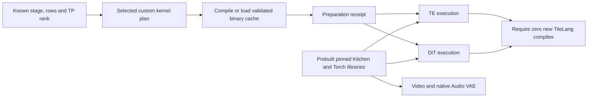
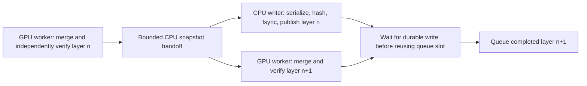

# H3 scoped defaults, all-stage operator preparation and bake batch

Status: implemented. The final exact capsule passed 179 regression tests and 27
optimization contracts both locally and in Kaggle CPU version 2. The single
[T4 batch, version 1](https://www.kaggle.com/code/pamcks/h3-operators-aot-bake-t4-20261028)
was accepted on 2026-10-28 at 09:59 UTC. Physical post-change timings and numerical
results are pending; notebook acceptance is not hardware qualification.

## Integrated defaults

| Change | Default and scope | Numerical contract |
| --- | --- | --- |
| Video VAE INT8 linears | Explicit pinned CUDA implementation inside Video encoder/decoder scope, SM75, FP16, ConvRot256, admitted QKV/O/FC1/FC2 shape families | Previously measured small rounding differences; not byte-exact to generic eager |
| Video VAE RMS-RoPE | Explicit CUDA functional/in-place FP16 head64/rot48 calls inside the same scope | Preserves native API and gains; small measured FP16 deltas |
| Encoder norm/SiLU/pad | Explicit CUDA at qualified C128/C1024 families; backend can still decline unsupported geometry | Existing fused implementation; no new precision opt-in |
| TE dequantization | TileLang ordered epilogue on SM75 K5120, N512/4096/12800, FP16 output | Byte-exact against existing scale-first eager epilogue in the preceding T4 probe |
| Offline disk bake | Bounded pipelined writer and reuse of an admitted CPU layer snapshot | Native merge/reference formulas, full-width ConvRot quantization and persisted proof schema unchanged |
| Operator preparation | Enabled by default for selected TE/DiT custom operators at exact shapes | Scheduling/compilation change; no attention/quantization arithmetic change |
| Dedicated DiT FP32 RMS-RoPE | Implemented explicit `tilelang_fp32` choice; `native` remains default pending physical numerical qualification | FP32 reduction, gains and rotation; final FP16 storage boundary retained |

No global `ck.registry.enable('cuda')` is installed. The VAE adapter uses
context-local activation and restores the module proxy after decode/encode,
including exception paths. TE/DiT linears retain their existing dispatch.
The encoder's independent FP16 convolution accumulation opt-in remains off;
the corrected convolution adapter is a diagnostic experiment, not a default.
Unsupported devices/dtypes and unadmitted families retain their original path.
CUDA implementations can still contain internal fallbacks; extension-call and
kernel evidence is required in the batch.

The TE change preserves shared QKV/Gate/Up preparation, INT8 GEMM geometry and
the two explicit FP32 multiplication-rounding boundaries. It replaces only the
dequantization epilogue; it does not promote a standalone Kitchen linear over
the shared TP2 path.

## All active operators: compilation versus first-use warmup

Preparation covers the **active default FP16 H3 configuration**, including TE,
DiT and Video VAE. It is not a whole-model graph compiler.

For TE, the exact specialization plan includes three dequantization widths,
attention-output packing/max/quantization, stored FP32 SwiGLU/ConvRot and its
quantizer, and both scaled-FP16 codecs/epilogues. For DiT it includes the two
column widths, corresponding row preparation, SwiGLU/quantization and transport
kernels, plus dedicated RMS-RoPE when selected. Default attention is Kitchen;
attention operators remain available and are not deleted. Nondefault TileLang
attention policies retain their existing execution, and the preparation receipt
reports incomplete default-plan coverage for those configurations rather than
claiming they were covered by this batch.

Kitchen's attention, linear, RoPE and norm/convolution implementations are shipped
compiled in the pinned wheel. Native PyTorch/cuBLAS/cuDNN/NCCL operators likewise
use shipped compiled kernels. Their first-use library/driver/kernel initialization
is a separate warmup cost, not a new H3 source compilation. Video VAE therefore
has no selected H3 TileLang compilation factory in this configuration. Audio VAE
remains Native FP32 on one GPU and introduces no custom source-compiled operator.
No claim is made that this batch warms every full-pipeline library path.

The TE hook prepares exact token-row shapes before the first TP block's math.
The Native H3 conditioning adapter sends a preparation command once the packed
layout is known, before the first denoiser RPC. A capability flag preserves old
service/proxy callers, and repeated shapes are cached. The explicit preparation
command also allows callers to schedule work earlier when they know the layout.



Preparation receipts bind source hashes, shape/rank, policy, Python, Torch,
TileLang, CUDA compiler version and target SM75. TileLang keeps its own binary
cache. AOT and runtime factory calls use identical argument conventions: omitted
versus explicit default arguments can otherwise create distinct Python cache
keys. CPU tests compare actual quantization and RMS-RoPE consumer calls with the
plan; GPU rehearsals call those consumers and require zero new `tilelang.compile`
calls after preparation. Compressed compiled-cache artifacts are retained.

Compilation time moves into preparation and is reported separately. This does
not make cold startup free or establish a full first-sampling latency speedup.
Fixed-shape rehearsals do not cover new shapes/dtypes or all attention policies.

## Bounded offline bake pipeline

Each GPU continues to own complete layers. Production merging and independent
Native verification remain sequential in that GPU worker, at full native matrix
width before TP2 splitting. Neither the LoRA GEMM order nor per-row weight-scale
domain changes.

After initial checksum/state admission, the worker reuses the CPU layer snapshot
for production and independent formula verification. Each read returns an
independent tensor copy, preventing CPU in-place mutation from corrupting the
reference input. Snapshot caches are released per target. Source mutation checks
remain at the existing preparation/completion boundaries.

A single CPU writer per worker owns the preceding completed layer while the GPU
processes the next. At most one layer is queued plus the layer currently in
production. The writer retains CPU tensors until serialization, tensor-state
hashing, payload hashing, payload/manifest sync and atomic per-shard publication
complete. Final completion waits for all writer futures. Failures propagate and
cannot publish a complete baked descriptor. The serial implementation remains
available as `pipeline=False` for direct comparison.



The diagram shows the intended scheduling dependency, not a measured overlap.
Each GPU has its own worker/writer pair. The benchmark records the actual
overlap, CPU contention and additional resident CPU tensors.

This targets the measured 134–137 seconds of hashing and 46–49 seconds of sync
per worker. It preserves those checks and durability operations and seeks to
overlap them with useful work. It does not assume spare CPU capacity or eliminate
disk flush cost. Host RSS and thread CPU/wall timelines must be assessed together
with latency. The parent-only auxiliary tail is unchanged in this implementation.

## Dedicated FP32 RMS-RoPE

The new TileLang kernel reads the actual packed TP2 QKV matrix, four heads per
CTA, with 28 heads/rank and dimension128. RMS squares, reduction, reciprocal
square root, gains and split-half rotation are FP32. It writes Q/K at the
existing FP16 storage boundary, avoiding separate full-sized FP32 Q/K promotion
and eager norm/rotation planes. V is unchanged. FP32 input/output is also tested
at a smaller shape; partial rotation normalizes the full head and rotates only
the requested prefix.

The native FP16 pipeline stores the rotation table in FP16. The fused operator
accepts that storage directly and promotes each loaded coefficient in registers
before the FP32 multiply/FMA. It preserves the table's existing rounding rather
than substituting ideal FP32 coefficients, and avoids a separate whole-table cast
kernel. FP32 table storage remains supported. The specialization key includes
frequency storage dtype, and AOT rehearsals use the actual FP16 table boundary.
CPU dispatch tests reject the earlier failure mode in which a FP32-only guard
would have silently kept the real FP16 pipeline on eager fallback.

The operator uses explicit FP32 multiplication/FMA intrinsics. It does not claim
byte identity for a differently ordered reduction. The batch checks finiteness
and numerical budgets against the existing eager FP32 island before promotion.
The previous rejection by Kitchen's FP32 dtype constraint remains correct; H3
calls its own supported implementation explicitly rather than altering that
constraint. Native remains the selected default until T4 results are reviewed.

Local SM120 checks are arithmetic previews only: the final direct-FP16-table
fixtures produce FP32 relative RMSE about 4.2–4.5e-8 and FP16 relative RMSE about
0.75–3.12e-6, including partial rotation. They are not T4 performance or
compatibility qualification.

## Single T4 batch

The 27 isolated operator cases cover:

- Eight default VAE linear calls, three default TE dequantization widths, two
  default encoder norm/pad cases, one default VAE RMS-RoPE case, and the corrected
  FP16 convolution diagnostic.
- Eight dedicated FP32 RMS-RoPE cases: row counts1/33/261/4097/51220/59134,
  zero/tiny/outlier and partial-rotation inputs, and strict FP32 input/output.
- TE2392 and DiT59134 preparation/execution rehearsals for both rank plans.

Separate child processes contain failures. Each case retains timing samples,
numerical deltas, peak allocations, actual kernel traces and error logs.
Convolution records whether the extension accepted the shape or internally
fell back. Warmed timings exclude compilation; first-use timings are separate.

The bake experiment uses public immutable TP2 shards for layers0/1/24/25/48/49
and the same public 8-step Turbo LoRA as the prior profiled bake. Only the twelve
required base shards plus the real auxiliary checkpoint and adapter are fetched.
It compares serial/pipelined order, then reverses the order for a second pair.
Each trial must preserve all twelve prior physical shard-state proofs and 24
independently verified block targets. CPU/writer threads have separate nesting
stacks and shared monotonic timestamps; first-merge CUDA trace flush is checked
per worker. Generated weight payloads are removed only after retaining their
proofs and traces, within the exclusively created benchmark scratch directory.

This is a **six-layer scheduling comparison**, not a new complete 50-layer bake,
208-target T4 qualification or measurement of the parent auxiliary tail. No full
H3 generation, TE/DiT denoising trajectory or visual-quality test is run.

## Source, qualification and delivery

The source archive is
`64fab3da8877917c135183495803db141ec6856844333ecbcdff826ff2a43559.tar.gz`,
binding capsule
`9398ba6958b1b5a88b957b32b505d864195c39727ecad58743e0c14a767a3de0`.
It preserves the frozen ComfyUI d49e888 legacy API and all core wheel pins,
including Kitchen0.2.37 and TileLang0.1.13. Kaggle retains native Torch/cu128.
No upstream update, environment upgrade or local conda modification is involved.

The exact extracted capsule passes 179 existing CPU regression tests and 27
optimization contracts locally and on Kaggle CPU. Earlier CPU-only and
unsubmitted drafts are preserved; the
final draft corrects loader schema consistency, legacy service capability gating,
exact AOT cache-key matching and native FP16 frequency-table storage. Unrelated
dirty runtime edits are not copied
wholesale or staged into the new commits; owned hunks are replayed explicitly
over the previously frozen source.

The new immutable archive passed Kaggle CPU setup/API/core qualification and
the same operator contracts before GPU submission. CPU version 1 had already
passed 179+26 tests but was superseded before any GPU submission to correct the
native FP16 frequency-table boundary. The final CPU receipt has the new capsule
hash and 179+27 tests; neither receipt is rewritten to stand for another source.
One bounded GPU notebook runs the complete batch. No status/list/live-log polling, automatic duplicate
submission, private activations, HF credentials or Dataset mounts are used.

The submitted source is pinned to commit
`b5b461ab6fcd38db41035643194ee816cb961f0c`. The source delivery uses zero Kaggle
Dataset/kernel-output mounts. Setup is bounded separately; operator/bake
execution has a 2700-second watchdog inside the 3300-second notebook limit.
The GPU receipt is recorded in the [progress evidence](../data/h3_optimization_batch_20261028/progress.json).
There is no scheduled status checker or automatic duplicate submission.

Evidence root: `D:/attention_eval/h3_optimization_batch_20261028`.

After the single final GPU collection, analyze only retained files:

```powershell
& 'C:\ProgramData\miniconda3\envs\comfyui\python.exe' `
  benchmarks/analyze_h3_optimization_batch.py `
  --artifacts 'D:\attention_eval\h3_optimization_batch_20261028\final\gpu_outputs' `
  --output 'D:\attention_eval\h3_optimization_batch_20261028\final\analysis'
```

The summary retains per-thread inclusive/exclusive phase boundaries and labels
writer/merge overlap as host spans. It does not infer GPU utilization from those
host spans or extrapolate six-layer results into a full 50-layer bake speedup.
