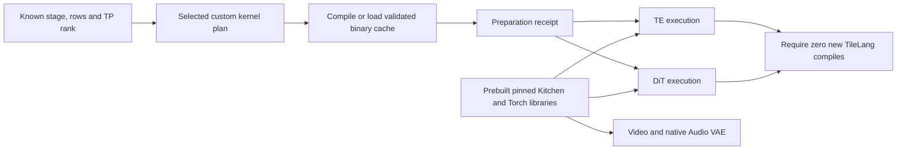
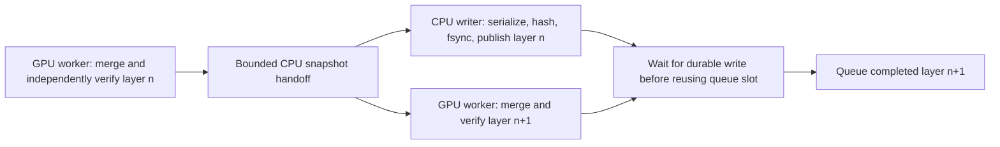
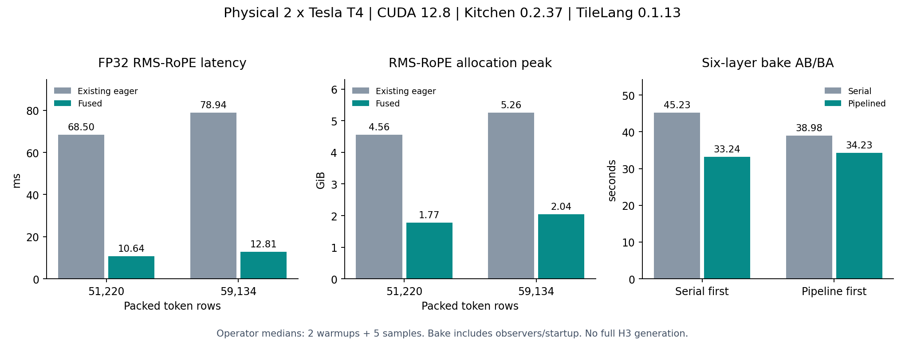
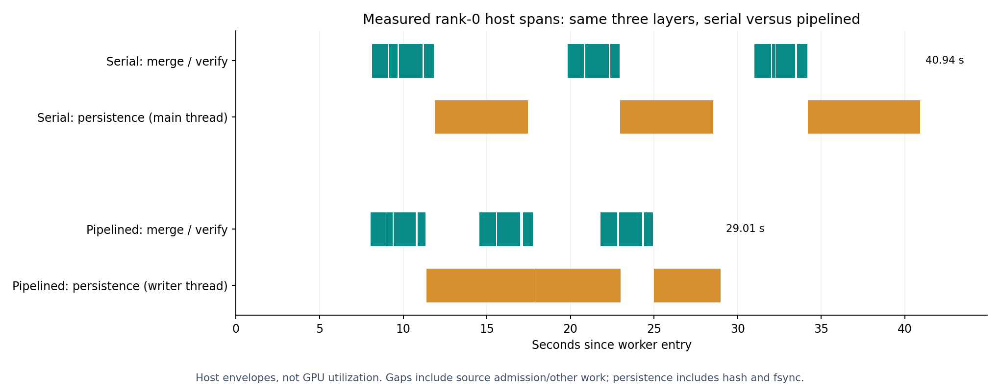

# H3 scoped defaults, all-stage operator preparation and bake batch

Status: physical two-T4 batch complete. All 27 cases executed and the six-layer
bake AB/BA comparison completed. All 154 artifacts were downloaded once and
verified. The corrected convolution adapter still takes a slower internal
fallback and stays disabled. The qualified FP32 RMS-RoPE operator is promoted
to the guarded SM75 default; Native remains selectable. This is operator and
bake qualification, without a full H3 generation or visual-quality claim.

## Integrated defaults

| Change | Default and scope | Numerical contract |
| --- | --- | --- |
| Video VAE INT8 linears | Explicit pinned CUDA implementation inside Video encoder/decoder scope, SM75, FP16, ConvRot256, admitted QKV/O/FC1/FC2 shape families | Previously measured small rounding differences; not byte-exact to generic eager |
| Video VAE RMS-RoPE | Explicit CUDA functional/in-place FP16 head64/rot48 calls inside the same scope | Preserves native API and gains; small measured FP16 deltas |
| Encoder norm/SiLU/pad | Explicit CUDA at qualified C128/C1024 families; backend can still decline unsupported geometry | Existing fused implementation; no new precision opt-in |
| TE dequantization | TileLang ordered epilogue on SM75 K5120, N512/4096/12800, FP16 output | Byte-exact against existing scale-first eager epilogue in the preceding T4 probe |
| Offline disk bake | Bounded pipelined writer and reuse of an admitted CPU layer snapshot | Native merge/reference formulas, full-width ConvRot quantization and persisted proof schema unchanged |
| Operator preparation | Enabled by default for selected TE/DiT custom operators at exact shapes | Scheduling/compilation change; no attention/quantization arithmetic change |
| Dedicated DiT FP32 RMS-RoPE | `tilelang_fp32` is the guarded SM75 default after this physical qualification; `native` remains explicit and unsupported-contract fallback | FP32 reduction, gains and rotation; final FP16 storage boundary retained |

No global `ck.registry.enable('cuda')` is installed. The VAE adapter uses
context-local activation and restores the module proxy after decode/encode,
including exception paths. TE/DiT linears retain their existing dispatch.
The encoder's independent FP16 convolution accumulation opt-in remains off;
the corrected convolution adapter is a diagnostic experiment, not a default.
Unsupported devices/dtypes and unadmitted families retain their original path.
CUDA implementations can still contain internal fallbacks; extension-call and
kernel evidence is required in the batch.

The TE change preserves shared QKV/Gate/Up preparation, INT8 GEMM geometry and
the two explicit FP32 multiplication-rounding boundaries. It replaces only the
dequantization epilogue; it does not promote a standalone Kitchen linear over
the shared TP2 path.

## All active operators: compilation versus first-use warmup

Preparation covers the **active default FP16 H3 configuration**, including TE,
DiT and Video VAE. It is not a whole-model graph compiler.

For TE, the exact specialization plan includes three dequantization widths,
attention-output packing/max/quantization, stored FP32 SwiGLU/ConvRot and its
quantizer, and both scaled-FP16 codecs/epilogues. For DiT it includes the two
column widths, corresponding row preparation, SwiGLU/quantization and transport
kernels, plus dedicated RMS-RoPE when selected. Default attention is Kitchen;
attention operators remain available and are not deleted. Nondefault TileLang
attention policies retain their existing execution, and the preparation receipt
reports incomplete default-plan coverage for those configurations rather than
claiming they were covered by this batch.

Kitchen's attention, linear, RoPE and norm/convolution implementations are shipped
compiled in the pinned wheel. Native PyTorch/cuBLAS/cuDNN/NCCL operators likewise
use shipped compiled kernels. Their first-use library/driver/kernel initialization
is a separate warmup cost, not a new H3 source compilation. Video VAE therefore
has no selected H3 TileLang compilation factory in this configuration. Audio VAE
remains Native FP32 on one GPU and introduces no custom source-compiled operator.
No claim is made that this batch warms every full-pipeline library path.

The TE hook prepares exact token-row shapes before the first TP block's math.
The Native H3 conditioning adapter sends a preparation command once the packed
layout is known, before the first denoiser RPC. A capability flag preserves old
service/proxy callers, and repeated shapes are cached. The explicit preparation
command also allows callers to schedule work earlier when they know the layout.



Preparation receipts bind source hashes, shape/rank, policy, Python, Torch,
TileLang, CUDA compiler version and target SM75. TileLang keeps its own binary
cache. AOT and runtime factory calls use identical argument conventions: omitted
versus explicit default arguments can otherwise create distinct Python cache
keys. CPU tests compare actual quantization and RMS-RoPE consumer calls with the
plan; GPU rehearsals call those consumers and require zero new `tilelang.compile`
calls after preparation. Compressed compiled-cache artifacts are retained.

Compilation time moves into preparation and is reported separately. This does
not make cold startup free or establish a full first-sampling latency speedup.
Fixed-shape rehearsals do not cover new shapes/dtypes or all attention policies.

## Bounded offline bake pipeline

Each GPU continues to own complete layers. Production merging and independent
Native verification remain sequential in that GPU worker, at full native matrix
width before TP2 splitting. Neither the LoRA GEMM order nor per-row weight-scale
domain changes.

After initial checksum/state admission, the worker reuses the CPU layer snapshot
for production and independent formula verification. Each read returns an
independent tensor copy, preventing CPU in-place mutation from corrupting the
reference input. Snapshot caches are released per target. Source mutation checks
remain at the existing preparation/completion boundaries.

A single CPU writer per worker owns the preceding completed layer while the GPU
processes the next. At most one layer is queued plus the layer currently in
production. The writer retains CPU tensors until serialization, tensor-state
hashing, payload hashing, payload/manifest sync and atomic per-shard publication
complete. Final completion waits for all writer futures. Failures propagate and
cannot publish a complete baked descriptor. The serial implementation remains
available as `pipeline=False` for direct comparison.



The diagram shows the intended scheduling dependency, not a measured overlap.
Each GPU has its own worker/writer pair. The benchmark records the actual
overlap, CPU contention and additional resident CPU tensors.

This targets the measured 134–137 seconds of hashing and 46–49 seconds of sync
per worker. It preserves those checks and durability operations and seeks to
overlap them with useful work. It does not assume spare CPU capacity or eliminate
disk flush cost. Host RSS and thread CPU/wall timelines must be assessed together
with latency. The parent-only auxiliary tail is unchanged in this implementation.

## Dedicated FP32 RMS-RoPE

The new TileLang kernel reads the actual packed TP2 QKV matrix, four heads per
CTA, with 28 heads/rank and dimension128. RMS squares, reduction, reciprocal
square root, gains and split-half rotation are FP32. It writes Q/K at the
existing FP16 storage boundary, avoiding separate full-sized FP32 Q/K promotion
and eager norm/rotation planes. V is unchanged. FP32 input/output is also tested
at a smaller shape; partial rotation normalizes the full head and rotates only
the requested prefix.

The native FP16 pipeline stores the rotation table in FP16. The fused operator
accepts that storage directly and promotes each loaded coefficient in registers
before the FP32 multiply/FMA. It preserves the table's existing rounding rather
than substituting ideal FP32 coefficients, and avoids a separate whole-table cast
kernel. FP32 table storage remains supported. The specialization key includes
frequency storage dtype, and AOT rehearsals use the actual FP16 table boundary.
CPU dispatch tests reject the earlier failure mode in which a FP32-only guard
would have silently kept the real FP16 pipeline on eager fallback.

The operator uses explicit FP32 multiplication/FMA intrinsics. It does not claim
byte identity for a differently ordered reduction. The batch checks finiteness
and numerical budgets against the existing eager FP32 island before promotion.
The previous rejection by Kitchen's FP32 dtype constraint remains correct; H3
calls its own supported implementation explicitly rather than altering that
constraint. The guarded fused implementation becomes the default after the
physical results below; unsupported layouts/devices retain Native.

Local SM120 checks are arithmetic previews only: the final direct-FP16-table
fixtures produce FP32 relative RMSE about 4.2–4.5e-8 and FP16 relative RMSE about
0.75–3.12e-6, including partial rotation. They are not T4 performance or
compatibility qualification.

## Single T4 batch

The 27 isolated operator cases cover:

- Eight default VAE linear calls, three default TE dequantization widths, two
  default encoder norm/pad cases, one default VAE RMS-RoPE case, and the corrected
  FP16 convolution diagnostic.
- Eight dedicated FP32 RMS-RoPE cases: row counts1/33/261/4097/51220/59134,
  zero/tiny/outlier and partial-rotation inputs, and strict FP32 input/output.
- TE2392 and DiT59134 preparation/execution rehearsals for both rank plans.

Separate child processes contain failures. Each case retains timing samples,
numerical deltas, peak allocations, actual kernel traces and error logs.
Convolution records whether the extension accepted the shape or internally
fell back. Warmed timings exclude compilation; first-use timings are separate.

The bake experiment uses public immutable TP2 shards for layers0/1/24/25/48/49
and the same public 8-step Turbo LoRA as the prior profiled bake. Only the twelve
required base shards plus the real auxiliary checkpoint and adapter are fetched.
It compares serial/pipelined order, then reverses the order for a second pair.
Each trial must preserve all twelve prior physical shard-state proofs and 24
independently verified block targets. CPU/writer threads have separate nesting
stacks and shared monotonic timestamps; first-merge CUDA trace flush is checked
per worker. Generated weight payloads are removed only after retaining their
proofs and traces, within the exclusively created benchmark scratch directory.

This is a **six-layer scheduling comparison**, not a new complete 50-layer bake,
208-target T4 qualification or measurement of the parent auxiliary tail. No full
H3 generation, TE/DiT denoising trajectory or visual-quality test is run.

## Physical results and decisions

The [version-1 notebook](https://www.kaggle.com/code/pamcks/h3-operators-aot-bake-t4-20261028)
ran on two distinct Tesla T4 devices, SM75, driver 580.178.04,
Torch 2.11.0+cu128, Kitchen 0.2.37 and TileLang 0.1.13. Loaded library evidence shows
cuBLAS 12/cuDART 12, without a CUDA 13 substitution. Every operator case has an
actual CUDA trace: 23 candidate traces plus four AOT rehearsal traces. Eight
additional compressed bake traces each contain 37 kernels and a completed
worker flush check. These are Torch/CUPTI Chrome traces, not Nsight Compute
hardware-counter measurements.



### FP32 RMS-RoPE

The reference is the existing FP32 RMS/gain/rotation island with the native
FP16 table/storage boundaries, rather than an all-FP32 replacement of H3.
Numbers below are medians of five CUDA-event samples after two warmups. They
include dispatch gaps inside the event interval; they are not kernel-only times.

| Rows | Existing ms | Fused ms | Speedup | Existing / fused peak GiB |
| --- | ---: | ---: | ---: | ---: |
| 1 | 0.471 | 0.092 | 5.15x | <0.001 / <0.001 |
| 33 | 0.464 | 0.104 | 4.48x | 0.00294 / 0.00114 |
| 261 | 0.582 | 0.167 | 3.48x | 0.0232 / 0.0090 |
| 4097 | 7.372 | 1.662 | 4.43x | 0.365 / 0.143 |
| 51220 | 68.499 | 10.635 | 6.44x | 4.555 / 1.771 |
| 59134 | 78.942 | 12.811 | 6.16x | 5.259 / 2.044 |

Each fused candidate trace has **one RMS-RoPE kernel**. At 59,134 rows its isolated
trace kernel duration is 10.271 ms; at 51,220 it is 8.641 ms. The eliminated eager
materializations explain the measured allocation reduction: packed input and
final Q/K remain, while separate FP32 Q/K promotions, normalized outputs and
rotation temporaries are no longer materialized. Peak allocation includes the
fixture inputs/outputs and is not a predicted full-DiT VRAM peak. FC1 or other
stages can become the peak after this change.

All eight cases pass the declared numerical/finiteness budgets. FP16-output
relative RMSE is at most 3.75e-6; strict FP32 input/output is at most 4.44e-8.
The additional cases include partial rotation, zero/tiny inputs and 65504
outliers. These seeded fixtures establish operator behavior; they do not establish
real-trajectory or generation quality. The arithmetic implementation, exact SM75
layout guards and Native fallback are unchanged by default promotion.

### Default VAE and TE dispatch

| Path | Physical speedup | Trace / numerical evidence | Decision |
| --- | ---: | --- | --- |
| VAE INT8 QKV/FC1 | 3.04-4.46x | Two kernels per call; accepted Turing CUTLASS dequantization in all nine extension calls; relative RMSE about 0.275-0.276% against eager | Keep scoped default |
| VAE INT8 O/FC2 | 1.69-2.81x | Four/seven kernels; CUDA quantization + cuBLAS INT8 + dequantization; relative RMSE about 0.165-0.169% / 0.020% | Keep scoped default |
| TE dequant N512/4096/12800 | 2.35/4.36/4.57x | One kernel, byte-exact eager output for all three widths | Keep default |
| VAE partial RMS-RoPE | 3.51x | One CUDA RMS-RoPE kernel; relative RMSE <=2.32e-6 | Keep scoped default |
| Encoder norm/SiLU/pad C128/C1024 | 3.48/5.66x | Three kernels including layout work; relative RMSE about 0.045-0.046% | Keep scoped default |
| Corrected FP16 Conv Adapter | 0.62x | CUTLASS returns False in 9/9 calls; actual trace uses cuDNN plus copies | Keep disabled |

For the convolution fixture, native cuDNN is 0.283 ms and the adapter path is
0.459 ms. The API repair is successful and output is byte-exact, but the extension
declines this geometry. Its backend prepares a candidate destination/layout,
then falls back to `F.conv3d(...).contiguous(channels_last_3d)`. The observed
cuDNN/copy trace supports fallback overhead, not successful FP16-accumulation
acceleration. This does not establish that every possible convolution geometry
is unsupported. Enabling the global CUDA registry does not force an internal
extension to accept a shape.

All VAE/TE cases leave the global CUDA registry unchanged. The VAE gains are
against the former eager paths, and the TE results measure the epilogue rather
than a complete block or an attention backend. Full VAE decode and quality were
not replayed in this batch.

### AOT and remaining first-use cost

| Stage/rank | Preparation s | Compile calls during preparation | Compile calls first/second execution | First/second rehearsal s |
| --- | ---: | ---: | ---: | ---: |
| TE0 | 26.790 | 12 | 0 /0 | 3.493 /0.0130 |
| TE1 | 27.058 | 12 | 0 /0 | 3.352 /0.0129 |
| DiT0 | 28.430 | 12 | 0 /0 | 3.797 /0.2543 |
| DiT1 | 28.113 | 12 | 0 /0 | 3.828 /0.2555 |

Four retained cache archives contain twelve compiled shared libraries and twelve
CUDA binaries each. Preparation binds their source, shape, rank, policy and
compiler/runtime identity. This proves no additional TileLang compilation in the
tested runtime consumers after preparation. It does not prove absence of library
initialization, allocator expansion or lazy module loading: first rehearsal
still costs 3.35-3.83 s. That residual cost is not attributed to a specific cause
without a first-use host trace. Rehearsals allocate zero fixtures and synchronize
each operator; neither column is DiT denoiser latency. Compilation cost is moved
outside sampling and remains part of total startup when a matching cache is absent.

### Offline baking

| AB/BA pair | Serial s | Pipelined s | Speedup |
| --- | ---: | ---: | ---: |
| Serial then pipeline | 45.232 | 33.242 | 1.361x |
| Pipeline then serial | 38.978 | 34.229 | 1.139x |

The pooled ratio is 1.248x, about 19.9% less measured wall time. Timing includes
fresh worker-process startup and observers. All twelve shard payload hashes,
manifest hashes and tensor-state proofs match across all four runs. Each mode
also matches the twelve prior physical-T4 tensor-state proofs and independently
verifies 24 Native targets. No formula, full-width quantization or durability
check was removed.

Each GPU worker peaks at 1.875 GiB in both modes. Host RSS increases from
1.93-1.97 GiB to 2.29-2.31 GiB per worker, consistent with a bounded extra CPU layer.
Per worker, checkpoint-read time drops from 3.22-3.36 s to 1.37-1.51 s. The writer
overlaps 4.02-5.89 s of merge/verification **host spans**. Hashing still contends
for CPU/memory bandwidth: state-hash wall time rises from 6.16-6.41 s to 8.68-9.40 s,
and output-file hashing from 3.21-3.33 s to 4.05-4.68 s. Fsync varies from 4.88-11.79 s
between serial trials and 5.88-10.32 s in pipelined trials, so all improvement cannot
be assigned to overlap alone.

The serial control disables snapshot reuse and writer pipelining together.
Their individual causal contributions were not isolated by a 2x2 ablation. Keep
the combined pipelined default, with the existing bounded ownership, checks and
serial control. These six layers do not measure the full 50-layer bake, auxiliary
tail, input download time or whole-pipeline latency. No full-bake speedup is
extrapolated.



The timeline uses the first serial/pipelined pair for rank0. Each lane is a
measured host envelope. In the serial case, persistence shares the main thread;
in the pipelined case, the writer overlaps later production. Unplotted gaps
include source admission and other work. The full source data also retains
rank1 and the reversed-order pair.

Aggregate values, kernel names, phase boundaries and dispatch rejection are in
the [analysis JSON](../data/h3_optimization_batch_20261028/analysis.json) and
[timing CSV](../data/h3_optimization_batch_20261028/micro_timings.csv). The
[artifact manifest](../data/h3_optimization_batch_20261028/gpu_artifact_manifest.json)
binds all 154 retained raw files under the local evidence root.

## Source, qualification and delivery

The source archive is
`64fab3da8877917c135183495803db141ec6856844333ecbcdff826ff2a43559.tar.gz`,
binding capsule
`9398ba6958b1b5a88b957b32b505d864195c39727ecad58743e0c14a767a3de0`.
It preserves the frozen ComfyUI d49e888 legacy API and all core wheel pins,
including Kitchen 0.2.37 and TileLang 0.1.13. Kaggle retains native Torch/cu128.
No upstream update, environment upgrade or local conda modification is involved.

The exact extracted capsule passes 179 existing CPU regression tests and 27
optimization contracts locally and on Kaggle CPU. Earlier CPU-only and
unsubmitted drafts are preserved; the
final draft corrects loader schema consistency, legacy service capability gating,
exact AOT cache-key matching and native FP16 frequency-table storage. Unrelated
dirty runtime edits are not copied
wholesale or staged into the new commits; owned hunks are replayed explicitly
over the previously frozen source.

The new immutable archive passed Kaggle CPU setup/API/core qualification and
the same operator contracts before GPU submission. CPU version 1 had already
passed 179+26 tests but was superseded before any GPU submission to correct the
native FP16 frequency-table boundary. The final CPU receipt has the new capsule
hash and 179+27 tests; neither receipt is rewritten to stand for another source.
One bounded GPU notebook completed the batch. No status/list/live-log polling, automatic duplicate
submission, private activations, HF credentials or Dataset mounts are used.

The submitted source is pinned to commit
`b5b461ab6fcd38db41035643194ee816cb961f0c`. The source delivery uses zero Kaggle
Dataset/kernel-output mounts. Setup is bounded separately; operator/bake
execution has a 2700-second watchdog inside the 3300-second notebook limit.
The GPU receipt is recorded in the [progress evidence](../data/h3_optimization_batch_20261028/progress.json).
There is no scheduled status checker or automatic duplicate submission. The
single final GPU retrieval returned all 154 files; their sizes and SHA256 hashes
were rechecked locally against the download manifest.

The tested immutable source retains its original Native RMS-RoPE default; the
eight numerical cases and DiT AOT rehearsals explicitly select the guarded
fused operator. After this qualification, the policy default, loader default/UI
and a contract assertion are updated. No arithmetic or dispatch guard changes.
A fresh isolated source comparison confirms these are the only three changed
payload files, and the promoted defaults pass the same 179+27 local CPU checks.
This promotion is not represented as a second physical run or a new full-pipeline
qualification; the original submission, receipts and archive remain unchanged.

Evidence root: `D:/attention_eval/h3_optimization_batch_20261028`.

After the single final GPU collection, analyze only retained files:

```powershell
& 'C:\ProgramData\miniconda3\envs\comfyui\python.exe' `
  benchmarks/analyze_h3_optimization_batch.py `
  --artifacts 'D:\attention_eval\h3_optimization_batch_20261028\final\gpu_outputs' `
  --output 'D:\attention_eval\h3_optimization_batch_20261028\final\analysis'
```

The summary retains per-thread inclusive/exclusive phase boundaries and labels
writer/merge overlap as host spans. It does not infer GPU utilization from those
host spans or extrapolate six-layer results into a full 50-layer bake speedup.
`benchmarks/plot_h3_optimization_batch.py` regenerates both figures from this
analysis and the retained worker events without executing any GPU workload.
