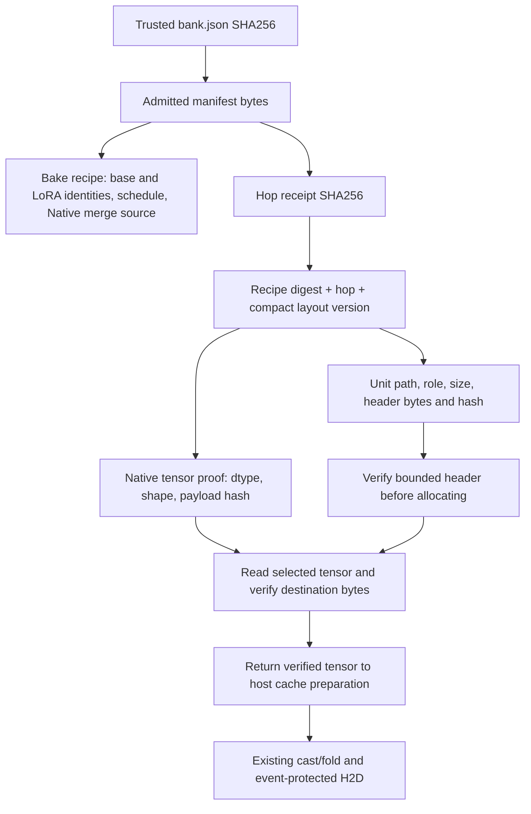

# PTD P2: separate Refiner and Output Head units

Implemented on `codex/h3-ptd-refasymopd`, 2026-10-29. This is an optional storage/loader adaptation. Native forwards, FP16-fix folding, head arithmetic, TP2 collectives and existing defaults are preserved. Hardware performance qualification is pending.

## Why this change follows P0/P1

The [physical T4 CPU scheduling experiment](H3_PTD_CPU_SCHEDULING_T4_RESULTS_20261029.md) found that rank 1 spent 43.45–51.91 seconds verifying eight complete auxiliary overlays, although it needed only the small heads. Rank 0 also scanned complete overlays before reading the refiner matrices. The optional full FP32 refiner sidecar regressed latency and added 22.97 GiB to the fixture bank.

P2 removes that coupling. It retains the compact Native merged tensor dtypes, separates payload files, and hashes the actual destination tensor bytes after reading them. This eliminates the extra full-overlay read in the new path without weakening consumption-time integrity. The refiner still requires reading and verifying its own matrices; this change does not eliminate their bandwidth, cast or fold cost.

## Physical layout

```text
PTD bank/
  bank.json                         # recipe, input identities, hop receipt hashes
  hop_00/
    receipt.json                    # Native proofs + unit layout/header/payload hashes
    dit.block00.rank0.safetensors    # unchanged INT8 expert shards and proofs
    dit.block00.rank0.json
    ...
    refiner/
      token_refiner_blocks_0_attn_qkv_proj.safetensors
      token_refiner_blocks_0_attn_out_proj.safetensors
      token_refiner_blocks_0_mlp_fc1.safetensors
      token_refiner_blocks_0_mlp_fc2.safetensors
      ...                           # one file per adapted projection
    heads/
      video.safetensors             # effective PDD weight + bias for this hop
      audio.safetensors             # independently fused audio weight + bias
  hop_01/ ... hop_07/
```

The video/audio banks are represented by eight small, independently addressable hop files. There is no monolithic refiner file to open or scan when consuming a head. Norms, conditioning projections and other unmodified tensors remain in the existing shared base bundle.

Current Native TP2 runs **both heads on both ranks**. Only rank 0 runs the refiner. Accordingly, rank 1 consumes only head units from the split PTD auxiliary bank; rank 0 consumes its refiner units and both heads. Changing that computation would require a separate communication adaptation. Initial admission of the original shared base bundle retains its existing verification; P2 removes the repeated **per-hop overlay** scans.

## Integrity and provenance



The trust boundary is explicit. `PTDBank(..., expected_sha256=...)` and the adapter node's `expected_bank_sha256` accept a digest obtained from a trusted bake/repack receipt. Without that optional pin, selecting a local manifest admits it as the trust root for backward compatibility. Computing a digest from an untrusted download is not authentication. Parent `Controller` admission pins its manifest digest into the configuration RPC; both workers must match it before selecting an expert.

Each hop receipt is read once into bytes, hashed, and parsed from those same bytes. Split auxiliary metadata binds the semantic bake recipe, hop, known compact layout, unit roles, exact coverage, file sizes, bounded safetensors header hashes, dtype/shape/offsets, and individual payload hashes. Unit hashes must also agree with the Native state proofs retained in that receipt.

On **every disk consumption**, including a reload after cache eviction, the loader:

1. Resolves only the requested unit and rejects path/symlink escapes.
2. Checks its receipt-bound file size and bounded header hash before allocating a tensor. Allocation uses receipt-bound metadata, never an unchecked file header.
3. Reuses the existing positional `CheckpointReader` range I/O to read the requested tensor into CPU storage.
4. Hashes the destination bytes and compares them to the tensor proof before returning any tensor to the caller.
5. Checks file identity/signature again and fails on a detected mutation.

There is no verification-off flag or timestamp-only payload admission. A payload bit flip with an unchanged size and restored timestamp still fails its SHA256 check. Reusing a previously verified CPU module inside the bounded cache needs no new disk read; loading bytes again always verifies them again. The reader retains metadata/counters, not weight payloads outside the host budget. Existing CUDA ready/use fences and consumption-aware cache protections remain intact.

## Baking and migration

`MiniMaxH3TP2PTDBake` exposes `split_auxiliary=False`. Setting it to `True` writes the new units directly after the existing independent Native merge verification and PDD head fusion. Its recipe also binds the auxiliary format, layout and writer source hash. No tensor cast, quantization, multiplication or folding is introduced by the file split.

Existing banks load through the original monolithic path. To avoid merging eight expert sets again, `repack_split_bank` can publish a separate split bank:

```python
from patches.ptd.bank import repack_split_bank

new_bank = repack_split_bank(
    "/tmp/original/bank.json", "/tmp/split_bank",
    expected_sha256=trusted_original_manifest_sha256,
)
```

Repacking verifies each original overlay's full hash **offline**, reads one projection/head unit at a time, writes compact units, and compares the complete logical tensor proofs to the original Native-verified receipt. INT8 shards/manifests are verified and hard-linked, with a copy fallback. The source bank stays intact. Disk admission reserves for the copy fallback, and publication uses a separate `.partial` directory followed by rename.

The original semantic bake recipe and shard proofs remain valid because no merge changes. A new hash-bound `auxiliary_repack` record identifies the trusted source manifest, original recipe, new layout and writer source. The new bank manifest/receipts have distinct hashes; cache identities include the admitted manifest digest so the two representations cannot alias.

`runtime_layout=True` conflicts with the split format and is rejected before loading/downloading weights. `baked_refiner=True` requires the historical FP32 sidecar and cannot be used with compact split banks. Both remain off. PTD, future cache and next-hop prefetch defaults are unchanged; no Native source or dependency upgrade is included.

## Validation and bounded T4 comparison

The exact frozen delivery passed **48 PTD contracts** and the **179-test runtime regression suite**, with no failures or skips. Sixteen contracts specifically exercise the split format: exact bytes/dtypes, Native FP16 refiner folding and epsilon preservation, heads with absent refiner files, corruption on initial read/reload, bounded header rejection before allocation, wrong provenance/layout, malformed coverage, path/symlink escapes, mutation during a read, old-bank compatibility, repack shard/tensor equality, receipt tampering and parent-to-worker manifest pinning.

These are synthetic CPU tests, not real-weight GPU accuracy or performance qualification. They used the local `comfyui` conda Python with GPUs hidden and downloaded no LoRA weights.

The T4 harness uses one two-layer real trained eight-hop bake and one offline repack, with the same seeded operator inputs and Native TP2 implementation. Comparison order is **monolithic / split / split / monolithic**. Both variants enable the same P0 future cache and P1 refiner prefetch; the FP32 sidecar stays off. All per-hop video/audio hashes and the final FP32 carry must match across all four cases.

Benchmark-only worker probes record RPC wall/thread CPU time, nested checksum/read/preparation spans, per-hop/per-role verified bytes, CUDA peaks and host cache reservations. Split cases require consumption evidence on both ranks, **zero refiner payload consumption on rank 1**, and zero legacy full-overlay verification spans. AOT, loading, bake and repack costs are reported separately from hop execution. The observer is kept the same across the paired runs. Nested spans overlap and must not be summed as independent critical-path costs; CUDA default-stream intervals include idle/wait time and are not Nsight kernel traces.

Kaggle's source-bound CPU setup/API gate is required before GPU submission. No full H3 generation, local real LoRA download, token, dataset mount, upstream upgrade or status/live-log polling is part of this experiment. No T4 speedup is claimed before collecting its final evidence.

## Reproducibility

Frozen archive SHA256: `6fbf526443929aca96a756bd060dbe583621753fdfe2e2b1a8d2a1405eed8b9a`.

Source capsule SHA256: `4877485cceaf780798665794dc40ae94143c2cfc3078dd46a4133f174f1801c6`.

Local evidence: `D:\attention_eval\h3_ptd_aux_split_20261029`. Native ComfyUI archive and exact core-lock hashes match the previous frozen parent; unrelated dirty-worktree changes are excluded.

Published source commit: `78a3d135d226ade1584fac538a8951971b3fafff`.
Collected [H3 PTD Aux Split CPU 20261029](https://www.kaggle.com/code/pamcks/h3-ptd-aux-split-cpu-20261029), version 1, in one final artifact request on 2026-10-29. Its exact source digest matches this delivery. All **179 runtime tests and 38 PTD preflight contracts passed**, including all 16 split-format contracts. Linux positional I/O and fallback/concurrent-descriptor contracts also passed. Native CPU Torch was 2.11.0+cpu; Kitchen 0.2.37 and TileLang 0.1.13 remained pinned. No weights were fetched and no GPU was used. This qualifies setup and CPU contracts, not CUDA kernels or hardware speed.

Using those successful source-bound receipts, Kaggle accepted [H3 PTD Aux Split T4 20261029](https://www.kaggle.com/code/pamcks/h3-ptd-aux-split-t4-20261029), version 1. The submitted source capsule is unchanged; comparison order is monolithic/split/split/monolithic, without the FP32 sidecar or a full generation. Acceptance does not establish that physical T4 execution has started or completed. Final GPU results remain pending. No status/list/live-log polling or duplicate submission was performed; collection will be one final artifact request when prompted.

The [CPU receipts and summary](../data/h3_ptd_aux_split_20261029/cpu_final/summary.json), [accepted T4 submission](../data/h3_ptd_aux_split_20261029/t4_submission_v1.json) and [source binding](../data/h3_ptd_aux_split_20261029/t4_source_binding_v1.json) preserve the evidence.

The user-requested final T4 artifact collection at **2026-10-29 04:16:54 UTC**
(12:16:54 Beijing) failed with `SSLEOFError: UNEXPECTED_EOF_WHILE_READING`
while connecting to Kaggle's output service. The CLI returned 1 and downloaded
zero files. This is a collection transport failure; it does **not** establish
that the GPU job failed, completed, or is still running. Output equality,
physical hardware qualification, timing and memory conclusions remain
unavailable. The exclusive collection claim is retained, with no automatic
retry, status/live-log polling or duplicate submission. See the
[blocker receipt](../data/h3_ptd_aux_split_20261029/t4_collection_blocker_v1.json)
and [original CLI error](../data/h3_ptd_aux_split_20261029/t4_collection_transport_error_v1.txt).

Implementation: [auxiliary units](../../patches/ptd/auxiliary.py), [bank/migration](../../patches/ptd/bank.py), [runtime trust binding](../../patches/ptd/runtime.py), [contract tests](../../benchmarks/test_ptd_auxiliary.py), [bounded experiment](../../benchmarks/run_ptd_tp2_t4.py).
