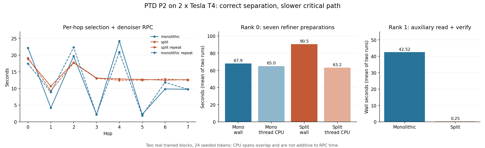

# PTD P2: physical two-T4 results

> Historical experiment record: the FP32 sidecar and P2 Split implementation and switches have been removed. P1 remains optional and off by default. Reproduce removed cases with their recorded immutable source snapshot. See [current cleanup](H3_PTD_RUNTIME_CLEANUP_20261029.md).

**Correctness and physical separation pass, but the current split loader is not a speedup.** It increases mean eight-hop RPC latency from **94.63 s to 110.22 s (+16.5%)**. Rank 1 no longer consumes refiner payloads, while rank 0's read/preparation waits grow enough to dominate execution. Keep the split format optional and preserve the existing defaults.

## Qualification and scope

[H3 PTD Aux Split T4 20261029](https://www.kaggle.com/code/pamcks/h3-ptd-aux-split-t4-20261029), version 1, completed normally. The experiment supervisor records exit code 0 after **1,108.49 s**. Hardware is two distinct Tesla T4 GPUs, both SM75. Actual runtime is Torch **2.11.0+cu128**, CUDA **12.8**, Kitchen **0.2.37**, TileLang **0.1.13**. Frozen Native ComfyUI and dependency pins are preserved.

The experiment baked two real trained DiT blocks, both refiners and full effective output heads for all eight hops. One original bank was repacked into independent compact units without merging LoRA again. Identical seeded 24-token operator inputs were used in **monolithic / split / split / monolithic** order, with a fresh TP2 service for each case. P0 future cache and P1 refiner prefetch were enabled in every case; the FP32 sidecar was disabled. No TE, VAE or full H3 generation was run. Pruned-AdaLN approximation consent remained explicit.

All independent checks pass:

- **48 PTD contracts** pass on the GPU host; **128 Native merge targets** are verified across eight hops.
- All **32 denoiser calls** finish with finite outputs. Every per-hop video/audio output hash and both final FP32 carry hashes match across all four cases.
- Each case keeps one shell/window for eight hops. All **eight durable worker reports** agree with the main result on all 16 completed RPC spans, CPU preparation spans, consumption records and CUDA peaks.
- Every cached CPU weight group is prepared once. All caches, outstanding preparation reservations and ownership protections drain to zero after teardown.
- Both split cases have **zero legacy full-overlay verification spans**. Rank 1 records **zero refiner tensor/payload consumption** and verifies only its small head payloads in the split PTD bank. Initial admission of the original shared base bundle retains its existing checks.

These establish storage, loading and sampling-handoff equivalence for this fixture. They do not establish full-model throughput or generation quality.

## Latency and memory

The execution metric sums parent hop-selection and denoiser RPC durations. It excludes download, baking, repacking, AOT, service construction/configuration, diagnostic queries and teardown. It is not full sampler or pipeline wall time.

| Metric | Monolithic, 2 repetitions | Split, 2 repetitions |
|---|---:|---:|
| Eight-hop RPC mean | **94.63 s** | 110.22 s |
| Individual totals, execution order within variant | 94.18 / 95.08 s | 111.08 / 109.35 s |
| Hops 1–7 RPC mean | **74.87 s** | 91.24 s |
| Maximum later-hop denoiser call | 24.17 s | **17.78 s** |
| Rank-0 window host wait, mean | **65.21 s** | 83.11 s |
| Rank-1 window host wait, mean | 8.95 s | **4.93 s** |
| Shared host-budget peak | **11.72–12.47 GiB** | 13.01 GiB |
| Rank-0 peak CUDA allocation | 3.464 GiB | 3.464 GiB |
| Rank-1 peak CUDA allocation | 0.388 GiB | 0.388 GiB |
| Rank-0 peak CUDA reservation | 3.820 GiB | 3.820 GiB |

Excluding hop 0 makes the slowdown **21.9%**, so first-hop preparation does not explain it. Later-hop maximum latency falls 26.4%, but there are only two repetitions per variant: this is evidence of a different pacing pattern, not a general smoothness guarantee. Split later hops mostly settle around 12–13 seconds rather than alternating very short and long calls.

The managed host peak increases about **7.5%** relative to the mean monolithic peak. Rank-1 CPU cache peaks rise from **1.10–1.47 GiB to 2.39 GiB**, consistent with different prefetch occupancy after removing its large verification task. That correlation does not prove it causes the rank-0 slowdown. HostBudget records no admission denials; scheduler-yield counters include slot contention and are not direct memory-pressure events.

Host peaks are reservation counters, not measured peak RSS. RSS entries are snapshots. CUDA peaks cover PyTorch allocations and omit external/context allocations. All resource caps are unchanged: 6 GiB GPU weight window, 4 GiB CPU cache per rank, 4 GiB pin cap, 20 GiB shared host budget and 4 GiB GPU activation reserve.

## What the profiler evidence shows

The table reports mean sums of nested CPU spans across two runs. Counts are per run. **These spans overlap/nest and must not be added to derive a critical-path total.**

| Rank / stage | Count | Monolithic wall / thread CPU | Split wall / thread CPU |
|---|---:|---:|---:|
| Rank 0: auxiliary read boundary | 112 | 58.60 / 56.03 s | 84.92 / 54.19 s |
| Rank 0: whole-overlay verification | 8 → 0 | 46.67 / 44.21 s | 0 / 0 s |
| Rank 0: next-hop refiner preparation | 7 | 67.89 / 64.96 s | 90.46 / 63.17 s |
| Rank 0: split tensor checksum, nested | 0 → 100 | — | 40.43 / 40.22 s |
| Rank 1: auxiliary read boundary | 39 | 42.52 / 40.73 s | **0.25 / 0.14 s** |
| Rank 1: whole-overlay verification | 8 → 0 | 42.48 / 40.70 s | 0 / 0 s |

**The intended rank-1 benefit is real.** The old path hashes eight overlays totaling **11.50 GiB**, even though it needs only small heads. The split path verifies **23.63 MiB** of head payload across its actual reads and no refiner bytes. It records 18 video and 18 audio tensor reads per rank: weight/bias for initial Native construction plus the eight queued head groups. These are consumption reads; cached group preparation counts remain exactly one per group.

**The rank-0 critical path does not improve.** Its auxiliary-boundary thread CPU time falls slightly, but wall time rises by 26.32 s. Wall minus current-thread CPU expands from **2.56 s to 30.73 s**. Seven refiner group preparations likewise take 22.58 s longer in wall time while using slightly less current-thread CPU. Window host waits increase by 17.90 s. The regression is therefore localized to rank-0 preparation/read waiting or lost overlap; increased arithmetic CPU work is not supported by these counters.

The remaining checksum cost is substantial: split rank 0 still spends about 40 s of thread CPU hashing the tensors it actually consumes. Splitting does not remove the required integrity work. It changes where and when that work runs.

**GPU transfer volume does not explain the slowdown.** Rank-0 H2D bytes are exactly **28,710,729,728** in every case; rank 1 transfers **3,163,574,272** bytes in every case. Rank-0 copy-event sums are **6.27 s monolithic versus 6.37 s split**, with unchanged CUDA allocation peaks. There is no evidence here of added transfer work or a VRAM-capacity regression. These intervals do not isolate NCCL or kernel utilization.

The current probes cannot distinguish time blocked in file reads/page faults from scheduling, locking or interference with another preparation thread. Both representations coexist during the comparison; separate auxiliary inodes compete for a limited file cache. ABBA order reduces some ordering bias but does not eliminate page-cache or CPU-load effects. Cgroup counters are cumulative snapshots, not an aligned per-stage reclaim trace. It would be unsupported to assign the entire extra wait to SSD, file count, Python locks or NCCL alone.

No Nsight Systems/Compute capture was produced. Available evidence is nested worker wall/thread CPU spans, per-unit verified consumption, cache/window counters, durable RPC CUDA intervals and allocation peaks. CUDA default-stream intervals include waits/idle time and are not pure kernel-time sums.

## Offline costs and storage

- Original eight-hop reduced-bank baking: **285.09 s**. This is not a controlled comparison to the earlier sidecar bake on another instance.
- One-time compact repack: **211.97 s**, measured separately and excluded from execution latency. Direct split baking can avoid this migration pass, but that bake route was not separately timed on T4 here.
- Original auxiliary files total **12,353,288,448 bytes**; split units total **12,353,288,704 bytes**: only **256 bytes** of extra headers across all eight hops. No dtype expansion or quantization change occurs.
- Original reduced bank: **17.36 GiB**. Expert shards are reused; no LoRA remerge or full FP32 sidecar is present.
- First AOT preparation: **30.71 s**. Subsequent preparations are **1.22–1.44 s** and remain outside the RPC metric.

## Decisions and next controlled work

1. **Retain the physical separation and keep it optional.** It achieves correct, independently verifiable ownership and removes rank 1's unrelated scan. It has not earned a performance-default promotion. Existing monolithic loading/defaults remain unchanged.
2. **Target rank-0 verified preparation.** Measure header checks, read calls, checksum, cast, fold and scheduling wait separately on the same timeline. This is a stronger target than further attention/GEMM tuning for the observed P2 regression.
3. **Test bounded read/hash/cast/fold pipelining.** Stream compact data through a small number of buffers, retain the Native FP32 cast/divide order, and publish a group only after its receipt-bound data passes verification. Preserve event-protected source lifetimes. Validate byte equality before timing. Do not disable hashes or reintroduce the full FP32 sidecar.
4. **Ablate prefetch interference.** Compare the current shared scheduling with bounded rank-1 lookahead and a controlled refiner preparation lane under the same budgets. Record per-unit read wait, CPU scheduling and file-cache behavior. A new experiment is needed before attributing the slowdown to a particular scheduler or storage mechanism.

No additional GPU run or full generation was submitted while collecting/analyzing this result.

## Provenance and reproducibility

Source commit: `78a3d135d226ade1584fac538a8951971b3fafff`.
Capsule SHA256: `4877485cceaf780798665794dc40ae94143c2cfc3078dd46a4133f174f1801c6`.
Original result SHA256: `812cad379983a8ee181dfd1d24cfb18a79b80e352b0d26d7cc7af6c4481cb2d1`.

The initial download failed with TLS EOF. A user-authorized retry recovered all benchmark results and worker reports but disconnected before the final supervision/log files. After the user explicitly permitted artifact-download retries in `AGENTS.md`, a filtered resume fetched the remaining files successfully, retained the earlier files byte-for-byte and confirmed normal exit. There were **three transfer attempts, zero status/live-log polls and zero duplicate GPU submissions**. Artifact transfers used no GPU experiment time.

[Archived evidence and reproduction instructions](../data/h3_ptd_aux_split_20261029/t4_v1_final/README.md) include the lossless original result, independent summary, eight complete worker reports, AOT receipts, source binding, setup receipt and final supervision. Analysis is separate from runtime code in [analyze_ptd_aux_split.py](https://github.com/chinokikiss/minimax-h3-2xt4/blob/b79b1bce1b8450a250e58bb8c8676630e58b4f59/benchmarks/analyze_ptd_aux_split.py).
