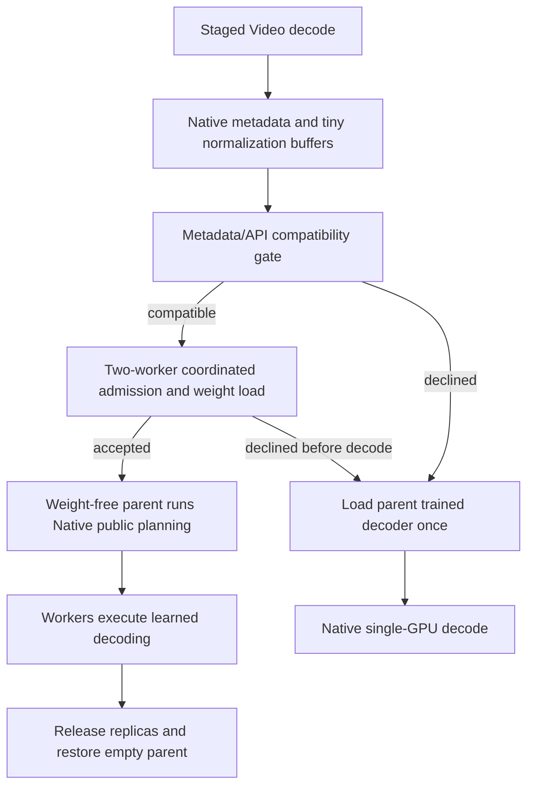

# H3 review follow-up — 2026-10-24

The six remaining prioritized findings in the
[performance engineering review](H3_PERFORMANCE_ENGINEERING_REVIEW_20261024.md)
now have implementations or explicit qualification switches. The requested
exclusions are preserved: full-width CPU offline-LoRA merging still runs
independently on each rank, and Scalar Sparse routing/execution is unchanged.
Kitchen remains the normal DiT attention default.

**125 CPU regression tests pass, with no skips.** Local operator previews use
the RTX 5060 Ti / SM120, the unchanged conda environment and actual TP2 shapes.
They are explicitly not new T4 measurements. No Kaggle interaction, full H3
generation, package installation, upstream update or remote publication occurred.
The [evidence record](../data/h3_review_optimizations_20261024.json) retains the
measurements, boundaries, source hashes and pending qualifications.

## Changes by review finding

| Finding | Implementation | Default / qualification |
|---|---|---|
| 3. Column linears | One output destination; FP32 scale product followed by accumulator multiply; no output-chunk concatenation or extra scaled FP32 chunk. Optional TileLang epilogue removes broadcast scale scratch; optional direct INT8 GEMM avoids the eager transpose/padding path. | Allocation repair active on the selected eager path. Experimental fused/direct paths are opt-in and gated to aligned DiT TP2 columns on SM75. |
| 4. Online QKV B output | Component-aware owned B rows for actual H3 rank128 QKV adapters; full A projection, separate ordered adapters and post-B strength retained. | `lora_selective_qkv_b=False` remains default. Wrong rank/shape/refiner targets keep full B. Local equality is not T4 promotion. |
| 5. Parent Video decoder | Metadata-only Native planning template and tiny normalization buffers before remote admission. Parent learned weights load only after refusal or explicit Native selection. | Active for staged Video auto mode. Existing already-trained VAE objects retain their scoped CPU fallback. |
| 6. Row-shard loading | Optional bounded full-row reads, plus loader access to the existing verified contiguous rank-block format. Full-width column requests automatically use contiguous reads. | Direct ranges remain default. Bounded reads trade fewer calls for source-byte amplification; do not promote from local SSD timing. |
| 7. Repeated integrity work | Strict state schema every load; one full file/state proof per unchanged shard/manifest identity. Cache only reader metadata and proof identities. Validate the admitted set at block boundaries and the addressed artifacts during matrix reads. | Active. Mutation still fails and requires reloading; tensor/merged-weight payloads are not cached by this proof. |
| 8. Unused worker output | Discard rank-1 nondiagnostic results before `packet(..., 'cpu')`. | Active. GPU synchronization, sequence acknowledgements and exception/cancellation handling remain in place. Both ranks still return explicit diagnostics. |

The original FP16-fix tensor flow, fused-stored FC2 preparation, scaled-FP16 row
transport, FP32 stability islands and Native single-GPU Audio decoding remain.
Frozen ComfyUI and its legacy attention API are unchanged. All 94 recorded local
package versions match; Kitchen is 0.2.37 and TileLang is 0.1.13.

## Column implementation and local preview

The default keeps the pinned eager quantizer and complete INT8 GEMM geometry.
It computes `scale = row_scale * weight_scale` in FP32, then
`value = accumulator.float() * scale`, then rounds into the output dtype.
Multiplying the accumulator by row scale first would change that contract and
is not used. The destination is allocated once; each bounded FP32 chunk is
multiplied in place and copied into its final rows.

Two explicit candidates extend that implementation:

- `tilelang_exact`: the same eager GEMM, followed by a single-store TileLang
  epilogue with two explicit `__fmul_rn` products in the required order.
- `cuda_int8_tilelang`: the same eager activation preparation, the existing
  direct Kitchen INT8 GEMM primitive used by row operators, and that epilogue.

The global Kitchen registry guard is retained. Neither candidate changes
ConvRot/quantization or silently selects a new global backend. Production
dispatch requires actual SM75, inference mode, the eager selected backend and
weight shape `[10752,5376]` or `[14336,5376]`. Other devices/shapes retain the
selected implementation. Compiler/dependency checks include column-only
TileLang selections. Autograd and compiled callers retain the public operator.

The local preview intentionally invokes the candidates directly on SM120.
Inputs are seeded FP16 shape fixtures and weights are trained base block-0
rank-0 slices, not captured denoising activations. The baseline source matches
the pre-edit file SHA256. Compilation/loading are outside the timed samples;
each path is warmed and measured three times, reversing order on the middle
repetition. Values below are medians from the final run.

| Projection, 51,220 tokens | Prior adapter (ms) | Default allocation repair (ms) | TileLang epilogue (ms) | Direct GEMM + epilogue (ms) |
|---|---:|---:|---:|---:|
| QKV, local output 10,752 | 110.841 | 104.716 | 69.048 | 63.981 |
| FC1, local output 14,336 | 141.053 | 132.589 | 84.766 | 78.463 |

| Incremental peak allocation | Prior | Default | TileLang epilogue | Direct + epilogue |
|---|---:|---:|---:|---:|
| QKV (GiB) | 3.803 | 3.579 | 3.079 | 3.078 |
| FC1 (GiB) | 4.811 | 4.605 | 4.105 | 4.105 |

All outputs at 261, 4,096 and 51,220 tokens match as raw uint8 storage views,
including signed zero, in these fixtures.
Separate epilogue probes cover signed INT32 limits, FP32 integer-conversion
rounding, scalar/channel scales and FP16/BF16/FP32 output casts. These probes
pass locally. The normal default is `preallocated`; faster candidates require
physical T4 numerical, memory and complete-API timing checks before promotion.
Small-shape measurements varied between previews; three-sample medians do
not establish p95 or whole-request latency.

Peak numbers subtract the already-live input/weight/reference allocation. They
are operator increments, not whole-request VRAM. Removing 1.368 GiB of FC1
output concatenation does not imply that amount of peak reduction: the live
INT32 accumulator and bounded dequantization scratch still set the peak.

## Shared TE preparation

On the actual 5,120-wide TE eager path, Q/K/V share one deterministic
ConvRot/row-quantization result. Gate/up similarly share their common input.
Each projection retains its own weight, output geometry and GEMM; QK Norm,
RoPE, attention, residual and MLP ordering are unchanged. Other backends,
autograd, compiled calls, module subclasses, overridden forward methods and
local/global forward hooks use the original module calls.

At 1,182 tokens with trained base TE slices and seeded FP16 inputs, forced-eager
local medians were 2.581 → 1.801 ms for Q/K/V and 9.607 → 9.130 ms for gate/up.
All outputs match exactly. Tests also prove that hooks fire and restore the
three independent preparations when present. This is not a whole-TE speedup
or physical T4 timing. Full vision-frontend replication remains unchanged;
moving that work to one rank requires a separate Native ordering/transport
qualification.

## Online QKV candidate

`lora_selective_qkv_b=True`, together with the existing `selective_b` master
switch, enables owned QKV B factors only for A `[128,5376]`, B `[21504,128]` in
ordinary DiT blocks. Each owner packs its 3,584 rows from each of the three
7,168-row components. Adapter order and strength application after B are
unchanged; packed ownership is reflected in host-residency byte estimates.

Local seeded two-adapter previews at 51,220 tokens are exact at the FP16-flow
operator output for both logical owners. Incremental peak allocation falls
from 8.231 to 6.180 GiB. Median time is 219.518 → 184.795 ms for owner 0 and
222.769 → 180.404 ms for owner 1. These are single-GPU logical-owner tests,
not two concurrent ranks or trained-adapter generation acceptance. B GEMM
geometry changes; the option stays disabled until target-hardware checks pass.
The existing qualified FC1 selected-B path remains enabled as before.

## Video decode ownership and fallback

The actual local checkpoint metadata check reads **2,784 bytes**, with every
learned parameter still on meta. It checks all 36 QKV quantization descriptors
and the legacy attention signature. Workers continue validating their actual
constructed QuantizedTensors before accepting the collective path.

When remote decoding succeeds, the staged parent has no learned decoder lease.
This removes the prior additional parent reservation; it does not predict
simultaneous RSS or claim T4 admission success. Public Native temporal chunking,
spatial tiling, overlap/blending, normalization and trimming stay in the parent.
Refusal restores the empty parent before loading Native weights; an error after
collective decode begins releases worker resources and propagates without a
second decode. Native-only Audio follows its existing preparation path.

Tests cover Native planner equality, successful remote admission without parent
weight loading, refusal/fallback, exceptions and trained-parent restoration.
The actual CPU metadata check correctly reports unavailable GPU dispatch on a
CPU-only host; it is not a GPU compatibility certificate. The historical T4
261-token final-projection discrepancy remains a qualification limit.

## Loading, integrity and deployment controls

Bounded range reads reserve at most 8 MiB of additional preparation scratch.
The fixture reduces 87 row reads to seven while reading twice the requested
column payload. `logical_read_bytes` remains owned payload; `source_read_bytes`
records bytes requested from the source API, not physical SSD traffic. Short
`pread` results, mid-read seek fallback, EOF, disordered row ranges and source
mutation are tested. The default remains direct ranges. A supplied
`rank_checkpoint_dir` uses the existing immutable contiguous rank format and
its provenance/schema/integrity gates.

Four bundle preparations now perform two complete state proofs, one per owner,
rather than four. Strict schema loading still occurs every time. Changed
descriptor, index, auxiliary, shard, manifest or LoRA identity fails; no complete
baked checkpoint is introduced. The same fixture still performs **20 full
merges for five targets**: the excluded cross-rank CPU-work duplication is
explicitly unchanged.

The loader appends these controls after the established widgets:
`prefetch_lifecycle`, `memory_pressure_aware`, `dit_reserve_gib`,
`command_timeout_seconds`, `rank_checkpoint_dir`, `checkpoint_read_chunk_mib`,
`lora_selective_qkv_b` and `column_linear_backend`. Old widget positions and
previous defaults are retained. Lifecycle scheduling can be enabled without
queue-idle speculation. Idle residency still enables its required lifecycle.
The retained large-runner values of 9-GiB DiT reserve and 1,500-second bundle
deadline are now expressible in the UI, not silently promoted as universal
defaults. Admission remains workload- and shape-dependent.

## Validation and pending work

The 125-test CPU run has zero failures/errors/skips and includes the original
review suites, new integrity/ownership/IO/numerical cases and the repaired
diagnostic fixture (`readers={}`). Additional control gates cover old dispatch,
selected-B FC1, UI/cache ownership and Native-only Audio. Source checks confirm
unchanged frozen ComfyUI, 94 package versions, offline merge implementation and
Scalar attention dispatch. Debug/preview code stays under `benchmarks/`.

Before enabling the new acceleration switches by default, use a bounded T4
operator batch for exact INT32/rounded outputs, warmed latency, allocation and
dispatch verification. Separately qualify Video admission/public decoding on
two real T4s. No whole-H3 speedup, current online-LoRA long-request admission,
generation distribution or semantic-quality improvement is claimed here.
The padded FP32 attention-O quantizer retains its prior arithmetic/geometry;
group-local rewrites remain numerical candidates, not allocation-only changes.

Evidence root: `D:/attention_eval/h3_review_optimizations_20261024/`.
Reproducible local previews: `benchmarks/preview_review_optimizations.py`,
`benchmarks/preview_review_lora.py`, `benchmarks/preview_review_te.py`.

The separately authorized [T4 follow-up experiment](H3_REVIEW_T4_EXPERIMENT_20261024.md)
now binds the new operator candidates to a frozen source archive and a
native-Linux CPU preflight. Its submission and results are recorded separately
from the historical local-preview evidence above.
