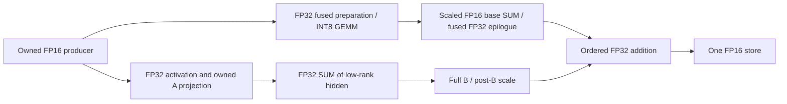

# RowParallel LoRA A reduction and reference-demand VAE loading

The H3 loader now combines the existing FP16-fix / fused-stored / scaled-FP16
base projection with **RowParallel LoRA A Partial Reduction by default**.
Video and Audio VAE constructors now keep metadata shells only; their encoder
weights load on actual reference encoding, not merely because a VAE is linked
for eventual output decoding. No package or pinned ComfyUI source was changed.

## LoRA algebra and numerical boundaries

With logical A written as `[K,R]`, feature partitioning gives

\[
H=XA=\sum_{p=0}^{P-1}X_pA_p,\qquad
\Delta Y=HB\,s.
\]

The implementation stores A as `[R,K]` and uses `F.linear(X_p, A_p)`, so the
equivalent code is:

```python
hidden = F.linear(owned_activation.float(), owned_A.float())
dist.all_reduce(hidden, op=dist.ReduceOp.SUM)  # FP32, [tokens, lora_rank]
delta = F.linear(hidden, full_B.float())
output_fp32.add_(delta.mul_(adapter_scale))
output_fp16 = output_fp32.to(torch.float16)
```

Each owner reads only its A input-column shard. B remains full; each rank needs
the complete row-projection output. For FC2, FP32 SwiGLU is applied to the owned
gate/up values before A. LoRA consumes the **unquantized, unrotated activation**,
not the base INT8 codes. Separate adapters retain their own A projection, SUM,
B projection and post-B scale/add order. No Concat A or strength folding into B
is introduced. The existing bounded hidden staging remains capped at 32 MiB.

The base INT8 row and LoRA bypass use different communication representations:



The hidden SUM is **FP32**, not the scaled FP16 accumulator codec. Summing A
partials still changes floating-point reduction/GEMM order relative to one
full-input Native A GEMM. It is an explicit approximation, not byte-exact
Native LoRA. Setting `lora_row_partial_reduce=False` restores the full-input
gather implementation. Offline-baked models have no online bypass to reduce;
unsharded refiner adapters and column-parallel Selective B are unchanged.

## Communication size: why this targets the measured bottleneck

For TP2 with one rank-128 adapter and FP32 LoRA arithmetic:

| Projection | Local K | LoRA R | Activation gather input per rank | Hidden SUM input per rank | Ratio of input tensor bytes |
|---|---:|---:|---:|---:|---:|
| DiT attention O | 3584 | 128 | `M * 3584 * 4` | `M * 128 * 4` | 28× |
| DiT FC2 | 7168 | 128 | `M * 7168 * 4` | `M * 128 * 4` | 56× |

At M6814, FC2's owned activation is **186.32 MiB** and a rank-128 hidden is
**3.33 MiB**; the full gathered activation tensor is **372.64 MiB**. Two
rank-128 adapters require two hidden SUMs, so the aggregate input-byte ratio
becomes 28× for FC2, not 56×. These are tensor-size calculations; collective
algorithms, launch latency, topology and waiting determine real communication
time. They are not measured bandwidth or speedup claims.

The prior [dual-T4 warm row traces](FP16_FC2_FUSION_VIDEO_SPLIT_20261022.md)
showed roughly 2.4-3.0 ms in the LoRA activation AllGather for the S513 stress
case. Partial reduction removes that LoRA gather. Other collectives, original
INT8 GEMM, full B GEMMs and base-quantizer communication remain where required.
This combined default has not received a new physical T4 latency measurement.

## Load encoder weights only when a reference needs them

`StagedVAE.__init__` reads checkpoint metadata and constructs the Native meta
shell without encoder/decoder parameter storage or a component host-budget
lease. `encode()` / `encode_tiled()` admit and load the encoder on demand.
`decode()` / `decode_tiled()` can be the first use and load only the decoder.
The previous component is released before another component is allocated.
Before denoising, the existing service release removes loaded reference encoders.
Decoder admission, Native public tiling/chunking and single-GPU FP32 audio
decoding retain their existing behavior.

| Reference inputs actually consumed | Video encoder | Audio encoder |
|---|---|---|
| No references / text-to-video | No | No |
| Reference image or silent video | Yes, when Video VAE is connected | No |
| Standalone reference audio | No | Yes, when Audio VAE is connected |
| Video with its index-matched soundtrack | Yes | Yes, with both VAEs connected |
| Image/video plus standalone audio | Yes | Yes |
| VAE connected only for generated output | No encoder; decoder loads at output | No encoder; decoder loads at output |

Native permits references to condition only the TE when the corresponding VAE
input is absent. That behavior is preserved; the loader does not force latent
reference encoding. An unmatched soundtrack does not request an audio encoder.
In the pinned Native reference node, soundtrack latent encoding is skipped
when no Video VAE is supplied; the preload hint follows that same rule.

Idle preloading now uses `patches/h3_reference_plan.py` to read the current API
graph, following VAE links only from known reference/encode consumers. It
supports nested and flattened H3 autogrow reference inputs, keyframes, guides
and ordinary VAE encoding. Decoder-only links do not select encoders. Changing
the reference type releases excluded speculative components. Without a graph,
standalone callers preload only registered VAEs previously used for encoding,
or may explicitly call `preload_idle()`.

Graph analysis is a best-effort prefetch hint: unknown/custom/dynamic producers
are not executed to discover a reference. An unresolved or nullable input may
change speculative prefetch, but actual component loading is always governed
by the Native caller's real `encode()` / `decode()` invocation. No prompt,
latent, waveform or generation computation runs speculatively.

## Configuration, checks and qualification scope

`RuntimeConfig.lora_row_partial_reduce` and the loader's schema/Python default
are now `True`. Both bundled TP2 graphs, the builder and the active pinned
checkout's TP2 workflow agree. Explicit `False` remains supported and changes
session/cache identity. Existing saved user graphs with explicit old values
retain them. No new widget or attention API was added.

Local checks passed:

- **64 focused tests**, including two-owner/stacked LoRA arithmetic, exact
  agreement with an independent FP32-partial reference, owned-A/full-B reads,
  reference-type filtering, lazy construction, decoder-first use and lease cleanup.
- **Four production-row GPU checks**: DiT FC2 and O on two logical owners,
  FP16 storage + stored fusion/scaled codec + two rank-128 adapters. All outputs
  exactly match their independent combined partial/codec reference; the LoRA
  bypass records only FP32 `[3,128]` SUMs, with no activation AllGather.
- **Trained Video and Audio VAE checks**: constructor component payload 0;
  small real-checkpoint encode and decode results exactly match Native, with
  encoder release before decoder and no remaining host lease at release.
  Separate decoder-first runs also match Native while reading **zero encoder
  payload**, then successfully switch to encoding and back to decoding.

These GPU checks ran on the local RTX 5060 Ti (SM120), using explicit logical
transport and preview kernel targets. They are arithmetic/lifecycle evidence,
not two-T4 NCCL, throughput or generation-quality acceptance. No full H3
pipeline or Kaggle job ran for this change. The known Video 261 `proj_out`
geometry mismatch is unaffected.

Local artifacts: `D:/attention_eval/h3_row_partial_reference_20261022/`.
The [source-bound integration record](../data/h3_row_partial_reference_loading_20261022.json)
contains test scopes, artifact hashes and current production-source identities.
