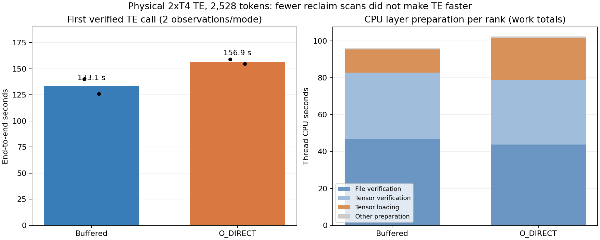
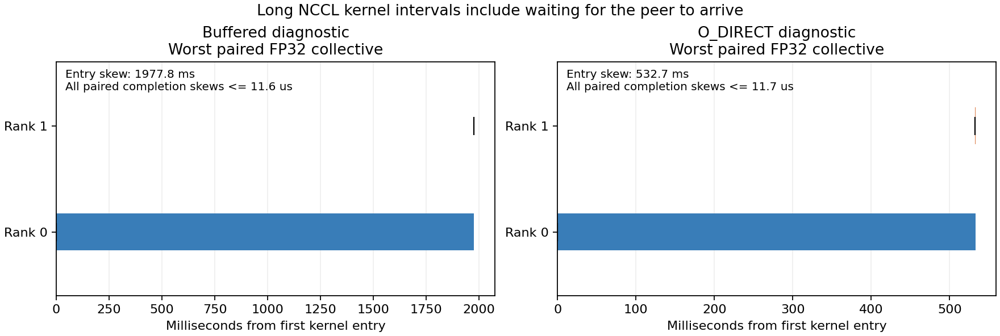

# TE O_DIRECT results on two T4s — 2026-10-30

**Keep buffered reads as the production default.** Completed v2 found the
current aligned O_DIRECT adapter **17.9% slower on first-use TE** and **45.4%
slower in the single unprofiled repeat comparison**. It reduced reclaim scans
but barely reduced first-call file refaults. Verification and CPU preparation
dominate; the direct adapter adds substantial copying work.

This is a negative result for this adapter/policy combination, not an upper
bound on an optimized direct-I/O implementation. Production operators,
verification and dependencies remain unchanged.

## Completion and identity

[Kaggle notebook](https://www.kaggle.com/code/pamcks/h3-te-direct-io-t4-20261030),
**version 2**, completed successfully. Its supervised experiment took
**1,602.26 seconds**, including downloads, raw I/O, warmup, TE and export.
Hardware was two distinct **Tesla T4 / SM75** devices. Software was native
Torch **2.11.0+cu128**, CUDA **12.8**, Kitchen **0.2.37**, TileLang **0.1.13**,
Python **3.13.15**, and the qualified frozen legacy ComfyUI source.

The previous 1216×704 reference presentation produced conditioning of shape
**[1, 2528, 5120]**. All nine calls, including warmup and diagnostics, were
finite and byte-identical. Conditioning SHA256:
`0031540982daaba24146013a7b55a02e87f646bcbc7a696e7de59e4329f64333`.
Native vision and all 50 TP2 TE layers ran; DiT, VAE, sampling and baking were
outside scope.

All **90 final files** passed size/SHA256 checks. Decoded supplemental sources
match commit `5e7cebb199d78f3d468c53255bd9dc09d8532803` and the v2 binding.
All four CUDA traces passed capture/flush checks, with **6,307 kernel events
per rank trace** and zero dropped I/O rows.

## TE time

| Boundary | Buffered | O_DIRECT | Direct change |
|---|---:|---:|---:|
| First verified call, two observations | 140.13 / 126.07 s | 158.93 / 154.91 s | — |
| First-call median | **133.10 s** | **156.92 s** | **+17.9%** |
| Unprofiled repeat, one observation each | **49.20 s** | **71.52 s** | **+45.4%** |
| Separate profiled repeat | 55.95 s | 81.45 s | Diagnostic only |
| Worker/service startup, approximate | 14.43 s | 14.88 s | Separate from calls |

One full warmup preceded buffered/direct/direct/buffered execution. Compiler
caches were reused, but fresh-worker first-use costs remain in first-call
measurements; these are not pure disk timings. Profiled calls are excluded
from unprofiled comparisons. With **one unprofiled repeat per mode**, the repeat
ratio is not a P95 or a broadly qualified steady-state result. The same adaptive
policy can produce different cache hits and physical read volumes across modes.

## Verification is a major CPU cost

Mean work over two first-use cases and both ranks, **per rank**:

| Component | Buffered wall work | Direct wall work | Buffered thread CPU | Direct thread CPU |
|---|---:|---:|---:|---:|
| File SHA256 | 68.50 s | 75.94 s | **46.82 s** | **43.80 s** |
| Native tensor-state SHA256 | 36.00 s | 34.87 s | **35.85 s** | **34.83 s** |
| Tensor loading within layer preparation | 13.06 s | 25.88 s | **12.60 s** | **22.99 s** |
| Entire layer preparation, enclosing the above | 118.20 s | 137.52 s | **95.80 s** | **102.32 s** |

Each rank verified **50 shard files and 50 tensor states**, approximately
**11.36 GiB per hash pass**. Both proofs remain enabled. Together they account
for **86.3% of buffered layer-preparation CPU** and **76.9% of direct preparation
CPU**. These are producer CPU-work shares, not additive end-to-end latency shares.

Auxiliary and bundle-index verification during startup adds about
**10.8–11.3 s wall work per rank**, including roughly 2.56 GiB of auxiliary data.
Download validation is another separately recorded phase outside TE timing.
Repeat calls performed **zero new file/tensor SHA256 proofs**, retaining
signature/schema guards and cached immutable-file verification identities.

CPU preparation and layer lease waits cover most of each call's elapsed
interval. Nested reads/hashes/preparation and parallel ranks must not be summed
into a serial critical-path breakdown. Tensor hashes read CPU storage, so disk
bandwidth alone cannot accelerate that work.

## Direct adapter costs and cache effects

The actual `/tmp` overlay passed descriptor, statx alignment and byte/cache
bypass checks. Representative real-shard ranges and final TE equality passed.
No application-level buffered fallback was used for direct weight reads.

The direct tensor path reads into aligned mmap scratch, copies into a bytearray,
slices that bytearray, converts to bytes, then copies into the final tensor.
Native buffered pread copies its returned bytes into the tensor. The adapter
therefore adds full-sized Python allocations and copies. Measured layer-loading
CPU rose **12.60 → 22.99 s per rank**. Aligned overread was only about **0.078%**
of first-call weight-read bytes; sector padding alone cannot explain the loss.

File-verification wall work also increased while its CPU time decreased slightly.
Preparation/admission and cache behavior changed too. A matched buffered-adapter
control and copy-elimination ablation are needed to isolate syscall effects
from adapter effects; they were not run here.

Repeat calls still reload many shards because CPU/GPU caches are bounded.
Cached proofs remove hashing, but do not make all 24.4 GB resident. Direct reads
bypass useful file-cache reuse while retaining copy overhead. Cache misses
also change read volume, so the entire repeat slowdown cannot be assigned to
one read syscall.

Approximate counters bracketing **first TE calls only**, means of two cases:

| Cgroup metric | Buffered | O_DIRECT |
|---|---:|---:|
| Reclaim scans | **12.82 million pages** | **5.88 million pages** |
| File workingset refaults | **6.15 million pages** | **6.02 million pages** |
| Full memory PSI accumulated stalls | **1.32 s** | **0.40 s** |

Scans fell about **54%**, but refault counts fell only about **2%**. Both modes
reached approximately **30 GiB cgroup usage**. Whole-pair file-memory peaks were
**15.43–18.34 GiB buffered** and **13.69–16.83 GiB direct**; anonymous peaks were
roughly **17.5–18.1 GiB**. These independent maxima must not be added; some pairs
include profiling. File charges include shmem, whose peaks were about 1.2–1.5 GiB.

The small probe establishes top-file cache behavior, not elimination of cache
charges throughout the stack. An overlay mount is recorded, but its lower-layer
cache/direct-I/O configuration is not established. Lower storage caching is a
plausible contributor to residual refaults, not proven attribution. Shared
cgroup activity, retained download caches and OS behavior limit interpretation.
O_DIRECT did **not** establish elimination of page-cache thrashing here.

Sampler CPU cost was **2.3–2.9 seconds per pair**. Per-read logging overhead
was not independently ablated. Both arms use the observer, but their adapter
and event patterns differ.

## GPU evidence: compute and waiting collectives

Separate second-call traces show similar non-NCCL kernel work:

| Diagnostic | GPU trace span | Non-NCCL kernel interval union, ranks 0 / 1 | FP32 AllReduce kernel work, ranks 0 / 1 |
|---|---:|---:|---:|
| Buffered | 54.29 s | **3.28 / 3.45 s** | **34.11 / 0.42 s** |
| Direct | 80.16 s | **3.40 / 3.80 s** | **5.95 / 2.08 s** |

Each pass has **100 FP32 collectives** paired in stream order across ranks.
Maximum kernel-entry skew was **1.978 s buffered**, **0.533 s direct**. All
paired completion skews reported by the traces were below **12 microseconds**;
both traces use the same timestamp base. Long intervals therefore include
waiting for peer arrival, rather than equivalent PCIe transfer service time.

The source exchanges FP32 per-row maxima for global quantization, approximately
**10 KiB at 2,528 rows**. Scaled FP16 SUM is separate. Preparation and enqueue
readiness can leave one rank inside the collective while the peer approaches
it. Direct I/O reduced this particular imbalance while increasing total TE time.

NCCL kernel residency can inflate apparent GPU activity. CPU preparation,
paired timing, compute intervals and copies must be inspected together. These
Kineto traces provide no Nsight Compute memory-stall or achieved-SM-utilization
counters; no such hardware-counter attribution is claimed.

## Priorities supported by the measurements

1. **Accelerate and overlap verification/preparation.** Evaluate bounded
   ahead-of-use hashing, efficient hash workers and consolidation of redundant
   data passes while preserving equivalent integrity acceptance. Proof reuse
   or lifecycle changes need separate validation; no TE checks are disabled here.
2. **Keep ranks ready for the same layer.** Inspect CPU-cache admission,
   cancellations and producer lead/lag before attributing long collectives to
   transport bandwidth.
3. **Remove direct-adapter copies before retesting it.** Reuse aligned storage,
   eliminate bytearray/slice/bytes copies and include a matched buffered-copy
   control. Retain read-volume and memory-policy accounting.
4. **Evaluate consumption-aware buffered cache retirement if needed.** Preserve
   within-shard reuse through verification/loading, then retire clean ranges
   after safe consumption under pressure. Benefits and repeat-prompt effects
   remain unmeasured.

No further GPU job or production change was made.

## Raw I/O and reproducibility

Two-reader, four-shard read/copy samples, in execution order:
**234.38 MiB/s buffered**, **4,851.03 MiB/s direct**, **4,737.01 MiB/s direct**,
**4,209.38 MiB/s buffered**. This strong order/cache effect prevents a first
buffered-versus-direct speedup claim. DONTNEED cannot establish physically cold
lower storage; these approximately 0.9-GiB samples do not establish a sustained
device ceiling. Raw read speed did not predict TE time.

[Summary/provenance](../data/h3_te_direct_io_20261030/retry2/analysis/summary.json),
[latency CSV](../data/h3_te_direct_io_20261030/retry2/analysis/latency.csv),
[final artifacts](../data/h3_te_direct_io_20261030/retry2/final_v2/) and
[contract/v1 failure](H3_TE_DIRECT_IO_T4_20261030.md) are retained. Public OS
samples are losslessly compressed, with original sizes/hashes preserved in
the download manifest and compression index. Original downloads remain at
`D:\attention_eval\h3_te_direct_io_20261030\retry2\final_v2`.

`benchmarks/analyze_te_direct_io.py` reproduces the results from either archive
form without GPU/network use. One TLS-1.2-protected final collection obtained
all artifacts without status/list/live-log polling. The result covers one
prompt/reference workload, two first-call samples and one unprofiled repeat per
mode; multi-request throughput and full H3 time remain outside scope.
