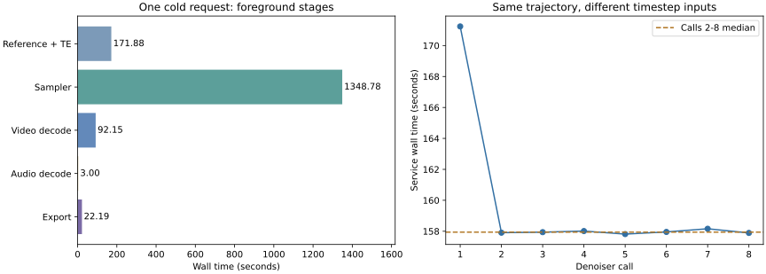

# H3 regular Turbo: 0.85 MP / 10-second E2E on two T4s

**Version 2 completed successfully:** eight denoiser calls, eight sampling steps,
Temporal Video VAE decoding, native single-GPU Audio VAE decoding, and exported
1216×704 video with stereo audio. Foreground generation took **1,639.157 s
(27 min 19.157 s)**. Offline baking took a separate **365.356 s**.
All recorded denoiser/sampler outputs and final tensors were finite.
**User review reports semantic discontinuities and vertical shaking. This run
is execution-qualified, but is not generation-quality-qualified.**

Notebook: [H3 Turbo 0.85MP 10s T4 20261029](https://www.kaggle.com/code/pamcks/h3-turbo-0-85mp-10s-t4-20261029),
version **2**. This report was prepared on 2026-10-30; the notebook keeps its
original 20261029 identifier. This is a regular Turbo run, not PTD.

## Workload and environment

| Item | Executed configuration |
|---|---|
| Hardware | Two distinct Tesla T4 GPUs, SM75; device UUIDs in the batch receipt |
| Stack | Native Kaggle Torch **2.11.0+cu128**, CUDA **12.8**; Kitchen **0.2.37**, TileLang **0.1.13** |
| Native source | Frozen legacy ComfyUI `d49e888586dd8ae012c0667b33466b815fee07f7` |
| Base | `cnmds/minimax-h3-tp2-int8-561a6211`, revision `d3e6a4b131056d2c626a01acf6ba48123a885783` |
| Adapter | `lightx2v/Minimax-h3-Turbo`, revision `30f485ed874aa44c8183348ad361c5eabad318da`; `minimax_h3_ref2v_turbo_8step_v1.0_768p_comfyui_bf16.safetensors`, strength 1 |
| Resolution | **1216×704 = 856,064 pixels = 0.856064 MP** |
| Native / export | 243 frames at 24 FPS / first 240 frames: **10.000 s**; native audio 324,000 samples / first 320,000 samples at 32 kHz |
| Sampling | Euler / Simple, **8 steps**, CFG 1, Video Shift **6**, Audio Shift **3**, seed **20261020** |
| References | Same ordered anime-character and shrine images; `ref_image_size=match`, empty negative prompt |
| LoRA loading | One verified dual-GPU offline TP2 bake persisted to instance disk; empty inference LoRA stack, no remerge |
| Precision | FP16-fix residual flow with divisor 64; FP32 stability islands; FP32 audio VAE |
| Attention | TE Kitchen causal INT8; DiT Kitchen dense INT8; Token Refiner Native SDPA; Video VAE Kitchen INT8 |
| Linear / fusion | Direct INT8 columns + TileLang epilogues, `fused_stored` SwiGLU/quantization, Scaled FP16 row SUM; fused norm, gate, row+gate and prepared attention enabled |
| Residency | GPU lookahead 2 with adaptive depth enabled, CPU lookahead 16; per-rank host cache 3 GiB; idle speculation off |
| VAE checkpoints | Video `minimax_h3_video_vae_int8_convrot.safetensors`; Audio `minimax_h3_audio_vae_fp32.safetensors` |
| Verification policy | Trusted DiT inference bake; download/bake validation and TE checks retained |

The full prompt, image identities, immutable LoRA hash and runtime configuration
are in the archived request/result. The prompt SHA256 is
`e2ebe6a75563a0184ef5fa99299acef24ee3170855774761c44d6714fb2f7754`.

The actual packed DiT sequence was **65,166 tokens**, not just the 60,192
generated-video tokens. Each rank's query shape was `[1,28,65166,128]`:

| Segment | Tokens | Half-open range |
|---|---:|---|
| Text | 2,528 | `[0,2528)` |
| Reference image 1 | 816 | `[2528,3344)` |
| Reference image 2 | 820 | `[3344,4164)` |
| Audio | 810 | `[4164,4974)` |
| Generated video | 60,192 | `[4974,65166)` |

## Latency and its boundaries



| Foreground stage | Wall time, s | Share of foreground |
|---|---:|---:|
| VAE metadata | 0.516 | 0.03% |
| Reference encoding + TE | **171.878** | 10.49% |
| Sampler, including preparation and eight calls | **1,348.776** | **82.28%** |
| Temporal Video VAE decode | **92.150** | 5.62% |
| Native Audio VAE decode | **3.004** | 0.18% |
| MP4 / WAV export | **22.194** | 1.35% |
| Foreground total | **1,639.157** | 100% including small gaps |

Foreground starts after worker/service construction and ends after media
export. It includes reference processing, sampling and decoding, but excludes
downloads, offline bake and later output hashing/stats/cleanup. Summed stage
intervals are 1,638.518 s; the remaining 0.639 s is between stage intervals.

Separate clocks must not be conflated:

| Boundary | Seconds | Interpretation |
|---|---:|---|
| Frozen environment bootstrap | 79.080 | Setup only; no new CPU smoke job |
| Supervised execution worker | 2,745.754 | Downloads, verification, staging, bake and full E2E subprocess |
| Offline bake subprocess | **365.356** | 208 Native-verified targets; 21,237,118,728 persisted bytes, about 19.78 GiB |
| Full E2E subprocess | **1,703.296** | Process startup, service construction, foreground, final hashing/stats and teardown |
| Worker remainder beyond bake + E2E subprocess | 677.102 | Download/staging/validation and orchestration combined; not a pure download timer |

Do not add foreground time to the E2E subprocess or worker time: these are
nested measurements. The bake bank lives on this instance's disk; it was not
uploaded as a persistent cross-instance weight cache.

### First call versus later calls

| DiT denoiser call | Service wall time, s | Rank 0 allocated peak, GiB | Rank 1 allocated peak, GiB |
|---|---:|---:|---:|
| 1 | **171.236** | **11.408** | **11.173** |
| 2 | 157.907 | 10.489 | 11.038 |
| 3 | 157.942 | 10.489 | 11.038 |
| 4 | 158.013 | 10.489 | 11.038 |
| 5 | 157.816 | 10.489 | 11.038 |
| 6 | 157.956 | 10.489 | 11.038 |
| 7 | 158.161 | 10.489 | 11.038 |
| 8 | 157.892 | 10.489 | 11.038 |

Calls 2–8 had a **157.942 s median**. Call 1 was **13.294 s / 8.42%** slower
than that median. These are consecutive calls with different timestep inputs
in one trajectory, not repeated identical-input steady-state trials.

The eight service calls sum to **1,276.924 s**. Sampling also included initial
Refiner preparation/execution (**22.645 s**), `prepare_dit` (**44.049 s**), a
second Refiner call (**0.422 s**), begin/end-sample handoffs and callbacks.
The 44.049 s preparation interval must not be attributed entirely to kernel
compilation. AOT was enabled, but this run has no per-compiler attribution.

CUDA event intervals for denoiser calls track the service times closely
(first call about 171.12 s per rank; later calls about 157.7–158.1 s). They
include dependency waits and launch gaps and are not exclusive kernel-busy
time. This run contains no Nsight Systems/Compute capture or operator ablation.

## Memory and lookahead evidence

| Measurement | Rank / GPU 0 | Rank / GPU 1 |
|---|---:|---:|
| First-call PyTorch allocated peak | 11.408 GiB | 11.173 GiB |
| Later-call PyTorch allocated peak | 10.489 GiB | 11.038 GiB |
| Highest denoiser PyTorch reserved peak | **13.771 GiB** | **14.291 GiB** |
| TE PyTorch allocated peak | 2.857 GiB | 2.794 GiB |
| Temporal decoder worker allocated peak | 2.989 GiB | 2.989 GiB |
| Sampled whole-device NVML used peak during sampling | **14.972 GiB** | **14.964 GiB** |
| Sampling NVML utilization, sample mean / median | **94.23% / 100%** | **95.72% / 100%** |

PyTorch values belong to individual workers. NVML values include device-wide
process/context/driver usage; they cannot be summed with worker allocations or
used as a precise allocator headroom prediction. The parent sampler also uses
GPU 0. Sampling succeeded once, but the large reserved footprint is not evidence
that more resolution or concurrent requests will fit.

The monitor retained **3,275 samples**, approximately every 0.5 s; 2,656 fell
within sampling. Utilization is the arithmetic mean of those samples, not
time-weighted occupancy or FLOP utilization. NCCL kernels can contribute to GPU
activity. These measurements do not support “mostly idle during sampling” at
this coarse scale, but cannot establish the amount of useful-compute overlap
or the causal benefit of adaptive lookahead without an ablation.

Reference/TE utilization was much lower (sample means **19.04% / 3.70%**),
but that combined stage includes reference processing, preparation and weight
streaming. This is a lead for a TE-specific trace, not proof that an attention
kernel or NCCL alone caused the gap.

Aggregate host-cache statistics across the request show about **307.85 / 314.69 s**
of recorded waits and **417.38 / 417.60 s** of preparation on ranks 0/1.
Each cache peaked at 3,171,723,776 bytes. These cumulative counters span models
and overlap execution; they must not be summed across ranks or subtracted from
foreground time as independent critical-path costs. The sampled cgroup usage
peaked at **29.890 GiB** against a **30 GiB** limit, including reclaimable file
cache. That is not an anonymous-RAM measurement.

## Executed operators and decoder behavior

Both ranks recorded **400 Kitchen attention calls within denoiser commands**:
50 DiT layers × 8 steps. Each also recorded **50 TE causal calls**, **250 TE
column-view calls**, **450 fused SwiGLU/quantization calls** and **900 scaled
FP16 row epilogues** across TE/DiT. The global Kitchen counter also includes VAE
work and must not be presented as the DiT layer count.

The output decoder selected **`native_temporal_pairs`** with **no fallback**;
both workers executed seven temporal-pair commands. Audio selected **`native`**
with no fallback. Image-only conditioning read the Video encoder on demand
(360,747,328 logical bytes); the Audio encoder read **zero bytes** before
sampling. Decoder weights were loaded at output time. No online LoRA modules
were attached, and both ranks reported zero inference-time merged matrices.

## Output integrity and quality boundary

Native decoded pixels were `[1,243,704,1216,3]`; audio was `[1,324000,2]`.
Export used `[1,240,704,1216,3]` and `[1,320000,2]`. `ffprobe` independently
confirmed **240 H.264 frames at 24 FPS**, 1216×704, with a **10.000 s** video
and stereo 32 kHz AAC stream. WAV inspection confirmed 320,000 stereo PCM16
samples at 32 kHz. Full pre-decode video/audio latents were saved before decoding.

| Private local artifact | Bytes | SHA256 |
|---|---:|---|
| `video.mp4` | 13,470,344 | `1bb0cf23006c6a2bc6bfe54ca6a57cd51982ca5072421e5711c4bdcfe4bfc5d7` |
| `audio.wav` | 1,280,044 | `aa2a9ba5eea4bc8f66aa754693fc2c7e5b34f962503666e2fe448ee879c10b04` |
| `decode_inputs.pt` | 23,219,349 | `295c0bc4df5394df0a0d67d7b712ee4a519a4421b80f975772d58aec01675a0e` |

Finite tensors and valid media establish execution/integrity, not perceptual
quality. No native FP32-flow comparison, visual/audio rating, temporal-consistency
assessment, semantic-distribution test or INT8-versus-FP16 VAE A/B was performed
in this job. In particular, behavior after two seconds still needs human review.
The run also emitted a multiprocessing semaphore cleanup warning after export;
the worker exited zero and media verified, but clean shutdown remains a follow-up.

## User quality review and TE causal hypothesis — 2026-10-30

The user reports that the umbrella disappears, a cat-like animal appears
abruptly, and the video shakes vertically without a convincing cause. These
are qualitative failure observations, not explained away by finite tensors or
correct output dimensions. No frame-accurate onset annotations or controlled
baseline ratings were supplied. Audio quality was not assessed in this feedback.

The prompt explicitly asks a white fox spirit to appear, dissolve and reform.
Animal appearance alone therefore does not prove an unsolicited-object error;
the reported abruptness, identity and continuity still need comparison. The
umbrella's persistence and smooth motion are explicit conditioning requirements.

TE Kitchen causal INT8 is a credible hypothesis, with two distinct mechanisms:

| Mechanism | Evidence and limits |
|---|---|
| Causal mask/index/tile-boundary bug | Earlier physical T4 controls preserved all 144 tested fixed-packed prefixes after future packed-input edits. No such bug is demonstrated by those tests; this E2E did not save its actual TE mask or per-layer Q/K/V for an exact-shape audit. |
| Quantization-induced future dependence | The earlier audit changed floating-point suffixes and requantized: 288/336 comparisons changed earlier outputs, including ordinary-scale edits. Shared quantization statistics can change a prefix representation even when its score mask remains causal. This is a measured operator limitation, not proof that it caused these video defects. |

See the [physical TE audit](TE_CAUSAL_PREFIX_PRECISION_20261026.md). Its inputs
were synthetic; trained-activation amplification and semantic quality were not
qualified. One should not reinterpret its aggregate error as an H3 quality limit.

This run's TE residual/Q/K/V attention path is FP16. The shared adapter
delegates FP16 input to pinned Kitchen 0.2.37; its separate direct-FP32
output-store fix is therefore not a correction for TE's causal-prefix behavior
here. The causal adapter forwards the full supplied mask, without default
triangle classification or replacing it with an implicit causal flag.

TE computes conditioning once before sampling; there is no TE recomputation
at the moment an object disappears in the output. A TE error could alter the
whole trajectory, but output time alone cannot locate a TE token boundary.
DiT INT8/fused arithmetic, the distilled eight-step adapter and VAE decoding
remain alternative contributors. No evidence currently assigns causality.

The Native VAE planner uses a 17-output-frame cadence (five latent tokens,
four-frame temporal ratio, three-frame trimming) with five-frame overlap
blending. Temporal pairs retain that planner; the cadence is not unique to
parallel decoding. A CPU-only encoded-video diagnostic tracked all 239 frame
transitions with an affine optical-flow fit. Large fitted vertical components
occur at multiple cadence phases, rather than establishing a simple phase-zero
cut failure. Foreground motion, camera scale/rotation and compression confound
that estimate. Neither it nor the older small-pixel-difference VAE comparison
rules out a decoder issue on this new input.

The attribution controls should be kept separate:

1. **TE-only Native SDPA:** retain the existing FP16-fix flow, INT8 TE weights/
   projections, masks, RoPE, GQA, DiT, LoRA, decoder, prompt and noise. Change
   only TE attention, verify actual SDPA dispatch, and compare conditioning and
   the complete generated trajectory. Save token/position/mask metadata and
   inspect word/image/padding boundaries. This is an attention-only control,
   not an all-FP32 TE reference or proof that the rest of the pipeline is exact.
2. **Decoder-only replay:** use the saved `decode_inputs.pt`, same checkpoint
   and precision, switching only Temporal to Native. This isolates additional
   parallel planning/assembly differences without repeating TE or DiT. Native
   also retains its own temporal chunking. A later checkpoint-precision control
   would be a separate comparison.

Use the existing Kitchen video as the first arm only after checking identical
source/model/input identities and noise hashes. Do not combine a TE replacement
with a different VAE, prompt, LoRA or sampling setup. Assess object persistence,
animal identity/entrance, reference preservation and vertical motion, especially
after two seconds; an L1/L2-only pass cannot establish semantic equivalence.
No GPU job or default-operator change was made for this review.

The user feedback and limited local motion diagnostic are archived under
`docs/data/h3_turbo_085mp_10s_20261029/quality_review/`.

## What this run establishes

1. **This exact 0.856 MP, eight-step, 10-second workload fits and completes on
   two physical T4s.** It does not establish a general maximum resolution or
   multi-request capacity. The previous 0.9 MP run OOM'd in the parent sampler;
   version 1 at 0.85 MP failed on an HF HTTP 503 before inference, not OOM.
2. **DiT sampling dominates foreground time.** Operator-level work on the real
   65,166-token TP2 layout has the largest foreground target. The current E2E
   evidence does not identify an exclusive kernel bottleneck or prove a fusion
   speedup; use existing physical operator traces and controlled operator tests.
3. **Cold preparation and repeated deployment deserve separate treatment.**
   Offline bake is substantial but reusable on the same disk. Preparation and
   downloads should not be mixed into a warmed denoiser latency claim.
4. **TE preparation and memory margins remain investigation targets.** Keep
   residency bounded and profile the TE stage and parent/worker handoff before
   expanding lookahead or introducing concurrent requests. No further GPU job
   was submitted during report preparation.

## Reproducibility, source sync and repository merge

One logical final-output collection was followed by one authorized missing-file
retry after a TLS interruption. All **27 final artifacts** were downloaded;
original errors/partial manifests remain private. Source identity was checked
against the submitted capsule and both benchmark overlays, not inferred from
the notebook title. No Kaggle status/live-log polling was used.

The runtime capsule is
`21abe7dd91f284eed9626bb018c6abf66adf1c066b2f76662d72ce53d46d41a1`;
benchmark overlays are bound to
`ba197bbd922828a9220f41090993527b4bd0b67e`. Earlier CPU qualification was
reused as authorized; no replacement CPU smoke instance was run.

Repository audit found **16 production paths** present in that qualified,
physically executed capsule but still uncommitted locally: the shared Kitchen
adapter/native headers and TE/decoder integration. Those validated paths are
included in the sync. All **97 production source entries** match the qualified
capsule after CRLF normalization, and vendor files match their exact manifest
hashes. Three newer local edits (loader, runtime worker, operator policy) and
unrelated local work remain uncommitted; this report does not qualify them.
Regular Turbo success does not qualify PTD's separate full E2E workload.

Evidence and analysis live under
[`docs/data/h3_turbo_085mp_10s_20261029/`](../data/h3_turbo_085mp_10s_20261029/):
`gpu_v2_final/`, `analysis/summary.json`, `analysis/denoiser_calls.csv`,
`analysis/analyze_e2e.py` and `runtime_sync_audit.json`. Media and replay latents
stay outside Git at
`D:\attention_eval\h3_turbo_085mp_10s_20261029\retry2\kaggle\gpu_final\turbo_085mp_e2e\generation\`.

Reproduce the offline analysis with the existing conda Python, Matplotlib and
local `ffprobe`; it executes no model and makes no network calls:

```powershell
& 'C:\ProgramData\miniconda3\envs\comfyui\python.exe' `
  docs/data/h3_turbo_085mp_10s_20261029/analysis/analyze_e2e.py `
  --artifacts D:/attention_eval/h3_turbo_085mp_10s_20261029/retry2/kaggle/gpu_final `
  --submission D:/attention_eval/h3_turbo_085mp_10s_20261029/retry2/kaggle/gpu_submission.json `
  --output D:/attention_eval/h3_turbo_085mp_10s_20261029/retry2/analysis
```
