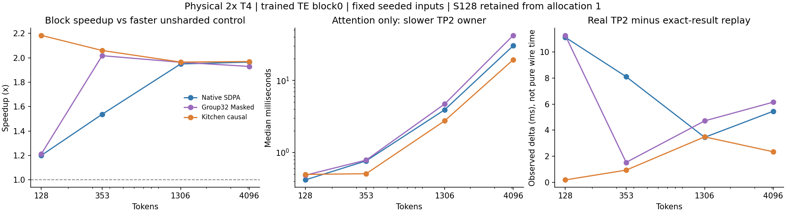

# TE attention and TP2 communication — 2026-10-27

Status: **complete on physical 2×Tesla T4, SM75**. The corrected
[private job](https://www.kaggle.com/code/pamcks/h3-te-attention-tp2-matrix-20261027)
version 2 completed S353/S1306/S4096; S128 is retained from version 1.
Both workers exited with code 0, and final artifacts were collected once per
attempt. The second experiment took 208.00 seconds, excluding provider startup
and setup. No full H3 generation was run.

**NCCL did not erase TP2's gain in this resident-block experiment.** All twelve
backend/length combinations were faster with TP2 than on either unsharded
control. This does not establish a speedup for the complete Native ComfyUI TE:
the control is the TP block adapter at `world_size=1`, and TP2 also enables
fused paths unavailable to that control. Weight streaming, vision, embeddings
and full-stage scheduling are outside the measurement.

## Measured results and decision

Wall times below are medians of seven samples after three warm-ups. Both
physical single-GPU controls are shown; TP2 and replay use the slower owner's
median. S128 uses allocation 1; all other lengths use allocation 2. Each row's
controls share an allocation. Raw samples, including early outliers, remain in
the [offline analysis](../data/te_attention_tp2_matrix_20261027/analysis.json).

| Tokens | Attention | Single GPU0 / GPU1, ms | TP2, ms | Exact-result replay, ms |
|---:|---|---:|---:|---:|
| 128 | Native SDPA | 29.060 / 28.783 | 23.978 | 12.851 |
| 128 | Group32 Masked | 29.272 / 33.512 | 24.156 | 12.882 |
| 128 | Kitchen causal | 29.616 / 29.152 | 13.351 | 13.168 |
| 353 | Native SDPA | 47.287 / 46.355 | 30.152 | 22.048 |
| 353 | Group32 Masked | 47.835 / 47.353 | 23.476 | 21.947 |
| 353 | Kitchen causal | 47.750 / 47.655 | 23.137 | 22.203 |
| 1306 | Native SDPA | 128.862 / 125.505 | 64.378 | 60.927 |
| 1306 | Group32 Masked | 130.428 / 129.031 | 65.726 | 61.013 |
| 1306 | Kitchen causal | 128.996 / 126.365 | 64.320 | 60.833 |
| 4096 | Native SDPA | 404.483 / 407.358 | 205.901 | 200.449 |
| 4096 | Group32 Masked | 438.348 / 429.024 | 222.391 | 216.242 |
| 4096 | Kitchen causal | 407.155 / 401.814 | 204.052 | 201.710 |

At S1306, TP2 saves roughly half the block latency for all three backends.
Native and Kitchen full-block medians differ by only 0.059 ms; this batch does
not establish a reliable block-level advantage between them at that shape.
The fixed Native→Group32→Kitchen order and changing rank readiness particularly
affect the shorter shapes. For example, Native S128's matched collective entry
skew reaches 7.54 ms in the diagnostic pass. The first Group32 S353 TP2 samples
are 37.70/32.54 ms before settling near 23 ms. All seven samples are retained;
short-shape whole-block rankings cannot be assigned entirely to attention.

The attention-only result is clearer:

| Tokens | Native SDPA, ms | Group32 Masked, ms | Kitchen causal, ms |
|---:|---:|---:|---:|
| 128 | 0.416 | 0.483 | 0.496 |
| 353 | 0.764 | 0.784 | 0.507 |
| 1306 | 3.912 | 4.706 | 2.749 |
| 4096 | 30.290 | 42.210 | 19.391 |

These are slower-owner TP2 attention-call medians, including wrapper preparation
and launches. Kitchen is fastest for S353 and longer; Native wins S128.
Group32 offers no speed advantage in this matrix. Keep all three implementations
available and retain the current TE default; no full-TE quality or semantic
selection is justified by these seeded inputs alone.



### Communication and profiler evidence

Each block performs exactly **four AllReduce calls per rank**: two FP32 MAX
reductions of `[S,1]` row scales and two power-of-two scaled FP16 SUM reductions
of `[S,5120]`. There is **no activation AllGather** in this path. Total collective
operand bytes per rank are `20488*S`: 2.62/7.23/26.76/83.92 MB for
S128/S353/S1306/S4096. These are input operand sizes, not measured PCIe traffic.

Actual and replayed block outputs are byte-exact for all twelve configurations;
both owners' actual output hashes also agree. Kitchen's observed real-minus-
replay deltas are 0.183/0.934/3.487/2.341 ms across the four lengths. Replay
retains GPU copies of cached collective results, changes the cache footprint,
and is timed separately. Its delta is neither pure network time nor a bound on
an achievable communication-free implementation. At the same short shapes,
Native/Group32 show much larger deltas because readiness/skew is not stationary.

Both owners' minimal CUDA probes exported kernel coverage before the real
S353 Kitchen trace. Each full trace contains 132 actual-pass kernels and 128
replay kernels; the former contains four NCCL kernels, the latter none. The
analyzer counts CPU `user_annotation` scopes only, excluding identically named
GPU annotations to avoid double-counting.

| Actual S353 profile family | GPU0 duration sum, ms | GPU1 duration sum, ms | Kernels per rank |
|---|---:|---:|---:|
| INT8 copy/layout | 7.392 | 6.860 | 7 |
| INT8 GEMM | 6.714 | 6.167 | 7 |
| NCCL | 1.826 | 2.747 | 4 |
| Other | 4.675 | 4.588 | 114 |
| Total | 20.606 | 20.362 | 132 |

These duration sums include waiting and overlap; they are not exclusive
critical-path shares and must not be subtracted from unprofiled medians.
The separately instrumented CPU scopes are 31.52/31.24 ms; they are not the
steady-state timing quoted above.

The strongest next optimization candidate is **repeated column-weight layout
conversion**. Five large signed-byte copy kernels account for 7.318/6.792 ms
of those copy sums. Their CPU correlations lead to `aten::copy_`;
`patches/dit_column_linear.py::shared_column_linears` explicitly materializes
`weight.T.contiguous()` for Q/K/V and Gate/Up in its eager INT8 GEMM path.
Prepacking/caching that layout, or qualifying a TE column GEMM that consumes
the stored layout directly, deserves a controlled ablation. This trace does
not establish guaranteed savings, bandwidth saturation or hardware stall causes.

Nsight Systems was absent. Nsight Compute was present at
`/usr/local/cuda/bin/ncu` but was not invoked. The archived evidence is Torch
profiler CUDA/NCCL traces; no Nsight or hardware-counter attribution is claimed.

### Numerical and memory observations

All 48 retained rank/topology/backend/length case records have finite attention
and block outputs; all 24 extra padding controls are finite. The following
relative L2 percentages describe attention outputs against an FP32 QK/softmax/PV
oracle on the same Q/K/V, with the range spanning the two TP2 owners:

| Tokens | Native SDPA | Group32 Masked | Kitchen causal |
|---:|---:|---:|---:|
| 128 | 0.02085–0.02100% | 2.122–2.273% | 4.292–4.496% |
| 353 | 0.02110–0.02125% | 2.475–2.570% | 2.369–2.389% |
| 1306 | 0.02132–0.02141% | 2.696–2.811% | 2.575–2.610% |
| 4096 | 0.02144–0.02148% | 2.949–3.049% | 2.783–2.882% |

Group32 is more accurate than Kitchen at S128, but not consistently so at the
longer lengths. These seeded trained-block inputs cannot establish actual TE
distribution error, prompt semantics or generation quality. Same-backend TP2
versus unsharded block relative L2 is 0.0345–0.0368%, with maximum absolute
difference 0.0001220703125. That comparison includes different GEMM shapes,
quantization/transport paths and rounding; the block reference uses FP16 flow,
not Native FP32 tensor-flow ground truth.

At S4096, TP2 per-rank peak allocated memory is about 2.238 GiB for Native and
1.856 GiB for Group32/Kitchen. The harness keeps both unsharded and TP2 control
models resident. These peaks are useful only within this harness and cannot be
used as full-encoder residency requirements.

Actual software: Torch 2.11.0+cu128 / CUDA 12.8, Kitchen 0.2.37, TileLang 0.1.13.
Both allocations' physical GPU UUIDs are retained per row in the offline
analysis. The frozen runtime and attention API were unchanged.

## Version 1 failure and bounded recovery

The S353 padding diagnostic constructed an FP32 additive bias for FP16 Q/K/V.
The pinned T4 Native SDPA backend rejected it with
`invalid dtype for bias - should match query's dtype`. The primary matrix
already used the Native FP16 finite causal mask; the mismatch was introduced
by the extra benchmark control. Production code and library versions are
unchanged.

The correction constructs additive padding masks in the query's dtype, with
the Native finite sentinel `finfo.min/4`. New CPU tests verify the dtype and
resume validation. All eight harness tests pass, together with four local
Native mask smoke cases covering Q64/KV8 and Q32/KV4, boolean and FP16 additive
masks. The local smoke is an API check, not T4 performance validation.

All six S128 configurations per owner were complete, finite and matched the
required exact collective-replay contract. Their TP2 output hashes also agree
between owners. Version 2 therefore executes **only S353, S1306 and S4096**:
18 configurations per owner, with no duplicate S128 measurements. Existing
points retain the original allocation's GPU identities; the retry records its
own allocation. Within-shape speedup comparisons stay paired on the same
hardware allocation. Cross-allocation differences are not attributed to this
mask fix. Performance checkpoints are now saved before extra mask diagnostics.

The [attempt evidence](../data/te_attention_tp2_matrix_20261027/manifest.json)
retains version 1 sources, per-rank results, traceback, collection receipt and
the version 2 submission/qualification, completed results and compressed CUDA
traces. Each attempt had one final collection, with no status/list/log polling.

The question is whether the current TE's smaller per-rank compute is outweighed
by real NCCL communication. Historical scripts estimated transport time; those
estimates are not evidence for the current operators. Older profiles also show
NCCL waiting for weight-readiness skew. This experiment removes weight I/O from
the timed region to test compute and communication directly.

## Matrix

| Item | Contract |
|---|---|
| Attention backends | Every current TE policy choice: Native SDPA (`native`), TileLang Group32 Masked (`tilelang_group32`), `kitchen_causal` |
| Unsharded geometry | B1, hidden5120, Q64/KV8, D128; intermediate25600 |
| TP2 geometry per rank | Q32/KV4, intermediate12800; replicated residual5120 |
| Tokens | 128, 353, 1306, 4096 |
| Masks | Native FP16 finite additive causal `[S,S]`, sentinel `finfo.min/4`; separate boolean/additive padding controls at S353 |
| Weights | Trained TE block0, two public immutable rank shards; no DiT/LoRA/VAE weights |
| Tensor flow | Current FP16 fix, divisor64; FP32 SwiGLU/quantization and current fused preparation / Scaled FP16 row transport |
| Inputs | Identical seeded FP16 residuals, normalized through the trained block; these are not captured H3 activation distributions |
| Sampling | Three warm-ups and seven repeated measurements per operation/configuration |
| Scope | Attention operators and one resident language-transformer block; no full TE, vision tower, embedding, weight-streaming or H3 generation |

The length sweep covers short and longer prefill. S1306 also matches the text
conditioning span recorded by the last H3 E2E; that span does not independently
establish the original Qwen multimodal input length. The sweep is a shape study,
not a claim that every length was captured at a TE input boundary.

Each rank runs an unsharded single-GPU control using weights reconstructed from
the two trained shards. Column weights/scales concatenate output rows; row
weights concatenate input columns; replicated row scales/norms must be equal.
The single-GPU controls execute one at a time, coordinated with CPU Gloo
barriers, so two concurrent full-block requests do not contaminate that baseline.
Both single and TP2 models remain resident in the harness; allocator peaks
therefore include the harness's two control models, not a complete TE deployment.

TP2 uses the current production block implementation and real NCCL collectives,
with `NCCL_P2P_DISABLE=1`, four channels and the default protocol selection,
matching the runtime. Loading, compilation/warm-up, output validation and
diagnostic capture are outside steady-state timing. Wall time and CUDA-event
spans include launch gaps and synchronization at each sample; they are not
exclusive kernel times or a 50-layer latency estimate.

## Causal communication control

An untimed TP2 pass records each collective's exact post-operation GPU result,
shape, dtype, reduction and order. A separate replay substitutes GPU copies of
those recorded results while keeping the block input fixed. It must reproduce
the actual TP2 output byte-for-byte and consume every recorded collective.
Real NCCL is absent from that replay; the copies, replay cache and Python
dispatch remain. This is an attribution control, not a deployable communication
replacement or a quality approximation.

The batch records seven real-TP2 samples and seven replay samples independently.
It reports both physical single-GPU baselines, the slower TP2 owner's median,
the slower replay owner's median, and the actual collective inventory. A speedup
below one against both single-GPU controls indicates a resident-block TP2 loss
for that backend and shape. A replay that remains slower than the single-GPU
control points to costs beyond communication alone, such as duplicate work,
different GEMM geometry and launches. Between-device differences are retained
rather than hidden in an average.

No sum of per-rank wait times, event spans or nested CPU durations is treated as
removable request latency. Collective operand bytes are not physical PCIe
traffic. Results cannot decide the full encoder's offload/residency policy:
27.14GB of TE weights cannot all reside on one T4, and streaming/readiness costs
remain a separate deployment question.

## Numerical and profiler controls

Attention outputs are compared with a bounded-query FP32 QK/softmax/PV oracle
using the same Q/K/V and TF32 disabled. INT8 weights retain their stored types.
Full-block comparisons use the same-backend unsharded output and a separate
Native-SDPA FP16-flow control. Those block controls are not labeled native FP32
tensor-flow ground truth. No generation/semantic quality result is inferred.

Actual and replayed TP2 outputs must be byte-equal. Both TP2 owners must also
return identical full-block output hashes. The padding controls preserve the
complete mask, and all numerical differences are retained.

A separate warmed S353 Kitchen TP2 profile first captures a minimal CUDA add,
exports/flushes the trace and verifies CUDA kernel events on both owners.
Only after that shared coverage gate does it capture actual collectives and
exact-result replay. Missing CUDA/NCCL coverage is recorded as a blocker.
Steady-state timings do not include profiler instrumentation. Nsight Systems
and Compute availability is recorded; a Torch profiler trace is not presented
as Nsight evidence. The parent checks both completed rank records and the
distributed launcher's exit code, together with the bounded supervisor's
termination result.

## Preserved setup and delivery

The passing frozen CPU environment/API receipt and immutable source bundle from
the VAE comparison are reused. All ten relevant TE runtime/operator source
hashes are checked against that bundle; none changed. The new three-module
experiment is embedded as separately hashed supplemental source, with eight CPU
contract tests passing on those exact bytes before submission. The Temporal
default promotion is separate: this TE-only job never loads a VAE.

The current runtime/default regression suite passed 179 tests. The local
unsharded Native/Kitchen smoke used a 5060 Ti only to check execution/finite
outputs; it does not qualify T4 timing or the SM75 Group32 path. The two local
trained shard files match the public files byte-for-byte. Kaggle fetches just
those 487,960,752 bytes from `cnmds/minimax-h3-tp2-int8-561a6211`, revision
`d3e6a4b131056d2c626a01acf6ba48123a885783`, with `token=False`.

Core pins remain Kitchen0.2.37 and TileLang0.1.13; the native Kaggle Torch/CUDA
family is retained and recorded. There are zero dataset/output mounts and no
private credentials. One bounded submission uses a 300-second setup cap,
900-second experiment cap and 1500-second notebook limit. No status/list/log
polling or automatic replacement is configured.

Sources: `benchmarks/build_te_parallel_job.py`, `run_te_parallel_batch.py`,
`te_parallel_matrix.py`, `test_te_parallel_matrix.py` and the offline analyzer
`analyze_te_parallel_results.py`. Reproduce without network access:

```powershell
python benchmarks/analyze_te_parallel_results.py --evidence docs/data/te_attention_tp2_matrix_20261027 --output docs/data/te_attention_tp2_matrix_20261027/analysis.json --plot docs/data/te_attention_tp2_matrix_20261027/comparison.png
```

Evidence: `D:/attention_eval/h3_te_parallel_20261027/`.
Machine-readable [status and source bindings](../data/te_attention_tp2_matrix_20261027.json).
