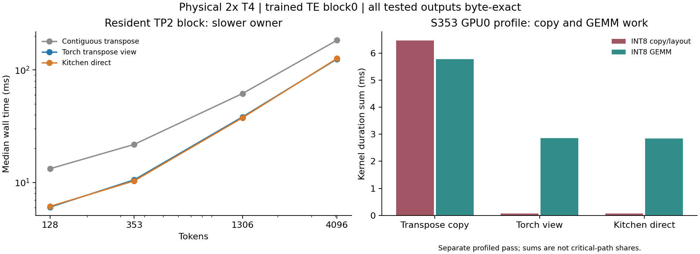

# TE INT8 column layout — 2026-10-27

Status: **complete on two physical Tesla T4s, SM75**. The
[version 1 job](https://www.kaggle.com/code/pamcks/h3-te-column-layout-t4-20261027)
completed all four lengths on both owners; worker exit code 0 and both CUDA
probe/profile gates passed. Its final artifacts were collected once, without
status/list/log polling. The experiment took 105.41 seconds, excluding setup
and provider startup. No full TE or H3 generation was run.

**Promoted: Torch transpose views for the qualified SM75 TP2 TE columns.**
They reduce resident-block latency by 31.9–54.4% in this matrix, without
transposed-weight caches or any measured numerical difference. Other devices,
geometries, layouts and execution-mode fallbacks retain their existing paths.

## Physical-T4 results and decision

The table uses the slower owner's wall-time median for each route. Five warm-ups
precede nine samples, interleaved with balanced route positions and CPU barriers
outside the timed region. Input, attention, quantization, transport and weights
are identical across routes within the allocation.

| Tokens | Legacy copy, ms | Torch view, ms | Kitchen direct, ms | View speedup |
|---:|---:|---:|---:|---:|
| 128 | 13.258 | 6.044 | 6.134 | 2.194× |
| 353 | 21.781 | 10.545 | 10.326 | 2.066× |
| 1306 | 61.675 | 38.198 | 37.580 | 1.615× |
| 4096 | 183.692 | 125.171 | 126.474 | 1.468× |

Both candidates deliver large gains. Kitchen direct is about 1.6–2.1% faster
at S353/S1306, while Torch view is about 1.0–1.5% faster at S128/S4096. The
simpler Torch view keeps the existing eager GEMM wrapper and padding, and
avoids another private CUDA dispatch choice. The direct route remains available
in the explicit experiment and existing supported runtime operators.

These are paired resident-block results. Do not combine them arithmetically
with the previous allocation's attention matrix, extrapolate them to all TE
layers, or label them full-pipeline speedups. No weight I/O, vision tower or
embedding stage is timed. The archived runtime/attention hashes bind this
experiment; later independent attention changes are not requalified here.



### Root cause: copies and a slower GEMM layout

The warmed S353 CUDA traces show both effects:

| Route | INT8 copies per owner | Copy duration sum GPU0 / GPU1, ms | INT8 GEMM duration sum GPU0 / GPU1, ms | AllReduce kernels per owner |
|---|---:|---:|---:|---:|
| Legacy copy | 7 | 6.460 / 6.482 | 5.772 / 5.788 | 4 |
| Torch view | 2 | 0.0646 / 0.0656 | 2.859 / 2.911 | 4 |
| Kitchen direct | 2 | 0.0672 / 0.0683 | 2.837 / 2.906 | 4 |

Five large transpose copies disappear on both T4s. The legacy trace has five
column calls named `volta_igemm_int8_128x128_ldg4_nn`, plus two row calls to
`cutlass_75_tensorop_i8816gemm_s8_128x128_tn_align16`. With a transpose view,
all seven INT8 GEMMs use the latter SM75 tensorop kernel. The row path is
unchanged; the five column calls acquire the faster kernel layout.

Thus the cost is not merely a redundant copy. Materializing a row-major
`[K,N]` transpose also selects a slower GEMM route on this frozen stack.
The view supplies the same values in column-major `[K,N]` strides and enables
the observed CUTLASS kernel. Raw INT8 operator checks support that attribution:
on GPU0 at M1306/K5120/N12800, the copy route takes 15.469 ms versus 3.708 ms
for Torch view and 3.658 ms for Kitchen direct (CUDA-event medians, including
the selected route's packing/padding). This is an operator measurement, not
the full-block speedup.

Profile duration sums include overlap, NCCL waiting and instrumentation. They
are evidence of changed work/kernel selection, not exclusive latency shares.
Nsight Systems was absent; Nsight Compute was installed but not invoked.
No hardware-counter or memory-stall attribution is claimed.

### Exactness, memory and guarded integration

All 24 full-block variant/length/owner outputs are finite and byte-exact to
their paired legacy control. Both TP owners' output hashes agree. All grouped
QKV/Gate-Up outputs, the 24 trained-weight raw-GEMM points across owners and
the separate signed-extreme cases pass their exact INT32/FP16 checks. This
is an operator-equivalence result, not a new generation-quality experiment.

No persistent transposed weights are allocated. At S128, full-block incremental
peak allocation falls from 76.0 MiB to 29.125 MiB; at S353 it falls from about
100.51 MiB to 79.08 MiB. S1306/S4096 peaks are unchanged because other tensors
set the peak. These are increments above the harness's resident tensors, not
total process VRAM or full-TE memory requirements.

`_column_accumulate` now uses a view only for same-device, contiguous CUDA INT8
matrices on SM75, positive M, K5120 and N in `{512,4096,12800}`. This is the
tested TE TP2 Q/K/V/Gate/Up geometry. It keeps the same eager accumulator,
padding, INT32 result, quantization and two FP32 scale multiplications. CPU,
SM120, unsharded column widths and other layouts retain the contiguous RHS.
Existing outer hooks/autograd/compile guards are unchanged; DiT's direct-GEMM
route and row projections are unaffected.

The view stays backed by the resident module's weight. The existing residency
window waits for weight readiness, records tensors on the compute stream, and
records a last-use event after the block before retiring storage. No new
cache/invalidation or weight-lifetime policy is introduced.

The final runtime guard and storage-alias dispatch tests pass with the existing
regressions: **21 local CPU tests**, zero failures. The six submitted Linux CPU
layout tests also passed before device execution. The physical experiment qualifies
the selected view arithmetic; the final integration adds only shape/device
guards. The submitted pre-promotion source bytes remain archived separately.

Measured environment: Torch 2.11.0+cu128 / CUDA12.8, Kitchen0.2.37,
TileLang0.1.13. GPU UUIDs:
`0b5064c1-348d-4358-81a0-91250ace86df` and
`71b3f09e-da72-8acc-26c7-d5eab4360c81`.

## Cause and proposed change

The [previous physical-T4 trace](TE_ATTENTION_TP2_MATRIX_20261027.md) contained
five large INT8 layout copies per TE block: Q/K/V and Gate/Up. Their summed
durations were 7.318/6.792 ms per owner in the separately instrumented S353
Kitchen pass. These sums are evidence of work, not guaranteed removable latency.

`shared_column_linears` shares ConvRot/quantization within QKV and Gate/Up, but
still calls `weight.T.contiguous()` before every individual GEMM. The stored
weight already has contiguous `[N,K]` layout. Its transpose view is `[K,N]`
with column-major strides and shares the same storage. Materializing that view
as another contiguous tensor is avoidable if the GEMM accepts those strides.

The experiment compares three exact-accumulator routes:

| Route | Weight supplied to GEMM | Other differences |
|---|---|---|
| `legacy_copy` | `weight.T.contiguous()` | Current pinned eager helper, including its row padding |
| `torch_view` | `weight.T` | Same pinned eager helper and padding; removes explicit transpose materialization |
| `kitchen_direct` | Original contiguous `[N,K]` | Existing `native_int_mm` Kitchen cuBLASLt wrapper; also avoids Torch row padding |

All routes retain stored INT8 weights, input rotation, row quantization,
FP32 scale multiplication order and FP16 output conversion. The direct route
may select different GEMM geometry; separate INT32 comparisons prevent later
dequantization from hiding a difference. For K5120, even the all-`-128` case
accumulates to 83,886,080, within INT32 range.

The submitted runtime refactor first extracted `_column_accumulate` as a private
column-only boundary, with the legacy default. After qualification, the runtime
promotes the guarded view described above. The explicit benchmark swaps this
boundary in a scoped context and restores it on exit. Row projections and
Kitchen's global helpers are never patched.
Checks require exactly five column calls per block, so a different dispatch
cannot silently produce a no-op experiment.

No transposed weights are cached. A full cached TP2 column copy would add
`(4096+512+512+12800+12800)*5120 = 157,286,400` bytes, **150 MiB per resident
TE block per rank**. TE's one-use streaming cannot assume that cost is
amortized. A view avoids that storage and introduces no stale-cache or LoRA
invalidation problem; the direct route uses the existing Kitchen workspace.

## Local preview

Hardware/software: RTX 5060 Ti, SM120, local conda Torch 2.12.1+cu132,
Kitchen 0.2.37 and TileLang 0.1.13. The local runtime normally chooses a
different column backend. This preview explicitly forces the pinned eager
columns and uses **Native attention in an unsharded block**. It validates the
candidate paths, but is not a current-default local pipeline speedup and cannot
predict TP2/T4 performance.

Trained block0 weights reconstruct the unsharded block from the two immutable
public rank shards. Inputs are fixed seeded FP16 residuals through that trained
block. Five warm-ups precede nine balanced, interleaved measurements per route.
Compilation/loading, validation, context setup and profiling are excluded from
timing. Every three repetitions balance the routes' measurement positions.

| Tokens | Legacy block, ms | Torch view, ms | Kitchen direct, ms |
|---:|---:|---:|---:|
| 128 | 12.348 | 4.816 | 4.447 |
| 353 | 16.568 | 8.177 | 8.188 |
| 1306 | 39.728 | 30.210 | 29.949 |
| 4096 | 115.087 | 105.979 | 105.514 |

These are wall-time medians of the explicitly forced local control. Native
attention and row projections retain their own local paths, so these values
must not be compared directly with the earlier physical-T4 block matrix.

All three routes produced byte-exact FP16 block and grouped projection outputs
at all four lengths. INT32 accumulators were exact on trained TP2 projection
weights at N512/N4096/N12800, including the non-multiple-of-32 row counts, and
on a separate full-range signed-extreme input. A preliminary seeded raw-GEMM
probe found the TP2 N12800 Torch-view call about 2.4–5× faster than the copy
route locally; that is an operator-only result.

The warmed local S353 trace confirms removal of the intended work:

| Profiled route | Total kernels | INT8 copy kernels | INT8 copy duration sum |
|---|---:|---:|---:|
| Legacy copy | 123 | 7 | 8.836 ms |
| Torch view | 118 | 2 | 0.0248 ms |
| Kitchen direct | 108 | 2 | 0.0252 ms |

Exactly five large transpose copies disappear. The remaining two INT8 copies
belong to other preparation work. These trace sums include overlap and
instrumentation; the paired unprofiled timings determine actual benefit.
The Windows trace contains mangled symbols; the offline analyzer recognizes
the signed-char copy lambda encoding as well as Linux demangled names.

Nineteen CPU tests passed: six new layout contracts, existing shared-column
hook/quantization and output-destination checks, bounded-column tests, and the
eight TE matrix contracts. They cover scope restoration, tensor immutability,
signed extremes, FP16/FP32 projection equality and balanced measurement order.

## Physical-T4 qualification contract

Only trained TE block0 and its operators run. There is no full TE, vision tower,
embedding pass, weight-streaming test, DiT sampling or H3 generation. Both
physical T4 owners execute the actual current TP2 implementation with:

- Kitchen causal attention, FP16 fix and divisor64;
- FP32 SwiGLU/quantization, `fused_stored` and Scaled FP16 row SUM;
- the same Native-style finite additive mask;
- the current NCCL configuration and four AllReduce calls per block;
- S128/S353/S1306/S4096, five warm-ups and nine balanced interleaved samples.

The job measures raw INT8 GEMMs, grouped QKV/Gate-Up calls and the complete
resident block separately. Every candidate must retain exact INT32 accumulators,
byte-exact grouped/full-block outputs and agreement between both TP owners.
Both owners export a minimal CUDA probe and a separate three-route S353 trace;
kernel attribution requires complete CUDA coverage. The analyzer also verifies
four NCCL kernels in every physical block profile. Compilation/loading and
profiling remain outside latency measurements. Peak-memory deltas are measured
relative to this harness's resident tensors, not a complete TE deployment.

The passed frozen bootstrap is reused without upstream or dependency updates.
Kitchen0.2.37 and TileLang0.1.13 stay pinned; Kaggle's matching native Torch/CUDA
family is retained and recorded. A hash-bound supplemental overlay contains
the column-boundary refactor and explicit experiment files. The original
capsule stays unchanged; the other nine relevant runtime/operator hashes must
still match it. New CPU layout contracts run before the operator stage.

Only two public hash-verified rank shards are downloaded, with `token=False`.
There are no dataset/output mounts or credentials. Setup is bounded to 300 s,
the experiment to 900 s and the notebook to 1500 s. The job was submitted once;
no status/list/live-log polling or automatic retries are configured. Final
artifacts were collected once and the bounded supervisor confirmed clean exit.

The guarded Torch view is selected from actual T4 evidence and exactness checks.
No persistent weight-layout cache or CPU prepacking scheme is needed for this
optimization.

Evidence: [status and bindings](../data/te_column_layout_20261027.json),
[local raw records and source manifest](../data/te_column_layout_20261027/manifest.json).
Offline reproduction:

```powershell
python -m benchmarks.analyze_te_column_layout --input D:/attention_eval/h3_te_layout_20261027/local_preview_final --output D:/attention_eval/h3_te_layout_20261027/local_summary.json
python -m benchmarks.analyze_te_column_layout --input docs/data/te_column_layout_20261027/t4 --output D:/attention_eval/h3_te_layout_20261027/t4_summary_reproduced.json
```

The first local attempt stopped when the production SM120 dispatcher correctly
declined the eager shared path. It was an experiment-selection issue, not an
operator failure; its failed record is retained locally. The successful preview
explicitly labels its forced eager columns/Native attention. Historical evidence
and submitted source bytes are preserved.
