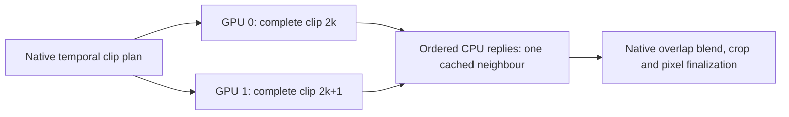

# Video VAE Temporal Parallel versus Query Parallel

Status: optional Temporal decoding is implemented and locally qualified.
The frozen-source CPU input/authentication gate and physical two-T4 comparison
are pending. **No T4 speedup is claimed yet.** The default remains `auto`,
which selects the existing Query path when compatible.

## Implementation

The reference is the user-provided
`C:/Users/Administrator/Downloads/h3_dual_vae.py`. Its useful scheduling unit
is a complete Native temporal clip, including the overlap tokens. Independent
clips can execute on two decoder replicas; Native then performs the same
padding, cropping, spatial tiling, overlap blending and output normalization.

The integrated implementation uses the existing persistent TP2 worker
processes. The parent retains its weight-free Native planner. Rank0 decodes
clip`2k`, rank1 decodes clip`2k+1`, and an odd final clip leaves rank1 idle.
Both owners return raw pixels to CPU. The parent caches at most one neighbour
and consumes replies in Native order. Decoder replicas are stage-scoped and
released through the existing lifecycle and memory admission policy.

This avoids a global class monkeypatch, a process-global helper cache, a third
parent GPU decoder and any change to the validated Kitchen attention API.
Each worker uses full Native spatial tiling and attention within its clip;
there are no per-layer KV collectives in Temporal mode. Query remains
available and unchanged. Audio VAE remains Native single-GPU FP32; encoder
parallelism is outside this decoder-only experiment.

Select `decode_mode=temporal` on `MiniMaxH3ParallelVAELoader`. Explicit
`query` aliases the existing `auto` Query selection; `native` is retained.
Unsupported dtype/model, patched parent or admission refusal uses the existing
Native fallback. A failure after worker execution begins propagates and
releases the stage instead of silently repeating a partial decode.

## Fixed input and environment

The benchmark replays the saved output video latent from the completed
[0.5MP E2E](H3_L1_TURBO_05MP_E2E_20261024.md), not newly sampled noise:

| Item | Fixed identity |
|---|---|
| Video latent | FP32`[1,24,107,34,60]`, tensor SHA256`8fb3296f9dfc00641698e1a1aa26acb7f0fa98675b89b597dc95f10e64a9fa64` |
| Output |960×544,362 frames,24fps |
| Native temporal geometry |21 clips, stride5 latent tokens, span7 tokens,5 overlapping output frames; no extra tail-token padding |
| Decoder checkpoint | `minimax_h3_video_vae_int8_convrot.safetensors`,2,811,065,184bytes, SHA256`52a2c8c73583c86e4f41cdcce3a6ad0ea562987bc0bf3d60a0cef5f5c8e60c0e` |
| Public model source | `Comfy-Org/MiniMax-H3` at frozen revision`e5eb578a89295337b8ff433a035929ce0279e0b6` |
| Core libraries | Kitchen0.2.37, TileLang0.1.13; native Kaggle Torch/CUDA/NumPy family recorded |
| Native source | ComfyUI`d49e888586dd8ae012c0667b33466b815fee07f7`, legacy attention API |

The original local evidence directory had been removed. One targeted final
artifact retrieval recovered `decode_inputs.pt` from the prior private Kaggle
job; its video tensor matches the previously recorded SHA256. Only that video
tensor was uploaded to the existing private HF dataset, pinned to an immutable
revision. No captured tensor or credential is included in the public source
bundle. The user separately authorized temporary authentication in this
private benchmark notebook and its CPU input-authentication gate.

## Qualification and measurement contract

- 178 CPU regression/contract tests pass locally, with no failures/errors/skips.
- Both Query and Temporal match Native byte-for-byte on eight trained local
  cases:2,7 and12-token crops, plus a12-token full-spatial544×960 clip pair.
  The local5060Ti/logical-rank timings are diagnostic and do not qualify T4
  performance.
- The isolated extracted delivery passes the same 178 CPU tests. The separate
  Kaggle CPU job checks frozen source, exact core pins, imports/signatures,
  private input authentication and tensor hashes before GPU submission.
- The physical job requires two distinct Tesla T4/SM75 identities, uses no
  TE/DiT weights, performs no sampler run and loads no Audio VAE.
- A same-hardware Native cropped clip is the numerical control. Both paths
  warm actual full-resolution spatial-tile shapes before three measured
  decodes per backend, alternating which backend starts each pair.
- Checkpoint download, replica loading and warm-up are separate from timed
  steady-state decoding. Only the benchmark harness retains decoder replicas
  between repeats; the normal runtime still releases them at stage end.
- Each output is checked for finite values and compared byte-for-byte, with
  per-frame maximum deviations retained. Numerical differences are reported
  while timing continues; non-finite outputs and execution failures stop the
  batch. Decoder equality does not establish new generation-quality results.
- Evidence includes parent wall time, worker CUDA-event spans, worker thread
  CPU time, returned tensor bytes, collective call/operand counts and sampled
  device memory/utilization. CUDA spans can include host gaps; collective
  operand bytes are not measured PCIe link traffic. This is not a complete
  Nsight trace or a concurrent/full-pipeline deployment benchmark.
- One bounded CPU submission precedes one bounded GPU submission. There is no
  status/list/live-log polling, automatic replacement or full-H3 retry.

Implementation: `patches/temporal_vae.py`, `patches/video_decode_planner.py`,
`patches/comfy_sampler.py` and `patches/comfy_tp_runtime.py`.
Benchmark: `benchmarks/run_vae_temporal_compare.py` and
`benchmarks/vae_decoder_service.py`.
Evidence: `D:/attention_eval/h3_temporal_vae_20261026/`.
