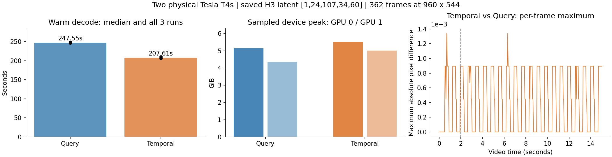
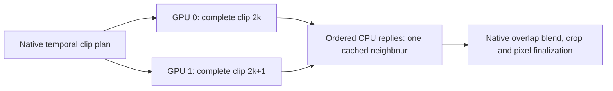

# Video VAE Temporal Parallel versus Query Parallel

Status: optional Temporal decoding is implemented and qualified on two physical
Tesla T4s. For the saved 362-frame, 960×544 H3 latent, Temporal's median warm
decode is **207.61 seconds versus Query's 247.55 seconds**: **1.192× speedup**
and **16.13% less latency**. Query remains the default; Temporal is selectable.

The private frozen-source [CPU preflight, version 1](https://www.kaggle.com/code/pamcks/h3-vae-temporal-cpu-20261027)
passed, including all 178 tests, core imports/legacy API checks, private-input
authentication and exact file/tensor hashes. Its final artifacts were collected
once at 2026-10-27 04:41 UTC. The gated
[two-T4 comparison, version 1](https://www.kaggle.com/code/pamcks/h3-vae-query-temporal-t4-20261027)
completed all six measured decodes without fallback, OOM or non-finite pixels.
Its final artifacts were collected once at 05:10 UTC. No status/list/live-log
polling or duplicate job was used.

## Physical T4 results

Both devices report Tesla T4 / SM75 with distinct UUIDs. The GPU environment
is native Torch 2.11.0+cu128 / CUDA 12.8, Kitchen 0.2.37 and TileLang 0.1.13.
The frozen source and input identities match the CPU gate and submitted bundle.
The timings include production parent planning, worker IPC, learned decoding,
Native blending and final output writes. Numerical checking occurs afterward;
checkpoint download, replica loading and warm-up are excluded.

| Measurement | Query | Temporal |
|---|---:|---:|
| Three full warm decodes (seconds) | 247.545 / 248.594 / 246.612 | 207.610 / 210.571 / 205.761 |
| Median (seconds) | 247.545 | 207.610 |
| Sampled device peak, GPU 0 / GPU 1 (GiB) | 5.148 / 4.349 | 5.513 / 5.011 |
| Allocator peak allocated, rank 0 / rank 1 (GiB) | 3.574 / 3.277 | 3.871 / 3.871 |
| Mean sampled utilization, GPU 0 / GPU 1 (%) | 96.90 / 96.46 | 98.57 / 82.40 |
| Decode worker round trips per request | 126 | 11 paired calls |
| AllGather calls per rank per request | 4662 | 0 |
| Broadcast calls per rank per request | 126 | 0 |
| Returned CPU payload, both ranks (MiB) | 3307.50 | 1757.11 |



Temporal's measured gain accompanies three concrete changes: independent clips
eliminate decode-time collectives; spatial tiling/blending executes inside the
owning worker, reducing parent/worker round trips; and only blended clip canvases
return to the parent, reducing CPU reply payload. Query records 90.439 GiB of
AllGather input operands per rank per full request. That counter describes
collective operands, **not measured PCIe link traffic**. The traces do not isolate
how much of the speedup comes from NCCL, launch/batching changes, blending or IPC.

Temporal uses 0.365 / 0.662 GiB more sampled device memory on GPU 0 / GPU 1.
NVML samples include the parent context and allocator reservations; allocator
peaks persist from replica preparation until the next preparation. Both are
reported separately to avoid treating device usage as live activation storage.

Temporal's median sum of worker CUDA-event spans is 204.08 seconds on rank 0
and 171.71 seconds on rank 1; Query's is 239.19 / 239.01 seconds. The pair
scheduler assigns 11 complete clips to rank 0 and 10 to rank 1, and rank 1
also finishes paired clips sooner. The final empty slot and per-pair waiting
leave measurable rank-1 headroom. Dynamic assignment and asynchronous replies
are possible follow-ups; neither is implemented or credited with a speedup here.
These event spans include host gaps and are not exclusive kernel/NCCL times.
High worker thread CPU time also includes CUDA/NCCL waiting; no call-stack
profile was captured to classify it as useful CPU computation.

## Numerical result and qualification boundary

| Comparison | Byte-exact | Maximum absolute pixel difference |
|---|---|---:|
| Temporal vs Native, real 7-token 16×16-latent cropped control | Yes | 0 |
| Query vs the same Native cropped control | No | 0.0004472733 |
| Three Query full outputs vs one another | Yes | 0 |
| Three Temporal full outputs vs one another | Yes | 0 |
| Full Temporal vs first full Query output | No | 0.0013418198 |

All outputs are finite. Across the full 362 frames, 189 have nonzero maximum
differences between methods. The overall maximum is identical before and after
frame 48 (two seconds at 24 fps): 0.0013418198. Differences recur periodically
with the 17-frame Native temporal stride; the recorded envelope does not grow
later in the video. This describes pixel differences, not a visual or semantic
quality judgment.

The full-output comparison reference is Query. A full Native decode was not
run, and the saved artifacts contain hashes/per-frame maxima rather than rendered
comparison videos. The cropped control supports Native equivalence for Temporal
at that control shape; it does not establish full-shape Native byte equality.
Query already differs from Native on that control. Attribution of the remaining
full-shape differences would require raw-tile/attention/blending ablations.
No new sampling, audio comparison or generation-quality acceptance is claimed.

For this measured workload, select `temporal` when prioritizing decode latency
and accepting its additional memory use. Keep `auto`/Query as the compatibility
default. No default promotion, new approximation or attention API change is
included in this result.

## Implementation

The reference is the user-provided
`C:/Users/Administrator/Downloads/h3_dual_vae.py`. Its useful scheduling unit
is a complete Native temporal clip, including the overlap tokens. Independent
clips can execute on two decoder replicas; Native then performs the same
padding, cropping, spatial tiling, overlap blending and output normalization.

The integrated implementation uses the existing persistent TP2 worker
processes. The parent retains its weight-free Native planner. Rank0 decodes
clip`2k`, rank1 decodes clip`2k+1`, and an odd final clip leaves rank1 idle.
Both owners return raw pixels to CPU. The parent caches at most one neighbour
and consumes replies in Native order. Decoder replicas are stage-scoped and
released through the existing lifecycle and memory admission policy.



This avoids a global class monkeypatch, a process-global helper cache, a third
parent GPU decoder and any change to the validated Kitchen attention API.
Each worker uses full Native spatial tiling and attention within its clip;
there are no per-layer KV collectives in Temporal mode. Query remains
available and unchanged. Audio VAE remains Native single-GPU FP32; encoder
parallelism is outside this decoder-only experiment.

Select `decode_mode=temporal` on `MiniMaxH3ParallelVAELoader`. Explicit
`query` aliases the existing `auto` Query selection; `native` is retained.
Unsupported dtype/model, patched parent or admission refusal uses the existing
Native fallback. A failure after worker execution begins propagates and
releases the stage instead of silently repeating a partial decode.

## Fixed input and environment

The benchmark replays the saved output video latent from the completed
[0.5MP E2E](H3_L1_TURBO_05MP_E2E_20261024.md), not newly sampled noise:

| Item | Fixed identity |
|---|---|
| Video latent | FP32`[1,24,107,34,60]`, tensor SHA256`8fb3296f9dfc00641698e1a1aa26acb7f0fa98675b89b597dc95f10e64a9fa64` |
| Output |960×544,362 frames,24fps |
| Native temporal geometry |21 clips, stride5 latent tokens, span7 tokens,5 overlapping output frames; no extra tail-token padding |
| Decoder checkpoint | `minimax_h3_video_vae_int8_convrot.safetensors`,2,811,065,184bytes, SHA256`52a2c8c73583c86e4f41cdcce3a6ad0ea562987bc0bf3d60a0cef5f5c8e60c0e` |
| Public model source | `Comfy-Org/MiniMax-H3` at frozen revision`e5eb578a89295337b8ff433a035929ce0279e0b6` |
| Core libraries | Kitchen0.2.37, TileLang0.1.13; native Kaggle Torch/CUDA/NumPy family recorded |
| Native source | ComfyUI`d49e888586dd8ae012c0667b33466b815fee07f7`, legacy attention API |

The original local evidence directory had been removed. One targeted final
artifact retrieval recovered `decode_inputs.pt` from the prior private Kaggle
job; its video tensor matches the previously recorded SHA256. Only that video
tensor was uploaded to the existing private HF dataset, pinned to an immutable
revision. No captured tensor or credential is included in the public source
bundle. The user separately authorized temporary authentication in this
private benchmark notebook and its CPU input-authentication gate.

## Qualification and measurement contract

- 178 CPU regression/contract tests pass locally, with no failures/errors/skips.
- Both Query and Temporal match Native byte-for-byte on eight trained local
  cases:2,7 and12-token crops, plus a12-token full-spatial544×960 clip pair.
  The local5060Ti/logical-rank timings are diagnostic and do not qualify T4
  performance.
- The isolated extracted delivery passes the same 178 CPU tests. The separate
  Kaggle CPU job checks frozen source, exact core pins, imports/signatures,
  private input authentication and tensor hashes before GPU submission.
- The physical job requires two distinct Tesla T4/SM75 identities, uses no
  TE/DiT weights, performs no sampler run and loads no Audio VAE.
- A same-hardware Native cropped clip is the numerical control. Both paths
  warm actual full-resolution spatial-tile shapes before three measured
  decodes per backend, alternating which backend starts each pair.
- Checkpoint download, replica loading and warm-up are separate from timed
  steady-state decoding. Only the benchmark harness retains decoder replicas
  between repeats; the normal runtime still releases them at stage end.
- Each output is checked for finite values and compared byte-for-byte, with
  per-frame maximum deviations retained. Numerical differences are reported
  while timing continues; non-finite outputs and execution failures stop the
  batch. Decoder equality does not establish new generation-quality results.
- Evidence includes parent wall time, worker CUDA-event spans, worker thread
  CPU time, returned tensor bytes, collective call/operand counts and sampled
  device memory/utilization. CUDA spans can include host gaps; collective
  operand bytes are not measured PCIe link traffic. This is not a complete
  Nsight trace or a concurrent/full-pipeline deployment benchmark.
- One bounded CPU submission precedes one bounded GPU submission. There is no
  status/list/live-log polling, automatic replacement or full-H3 retry.

The Kaggle CPU environment used Python 3.13.15, native Torch 2.11.0+cpu,
Torchvision 0.26.0+cpu, Torchaudio 2.11.0+cpu and NumPy 2.1.3. The exact
Kitchen 0.2.37 / TileLang 0.1.13 overlay passed imports and signatures.
Setup took 141.22 seconds; the regression suite took 32.51 seconds. This
qualifies the CPU setup/contracts only. The GPU job recorded its own native
CUDA platform and verified two distinct T4/SM75 UUIDs before decoding.
It used a 300-second setup bound, 2700-second comparison bound and
3300-second notebook limit, with zero dataset/kernel-output mounts. Provider
startup is excluded from the internal bounds. GPU setup took 70.25 seconds;
the bounded execution took 1560.44 seconds, including the 29.13-second model
download/verification and 1527.07-second comparison process. Both supervisors
exited successfully. The credential-bearing launcher was removed and collected
artifacts passed the credential scan.

Implementation: `patches/temporal_vae.py`, `patches/video_decode_planner.py`,
`patches/comfy_sampler.py` and `patches/comfy_tp_runtime.py`.
Benchmark: `benchmarks/run_vae_temporal_compare.py` and
`benchmarks/vae_decoder_service.py`.
The immutable delivery is published at source commit
`60af7e7c7af4cfe998ae55527ded95104e60d7aa`; distribution SHA256
`519bc752462ac2be251dd637d7398de637a5c29c7b581fa28525dd254689896a`,
capsule SHA256
`168bf4446f17eb4a0714f5a8f4727d9c2cb8ddf78602868b0002481fad2a95d3`.
Public source URL content was downloaded and hash-verified before submission.
The rejected first local bundle was never submitted; both attempts are retained
in the local evidence directory. Machine-readable status:
[vae_temporal_query_20261027.json](../data/vae_temporal_query_20261027.json).
Raw results, numeric memory samples, CPU/GPU receipts, offline analysis and plot
are archived in [the evidence folder](../data/vae_temporal_query_20261027/).
Reproduce the analysis without a GPU or Kaggle interaction:

```powershell
python benchmarks/analyze_vae_temporal_results.py --comparison docs/data/vae_temporal_query_20261027 --output analysis.json --plot comparison.png
```

The analyzer accepts both the original result filenames and their public archive
names. No captured activations or private notebooks are published.
Evidence: `D:/attention_eval/h3_temporal_vae_20261026/`.
